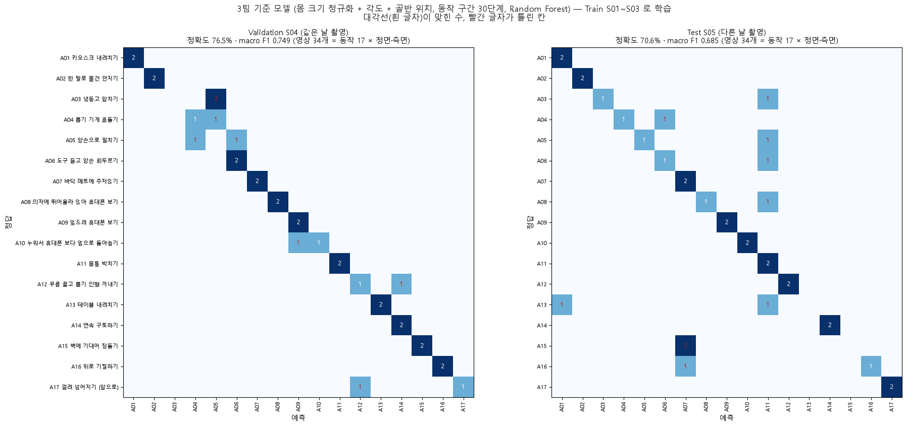
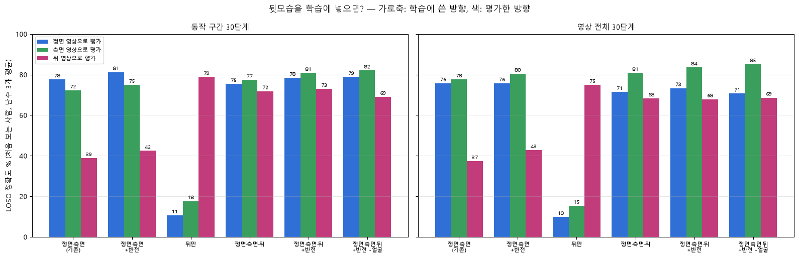

# Unmanned Store Anomaly — 무인 상점 이상행동 인식

무인 아이스크림 할인점 CCTV 를 가정하고, 사람의 **2D 자세(Pose)** 로 매장 안 이상행동을 찾는 팀 프로젝트입니다.
Vision AI 과정 3팀 프로젝트 (2D 자세추정 수업에서 시작).

- 입력: 핸드폰으로 찍은 RGB 영상 (정면·측면, 11/23 뒷모습 추가)
- 방법: YOLO Pose → COCO 17 Keypoint → 정규화 Feature → Frame 을 시간 순서로 묶은 Sequence
- 목표: 기물 파손·폭력·배회·절도 의심·응급(쓰러짐) 동작을 Sequence 로 구분

왜 이렇게 만들었는지(원본을 그대로 둔 이유, YOLO 를 고른 이유, 정규화·라벨·구간·개인정보 결정)는 [기술 결정 기록](docs/DESIGN_DECISIONS.md)에 숫자와 함께 적었습니다.
정규화 방식 비교(수업의 이미지 기준 vs 몸 기준)는 [정규화 비교 분석](docs/NORMALIZATION_ANALYSIS.md), 동작 분류 Baseline(수업 6일차 방식 vs 3팀 방식)은 [Baseline 성능평가](docs/BASELINE_EVALUATION.md), 전체 문서 목록은 [docs/README.md](docs/README.md).

## 동작 17개

| ID | 동작 | 분류 |
|---|---|---|
| A01 | 키오스크 내려치기 | 기물 파손 |
| A02 | 한 팔로 물건 던지기 | 기물 파손 |
| A03 | 냉동고 앞차기 | 기물 파손 |
| A04 | 뽑기 기계 흔들기 | 기물 파손 |
| A05 | 양손으로 밀치기 | 폭력 |
| A06 | 도구 들고 양손 휘두르기 | 폭력 |
| A07 | 바닥 매트에 주저앉기 | 배회 |
| A08 | 의자에 뛰어올라 앉아 휴대폰 보기 | 배회 |
| A09 | 엎드려 휴대폰 보기 | 배회 |
| A10 | 누워서 휴대폰 보다 옆으로 돌아눕기 | 배회 |
| A11 | 몸통 박치기 | 폭력 |
| A12 | 무릎 꿇고 뽑기 인형 꺼내기 | 절도 의심 |
| A13 | 테이블 내려치기 | 기물 파손 |
| A14 | 연속 구토하기 | 응급 |
| A15 | 벽에 기대어 잠들기 | 응급 |
| A16 | 뒤로 기절하기 | 응급 |
| A17 | 걸려 넘어지기 (앞으로) | 응급 |


얼굴이 나오지 않게 원본 영상 없이 관절 뼈대만 그렸습니다 (`scripts/08_draw_skeleton_figure.py`).

정의 원본: [`configs/action_classes.csv`](configs/action_classes.csv)

라벨 검수에서 이름과 실제 촬영 모습이 다른 동작은 `filmed_as` 열에 적었습니다.

| ID | 실제 촬영 모습 |
|---|---|
| A08 | 의자 대신 책상 모서리에 올라가 걸터앉음 (뛰어오르지 않음) |
| A15 | 벽에 잠깐 기댔다가 바닥에 무릎 꿇고 손 짚어 엎드려 웅크림 |
| A16 | 쪼그려 앉았다가 천천히 뒤로 누움 (실제 기절보다 느림) |

## 데이터

- 영상 170개 = 동작 17개 × 참가자 5명 × 정면·측면, 약 60fps, 총 19.5분 (70,159 Frame)
  - S01~S04 는 2026-11-13 함께 촬영, S05 는 2026-11-16 따로 촬영 (A01 → A17 순서로 정면·측면)
- **+ 뒷모습 85개 (2026-11-23 재촬영, 5명 × 17동작)** → 모두 255개. 팀 드라이브에 통일 번호 `S0x_A0xx_T03` 으로 올라온 것을
  `01_build_manifest.py` 가 이 저장소 번호로 되돌려 방향 `B` 로 붙임
- 이름 규칙: `T03_S{참가자}_A{동작}_T{테이크}_{F|S|B}` (예: `T03_S01_A07_T01_F` = 참가자 1, 바닥에 앉기, 정면)
- 목록: [`configs/clip_manifest.csv`](configs/clip_manifest.csv), 영상 상태: [`reports/tables/video_inventory.csv`](reports/tables/video_inventory.csv)
- **촬영 원본·실명 대응표는 올리지 않습니다** (얼굴·이름이 나옴). 참가자는 가명 S01~S05 로만 씁니다.

### 팀 통일 라벨 (2026-11-23)

3팀이 공동 데이터 저장소에서 사람 번호·동작 번호·동작 이름을 하나로 맞췄습니다 (예: `S04_A001_T01`).
이 저장소는 그 전에 만든 번호로 검수·학습을 끝냈기 때문에, **영상·구간·Feature 는 그대로 두고 이름표만 바꿔** 산출물을 다시 냈습니다.

- 대응표: [`configs/unified_label_map.csv`](configs/unified_label_map.csv)
  - 사람: 이 저장소 S01→S03, S02→S01, S03→S02, S04·S05 는 같음 → **Train 3명·Validation S04·Test S05 구성은 그대로**
  - 방향: 정면 F → `T01`, 측면 S → `T02`, 뒤 B → `T03`
  - 동작: `A01`→`A001` … `A17`→`A017` (예: A13 테이블 내려치기 = `shotgun`, A15 = `fall_sideways`)
- 변환: `scripts/16_export_unified_labels.py` → [`reports/unified/`](reports/unified/) (영상 목록·구간·Split·예측·동작별 F1·사람 검수)
- 확인: 통일 번호로 다시 학습해도 **영상마다 예측이 같고 정확도도 같습니다** ([`verify_same_results.csv`](reports/unified/verify_same_results.csv): 구간 모델 Val 76.5% / Test 70.6%, 영상 전체 모델 Val 73.5% / Test 61.8%).
- 웹 서비스(store-anomaly-service)의 동작 이름은 발표(교과10 10일차) 뒤에 통일 이름으로 바꿀 예정입니다.

## Pipeline

```text
핸드폰 영상 (정면·측면)
   ↓ 01 Manifest: 촬영 시각으로 동작·참가자·방향 정하기 → clip_id
   ↓ 02 영상 검사: 열림·FPS·길이·끝까지 디코딩
   ↓ 03 Frame 마다 YOLO Pose
        → 38-D (어깨 폭 정규화 좌표 34 + 관절각도 4, 수업 형식)
        → 몸 크기 정규화 좌표 34 (측면·누운 자세에서도 안 튐)
        → 3팀 Feature: 상체 기울기·몸 상자 비율·골반 화면 위치·몸통 길이
        → 원본 Keypoint 17 × (x, y, conf)와 품질 정보
   ↓ 04 라벨 검수 그림: 동작마다 8개 영상 × 6개 시점, 사람 수 자동 경고
   ↓ 05 영상별 QA 요약 → PASS / REVIEW
Sequence CSV (clip 하나 = 파일 하나, 159열)
```

| 파일 | 하는 일 |
|---|---|
| `scripts/01_build_manifest.py` | 팀 드라이브 영상 → clip_id·Manifest (`--copy` 로 영상 복사) |
| `scripts/02_check_videos.py` | 모든 MP4 디코딩 검사 → `reports/tables/video_inventory.csv` |
| `scripts/03_build_sequences.py` | Frame별 Feature → `reports/sequences/<clip_id>_sequence.csv` (`--clip`, `--all`, `--save-video`) |
| `scripts/04_make_review_sheets.py` | 라벨 검수 그림 → `reports/review/`, 점검표 → `reports/tables/review_checklist.csv` |
| `scripts/05_summarize_sequences.py` | 영상별 QA → `reports/tables/sequence_qa.csv` |
| `scripts/06_estimate_segments.py` | 동작 시작·끝 자동 추정 → `reports/tables/segments_auto.csv` (누움·앉음 동작은 일어나기 직전까지, `--sheets` 로 확인 그림) |
| `scripts/07_render_overlay.py` | Sequence CSV 의 관절별 Confidence(초록·주황·빨강)·평균 conf 그래프를 원본 위에 그린 재생용 영상 → `reports/videos/<clip_id>_overlay.mp4` (`--clip`, `--subject`, `--all`) |
| `scripts/09_action_keypoint_qa.py` | 동작별 중요 관절 QA (수업 5일차 기준) → `action_keypoint_qa.csv`, 사람 판정표 `human_qa.csv` |
| `scripts/10_build_approved_manifest.py` | Human QA PASS 만 → `configs/approved_clip_manifest.csv` (동작 구간 포함) |
| `scripts/11_build_subject_split.py` | 사람 단위 Train / Validation / Test + Leakage 검사 → `reports/splits/` (LOSO 5-fold 포함) |
| `scripts/12_compare_normalizations.py` | 정규화 5가지 비교 (서 있는 자세 크기 차이, 측면 튐, 사람 단위 5-fold 분류) |
| `scripts/13_build_sequence_dataset.py` | 입력 점검 + 동작 구간을 30단계로 보간한 고정 길이 Dataset → `reports/dataset/` |
| `scripts/14_train_baseline.py` | Random Forest 실험 9개 (한 번에 하나씩 바꿈), 혼동 행렬, 틀린 영상, 마지막 Test S05 |
| `scripts/15_export_service_model.py` | 웹 서비스용 모델 (5명 전부, 기본 정면·측면·뒤 + 좌우 반전) → `artifacts/service/` |
| `scripts/16_export_unified_labels.py` | 팀 통일 라벨로 산출물 다시 쓰기 + 같은 결과인지 재학습 확인 → `reports/unified/` |
| `scripts/17_flip_and_view_check.py` | 좌우 반전 증강 전/후, 학습에 없던 촬영 각도 정확도 → `flip_augmentation.csv`, `view_generalization.csv` |
| `scripts/18_back_view_experiments.py` | 뒷모습을 학습에 넣었을 때 (정면·측면·뒤 따로, 좌우 반전, 얼굴 관절 빼기, 동작별) → `back_view_*.csv`, `docs/images/back_view_summary.png` |
| `scripts/08_draw_skeleton_figure.py` | 동작별 뼈대 그림 (영상·얼굴 없이) → `docs/images/actions_skeleton.png` |
| `scripts/video_hub.py` | 같은 와이파이에서 팀원 핸드폰 영상을 모으는 업로드 서버 (표준 라이브러리만) |
| `src/feature_utils.py` | 관절각도, 어깨 폭 정규화 (교과10 수업 코드) |
| `src/team_feature_utils.py` | 3팀 Feature, 몸 크기 정규화 |

## 지금까지 결과

- 170개 영상 모두 디코딩 정상, Pose 성공률 평균 99.9% (최저 88.7%)
- 자동 QA: **PASS 141 · REVIEW 29** (화면 끝 닿음 10, 손목 가림 10, 다른 사람 잡힘 6, 사람 놓침 2, 하체 가림 1 — 겹침 포함).
  다시 찍기·제외는 사람이 영상을 보고 정함
- 측면 영상은 어깨 폭이 0 에 가까워져 수업 방식(어깨 폭 정규화) 값이 튐
  → 어깨 폭과 몸통 길이 중 큰 쪽으로 나누는 **몸 크기 정규화**를 더함
  (값이 어깨 폭 5배 넘게 튀는 측면 Frame: 54.6% → 0.01% 미만)
- 라벨 검수 (2026-11-17, S05 는 11-18): 동작별 그림 17장으로 170개 모두 확인 → **라벨 오류 0, 170개 OK**
  - S05 의 A15 는 엎드리지 않고 벽 옆에 주저앉음 (같은 동작의 다른 모습으로 그대로 사용)
  - 자동 경고 3개는 모두 YOLO 검출 문제 (누운 자세 미검출 1, 1명을 2명으로 검출 2)
  - S01 은 A11·A12·A13·A17 에서 겉옷을 벗었을 뿐 같은 사람
  - S02 의 A13(테이블 내려치기)은 동작이 약하지만 "약한 예시"로 그대로 사용
- 동작별 중요 관절 QA (수업 5일차 기준, 동작 구간 안): AUTO_PASS 164 · CHECK 6
  → CHECK 는 모두 YOLO 가 가장자리 물체를 사람으로 잡거나 멀리서 몇 Frame 놓친 것 → **Human QA PASS 170**
- Split: Train S01~S03 (102) · Validation S04 (34) · Test S05 (34), Leakage 검사 통과
- 정규화 비교: 다른 날 촬영한 S05 시험에서 이미지 기준 38.2% vs 몸 크기 + 화면 위치 67.6% → 학습 Feature 는 몸 기준으로
- **동작 분류 Baseline (수업 6일차, Random Forest, 17개 동작):**

  | 모델 | Validation S04 | Test S05 (다른 날 촬영) |
  |---|---:|---:|
  | 수업 그대로 (어깨 폭 38-D, 영상 전체) | 67.6% | 55.9% |
  | **3팀** (몸 크기 정규화 + 각도 + 골반 위치, 동작 구간 30단계) | **76.5%** | **70.6%** |

  - 가장 큰 차이는 시간 흐름: 가운데 Frame 1개(Static) 57% vs 30단계 Sequence 74% (S01~S04 4-fold)
  - 각도·골반 위치·구간 자르기는 Random Forest 난수 변동(±4%p) 안 → 효과 있다고 쓰지 않음
  - 틀린 영상 추적: 서서 하는 팔 동작끼리 혼동, 다른 날 측면 영상이 몸통 박치기로 쏠림, S05 의 A15 는 촬영 방식 차이



- **뒷모습 추가 (11/23, [Baseline 성능평가 5-2](docs/BASELINE_EVALUATION.md)):** 처음 보는 사람 기준(LOSO)

  | 학습 | 정면·측면 | 뒤 | Test S05 전체 |
  |---|---:|---:|---:|
  | 정면·측면 (기존) | 74.9% | 38.8% | 55.6% |
  | **정면·측면·뒤 + 좌우 반전** | **79.6%** | **72.9%** | **74.2%** |

  - 뒤를 넣어도 정면·측면은 떨어지지 않음. 뒷모습에서 약한 동작: 무릎 꿇고 꺼내기 27% · 휘두르기 33% · 테이블 내려치기 40%
  - 위 기준 모델 표(170개)는 정면·측면만으로 다시 돌려도 같은 숫자 (`BASE_VIEWS`)



## 실행

```bash
git clone https://github.com/wlgptjd333/unmanned-store-anomaly.git
cd unmanned-store-anomaly
uv sync
source .venv/bin/activate

# 영상은 data/rgb/videos/<clip_id>.mp4 에 둡니다 (팀 드라이브에서 받기)
python scripts/02_check_videos.py
python scripts/03_build_sequences.py --clip T03_S04_A01_T01_F --save-video
python scripts/03_build_sequences.py --all
python scripts/05_summarize_sequences.py
python scripts/04_make_review_sheets.py
# 6일차 Baseline (승인 목록 configs/approved_clip_manifest.csv 기준, YOLO 다시 안 돌림)
python scripts/13_build_sequence_dataset.py
python scripts/14_train_baseline.py
python scripts/16_export_unified_labels.py          # 팀 통일 라벨 산출물 (재학습으로 같은 결과 확인)
python scripts/17_flip_and_view_check.py            # 좌우 반전·촬영 각도
python scripts/18_back_view_experiments.py          # 뒷모습 추가 실험 (약 4분)
python scripts/07_render_overlay.py --subject S04   # YOLO 다시 안 돌림, 영상 1개 약 10초
```

`yolo11n-pose.pt` 는 첫 실행 때 Ultralytics 가 자동으로 받습니다.

## 다음 할 일

- [x] 라벨 사람 검수 (`review_checklist.csv` 의 `review_result`)
- [x] 동작 시작·끝 구간 자동 추정 (`segments_auto.csv`) — 사람 확인 남음
- [x] 동작별 관절 QA → Human QA (PASS 170) → Approved Manifest → 사람 단위 Split·Leakage 검사
- [x] Sequence 를 고정 길이(30단계)로 맞추고 Random Forest Baseline 학습·오류 분석·Test
- [ ] 시간 순서 모델 (1D-CNN / GRU) 을 같은 Split 으로 비교
- [ ] VICON 3D 동작을 여러 각도로 2D 투영해 학습 데이터 늘리기 (동작 번호 대응 확인부터)
- [ ] 동작 구간 끝 사람 확인 (누운 동작)
- [x] 뒷모습 85개 촬영·학습 (11/23) — 뒤 39% → 73%, 정면·측면 유지
- [ ] 뒷모습 85개 사람이 영상으로 라벨 확인 (지금은 자동 QA + 모델 예측 + 8개 직접 확인)
- [x] 웹 서비스 모델을 "정면·측면·뒤 + 좌우 반전"으로 다시 내보내기 (11/24, Test S05 61.8% → 74.5%)
- [ ] 대각선(45°) 촬영

## 출처

교과10 수업 저장소 [`vision-ai-lab/subject10_pose_action`](https://github.com/wlgptjd333/vision-ai-lab/tree/main/subject10_pose_action) 에서 시작했고,
3팀 코드는 2026-11-17 이 저장소로 옮겼습니다. 이전 기록은 그쪽 커밋 `b3d6c32`, `3e0e9a5` 에 있습니다.
