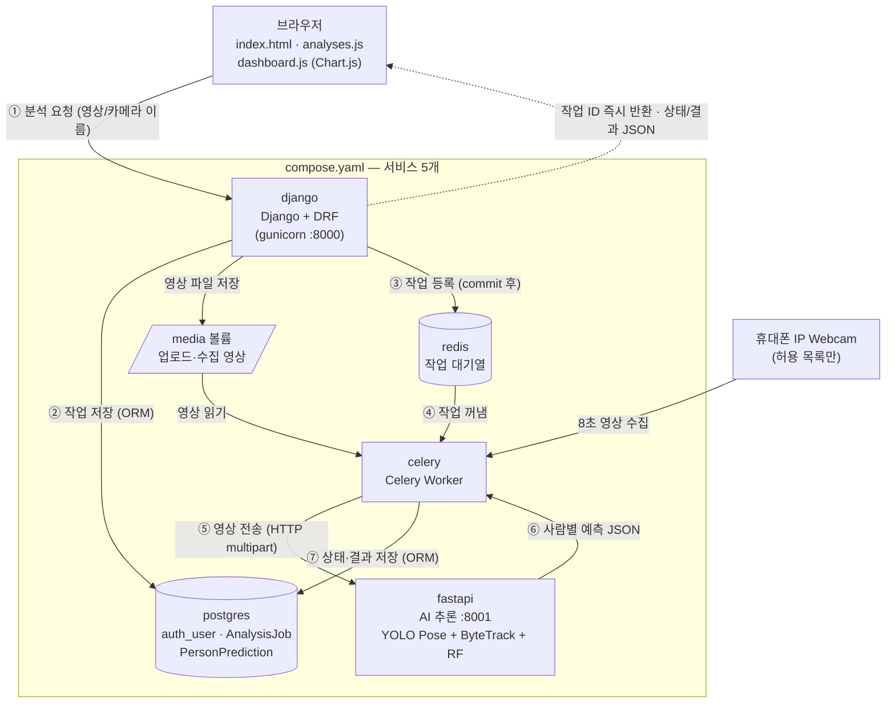
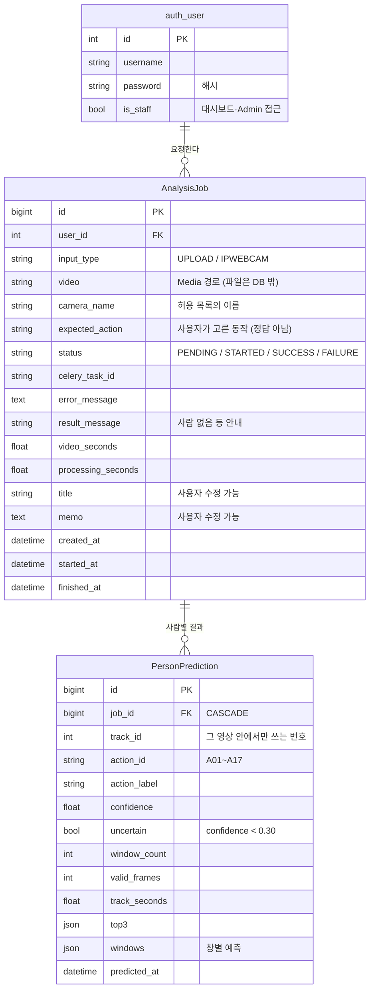
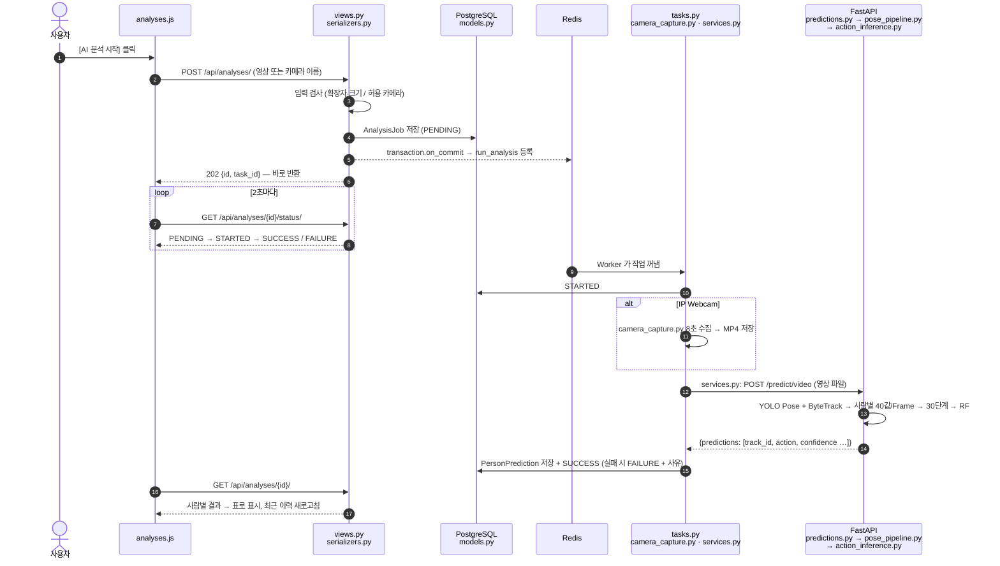
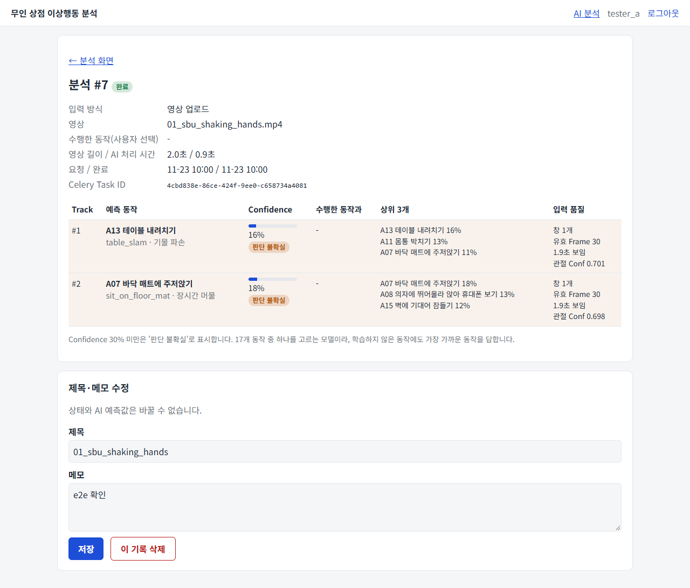
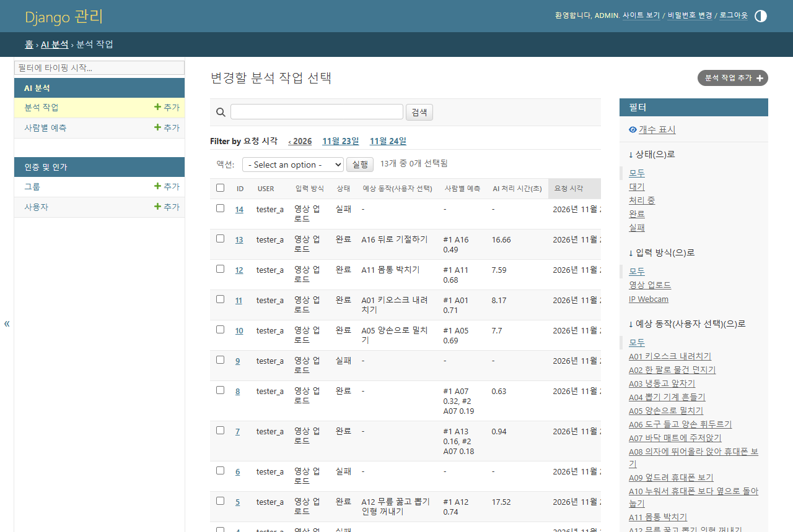

# store-anomaly-service

무인 상점 CCTV 같은 영상에서 **사람마다 어떤 이상행동에 가까운지** 예측해 기록·조회하는 웹 서비스입니다.
교과10(자세추정·동작인식) 최종 프로젝트이며, 모델은 3팀이 직접 촬영한 데이터로 만든 것을 씁니다.

> 데이터·모델 쪽 작업(촬영 정리, Pose 추출, QA, 학습·평가)은 [unmanned-store-anomaly](https://github.com/wlgptjd333/unmanned-store-anomaly) 저장소에 있고,
> 이 저장소는 그 모델을 **웹 서비스로 연결하는 부분**만 담습니다. (데이터는 3팀 공동, 서비스는 개인 프로젝트)

## 1. 프로젝트 소개

- 로그인한 사용자가 **영상 업로드** 또는 **IP Webcam(휴대폰 카메라에서 8초 수집)** 으로 분석을 요청하면,
  YOLO Pose + ByteTrack 으로 사람을 추적하고 사람별로 **17개 이상행동 중 가장 가까운 동작과 Confidence** 를 보여 줍니다.
- 분석은 Celery 가 백그라운드에서 처리하므로, 요청하자마자 작업 ID를 받고 화면이 상태(대기 → 처리 중 → 완료/실패)를 따라갑니다.
- 결과는 PostgreSQL 에 남고, 관리자는 Django Admin 과 `/dashboard/`(Chart.js)에서 전체 기록·통계를 봅니다.
- 예측은 **참고용**입니다. 17개 중 하나를 고르는 모델이라 학습하지 않은 동작에도 답을 내므로, Confidence 30% 미만은 `판단 불확실`로 표시합니다.

| 분류 | 동작 (ID) |
|---|---|
| 기물 파손 | A01 키오스크 내려치기 · A02 한 팔로 물건 던지기 · A03 냉동고 앞차기 · A04 뽑기 기계 흔들기 · A13 테이블 내려치기 |
| 폭력 | A05 양손으로 밀치기 · A06 도구 들고 양손 휘두르기 · A11 몸통 박치기 |
| 장시간 머묾 | A07 바닥 매트에 주저앉기 · A08 의자에 뛰어올라 앉아 휴대폰 보기 · A09 엎드려 휴대폰 보기 · A10 누워서 휴대폰 보다 옆으로 돌아눕기 |
| 도난 의심 | A12 무릎 꿇고 뽑기 인형 꺼내기 |
| 응급 | A14 연속 구토하기 · A15 벽에 기대어 잠들기 · A16 뒤로 기절하기 · A17 걸려 넘어지기 |

## 2. 실행 방법

필요한 것: Docker Desktop(Compose v2). GPU 는 필요 없습니다(AI 서버는 CPU 로 추론).

```bash
git clone https://github.com/wlgptjd333/store-anomaly-service.git
cd store-anomaly-service

# 1) 환경변수: 예시를 복사한 뒤 비밀값과 카메라 주소를 직접 채운다 (.env 는 Git 에 올라가지 않음)
cp .env.example .env
#    DJANGO_SECRET_KEY, POSTGRES_PASSWORD  → 긴 무작위 문자열
#    IPWEBCAM_CAMERAS                      → phone=http://<휴대폰 IP>:8080/video  (허용할 카메라만)

# 2) 빌드·실행 (서비스 5개). 처음엔 PyTorch(CPU) 등을 받느라 몇 분 걸린다
docker compose up -d --build

# 3) 마이그레이션 — django 컨테이너가 시작할 때 자동으로 migrate 한다. 직접 하려면:
docker compose exec django python manage.py migrate

# 4) 관리자 계정
docker compose exec django python manage.py createsuperuser
```

| 화면 | 주소 |
|---|---|
| 사용자 (회원가입·로그인 → AI 분석) | http://localhost:8000/ |
| 관리자 대시보드 (is_staff 만) | http://localhost:8000/dashboard/ |
| Django Admin | http://localhost:8000/admin/ |
| FastAPI 문서 (개발용, 이 컴퓨터에서만) | http://localhost:8001/docs |

**모델 파일 위치** — `ai_service/models/`

| 파일 | 내용 | Git |
|---|---|---|
| `store_anomaly_rf.joblib` | Random Forest (17 Class, 0.6 MB) | 포함 |
| `rf_feature_columns.json` | 입력 1,200개 Feature 이름·순서 | 포함 |
| `rf_training_info.json` | Class 이름, 30단계, Frame Feature 40개, Pose 설정, 평가 수치 | 포함 |
| `yolo11n-pose.pt` | YOLO Pose 가중치 (Ultralytics) | 제외 — Docker 빌드 때 자동으로 받음 |

모델을 다시 만들려면 데이터 저장소에서 `scripts/15_export_service_model.py` 를 실행하고 위 세 파일을 복사합니다.

로컬(도커 없이) 테스트: `cd backend && pip install -r requirements.txt && python manage.py test` (SQLite·가짜 AI 서버로 18개).

## 3. 전체 아키텍처



- **PostgreSQL 은 Django ORM 으로만** 씁니다. FastAPI 는 DB 를 모르고, 영상을 받아 JSON 만 돌려줍니다.
- 컨테이너끼리는 `localhost` 가 아니라 서비스 이름(`postgres`, `redis`, `fastapi`)으로 부릅니다.
- 공개 포트는 django `8000` 하나. fastapi `8001` 은 개발 확인용으로 `127.0.0.1` 에만 엽니다.
- Django 와 Celery 는 같은 이미지(`backend/Dockerfile`)를 쓰고 실행 명령만 다릅니다. 업로드 영상은 `media` 볼륨을 함께 씁니다.

## 4. DB 설계 (ERD)



| 테이블 | 저장하는 것 | 작성 위치 |
|---|---|---|
| `auth_user` | 회원 (Django 기본) | Django 제공 |
| `AnalysisJob` | 분석 요청 1건: 누가, 어떤 입력으로, 지금 상태, 실패 사유, 처리 시간 | `backend/analyses/models.py` |
| `PersonPrediction` | 그 요청 영상 속 사람 1명의 예측. 두 사람이면 작업 1건에 2행 (`(job, track_id)` 유일) | `backend/analyses/models.py` |

- 영상 파일은 DB 에 넣지 않고 Media 폴더에 두며 경로만 저장합니다. 기록을 지우면 사람별 예측(CASCADE)과 영상 파일도 함께 지웁니다.
- 일반 사용자는 **제목·메모만** 고칠 수 있습니다. 상태·예측값을 사용자가 바꾸면 기록과 통계를 믿을 수 없게 되기 때문입니다.

## 5. AI 추론 버튼 구현 흐름



| 단계 | 파일 |
|---|---|
| 입력 화면·탭 전환·상태 조회·결과 표 | `backend/templates/analyses/index.html`, `backend/static/js/analyses.js` |
| 요청 접수·권한·작업 등록 | `backend/analyses/views.py`, `serializers.py`, `permissions.py` |
| 백그라운드 처리 | `backend/analyses/tasks.py`, `camera_capture.py`, `services.py` |
| 추론 API | `ai_service/main.py`, `routers/predictions.py` |
| 영상 → 사람별 Feature | `ai_service/services/pose_pipeline.py` (+ `src/` 의 3팀 Feature 코드) |
| 모델 로드·예측 | `ai_service/services/model_loader.py`, `action_inference.py` |
| 대시보드 집계·차트 | `backend/analyses/page_views.py`, `backend/static/js/dashboard.js` |

## 6. 사용한 모델과 입력 형식

**왜 Joblib 하나로는 영상을 분류할 수 없나** — Random Forest 는 숫자 1,200개를 받는 분류기일 뿐입니다.
영상에서 사람을 찾고(YOLO Pose), 사람을 이어 붙이고(ByteTrack), 학습 때와 **같은 계산·같은 순서**로 숫자를 만드는 과정이 앞에 있어야 합니다.

| 단계 | 내용 |
|---|---|
| Pose | `yolo11n-pose.pt`, imgsz 640, 사람 conf 0.25, 관절 conf 0.5 (학습과 같음) |
| 추적 | ByteTrack — 사람마다 `track_id` |
| Frame Feature 40개 (`body40`) | 몸 크기 정규화 17관절 x,y (34) + 팔꿈치·무릎 각도 4 + 골반 화면 위치 2 |
| 유효 Frame | Pose 성공 · 정규화 성공 · 40개 값이 모두 숫자 (학습 때 규칙 그대로) |
| Sequence | 유효 Frame 을 시간 0~1 로 펴서 30단계로 보간 → 30 × 40 = **1,200** |
| 창(Window) | 사람이 보인 시간이 8초 이하면 전체가 창 1개, 더 길면 8초 창을 4초씩 밀며 확률 평균 |
| 모델 | Random Forest 300그루, class_weight balanced, 17 Class |

- **학습 데이터 (2026-11-24 갱신)**: 3팀 5명 × 17동작 × **정면·측면·뒷모습** = 255개 영상 (RGB) + 학습 때만 **좌우 반전** 복사본을 더함.
  평가는 사람 단위로 나눠 Train S01~S03 → Validation S04 / Test S05(다른 날 따로 촬영). 서비스용은 5명 전부로 다시 학습했습니다.

  | 서비스 모델 | Validation S04 | Test S05 | Test 정면 / 측면 / 뒤 |
  |---|---|---|---|
  | 11/22 정면·측면 170개 | 73.5% | 61.8% | — (뒷모습 평가 없음) |
  | **11/24 정면·측면·뒤 255개 + 좌우 반전 (현재)** | 68.6% | **74.5%** | 76.5% / 76.5% / 70.6% |

- **뒷모습을 넣은 이유**: 매장 카메라는 사람을 뒤에서도 봅니다. 11/23 5명이 뒷모습을 다시 찍어 확인해 보니,
  정면·측면으로만 배운 모델은 뒷모습을 **37%** 만 맞혔습니다 (LOSO: 한 명씩 빼고 학습해 그 사람으로 평가, whole 창).
  뒷모습을 학습에 넣고 좌우 반전을 더하니 뒷모습 **68%**, 정면·측면도 76.7% → **78.4%** 로 함께 올랐습니다.
  Validation S04 는 73.5 → 68.6% 로 내려갔지만 한 사람 51개 영상이라 변동이 크고(측면 58.8%), 5명을 돌아가며 본 LOSO 와
  다른 날 찍은 Test 가 모두 올라서 새 모델을 씁니다. 실험 전체는 데이터 저장소 `docs/BASELINE_EVALUATION.md` 5-2절.
- **창을 `whole`(영상 전체)로 고른 이유**: 서비스로 들어오는 영상에는 사람이 표시한 '동작 구간'이 없습니다.
  구간(segment) 모델이 Validation 76.5% 로 조금 높지만 차이가 난수 변동(±4%p) 안이라, 입력 모양이 서비스와 같은 whole 모델을 씁니다.
- **입력 영상**: mp4·mov·avi·mkv·webm, 100 MB 이하, 처음 60초까지. 60fps 는 30fps 로 줄여 처리.
- **IP Webcam**: `.env` 에 등록한 카메라만 이름으로 고르고, Worker 가 **8초** 동안 받아 MP4 로 저장한 뒤 같은 추론을 탑니다.

FastAPI `POST /predict/video` 응답 (발췌):

```json
{
  "ok": true, "message": "",
  "video": {"frames": 558, "fps": 60.0, "seconds": 9.3, "width": 1080, "height": 1920},
  "processing_seconds": 17.5,
  "predictions": [
    {"track_id": 1, "action_id": "A12", "action_label": "kneel_grab_prize", "action_name_ko": "무릎 꿇고 뽑기 인형 꺼내기",
     "confidence": 0.74, "uncertain": false, "window_count": 2, "valid_frames": 279, "track_seconds": 9.3,
     "top3": [{"action_id": "A12", "probability": 0.74}, {"action_id": "A09", "probability": 0.13}, {"action_id": "A17", "probability": 0.07}]}
  ],
  "skipped_tracks": []
}
```

| 상황 | 응답 | Worker 처리 |
|---|---|---|
| 정상 | 200 + predictions | SUCCESS + 사람별 저장 |
| 사람 없음·관절이 거의 안 보임 | 200 + 빈 predictions + message | SUCCESS + 안내 문구 |
| 영상을 열 수 없음·형식 오류 | 400 + detail | FAILURE + 사유 |
| 모델 준비 안 됨 | 503 | FAILURE + 사유 |
| AI 서버 연결 실패·시간 초과 | — | FAILURE + 사유 |

## 7. 실행 결과와 검증

**정상 분석** — 입력: 사용자 본인(S04)이 촬영한 `A05 양손으로 밀치기` 정면 영상 2.8초 → 예측 A05, Confidence 69%, 일치 (11/24 새 모델).
(이 영상은 서비스용 모델 학습에도 들어간 영상이라 정확도 근거가 아니라 **흐름 확인용**입니다. 정확도는 6번의 사람 단위 평가 수치를 봅니다.)


**두 사람 (T04)** — 입력: 8일차 SBU 악수 영상(2명) → 한 작업에 Track 1·2 결과가 따로 저장. 학습하지 않은 동작이라 둘 다 Confidence 20% 아래로 `판단 불확실`.



**오류·실패** — 입력: 이름만 `.mp4` 인 손상 파일 → AI 서버가 400, 작업은 `실패` 와 사유로 저장.


**사용자 화면** — 업로드 / IP Webcam 탭, 최근 이력


**관리자 대시보드** — 동작별 예측 건수(분류별 색, 옅은 색 = 판단 불확실), 작업 상태별 건수, 입력 방식별 건수·평균 처리 시간


**Django Admin** — 상태·입력 방식·예상 동작 필터, 사용자 검색, 사람별 예측 Inline



### 과제 테스트 (T01~T10)

| 테스트 | 확인 방법 | 결과 |
|---|---|---|
| T01 모델 불러오기 | `GET /health` — 3개 파일 교차 확인(입력 수·Feature 순서·Class) | 17 Class · 1,200 Feature · ready |
| T02 영상 업로드 | `scripts/e2e_check.py` (Docker, 세션 로그인 → API) | PENDING → STARTED → SUCCESS. 11/24 새 모델로 정면 A05·뒷모습 A01·A11·A16 4개 모두 예측 일치 |
| T03 IP Webcam | ① 가짜 카메라: Worker 컨테이너 안에서 MJPEG `/video` 로 S04 영상을 반복 송출, `IPWEBCAM_CAMERAS` 에 임시 등록 ② 휴대폰 IP Webcam 앱 | ① 202(0.1초) → 8.0초 MP4 저장 → SUCCESS, 허용 목록 밖 이름은 400. 예측은 짧은 영상을 되풀이한 입력이라 `판단 불확실`(A02 24%) ② 발표 시연 때 확인 |
| T04 사람별 결과 | SBU 2인 영상 2개 | 작업 1건에 Track 1·2 각각 저장 |
| T05 비동기 | 업로드 POST 응답 시간 | 0.02~0.5초에 202 + 작업 ID (분석은 9~22초 뒤 완료) |
| T06 영구 저장 | 새로고침·상세 재조회 | 같은 결과 |
| T07 CRUD 권한 | 회원 B 가 A 의 작업 조회/수정/삭제 | 404 / 404 / 404, B 목록 0건. A 의 PATCH 는 제목·메모만, PUT 405 |
| T08 관리자 | admin 으로 `/dashboard/`, 일반 회원 | 200 / 관리자 로그인으로 이동 |
| T09 예외 처리 | 손상 파일, `.txt`, 허용 안 된 카메라 URL, Redis·AI 서버 끊김 | FAILURE + 사유 / 400 (DB 저장 전 거절) |
| T10 Docker 재시작 | `docker compose down` → `up` | 작업 3건·예측 2건 그대로, 재시작 뒤 새 분석 성공 |

Django 단위 테스트 18개(`backend/accounts/tests.py`, `backend/analyses/tests.py`)는 AI 서버와 카메라를 가짜로 바꿔 위 흐름을 확인합니다.

### 만난 오류와 해결

| 증상 | 확인한 곳 | 바꾼 것 | 확인 |
|---|---|---|---|
| 업로드하면 화면에 응답 대신 오류, 작업이 `대기`에서 멈춤 | `docker compose logs celery` → `ModuleNotFoundError: packaging` (kombu Redis 전송) | `backend/requirements.txt` 에 `packaging` 추가. 등록 실패 시 500 대신 작업을 `FAILURE`(사유: Redis 등록 실패)로 남기게 `views.py` 수정 | 재빌드 후 E2E 통과, 단위 테스트 `test_queue_down_saved_as_failure` |
| 로컬 테스트에서 화면 테스트 6개가 `Missing staticfiles manifest entry` | 테스트는 `collectstatic` 없이 돌아가는데 해시 파일명 저장소를 씀 | 해시 저장소는 Docker 이미지(`STATIC_MANIFEST=1`)에서만 쓰게 설정 | 로컬 18개 통과, 컨테이너는 `app.<hash>.css` 로 서빙 |
| Docker Desktop 시작 직후 종료 (`docker-secrets-engine\engine.sock` 접근 불가) | 이전 실행이 남긴 소켓 파일이 지워지지 않음 | 그 폴더를 옆으로 옮기고 재시작 | 엔진·WSL `docker` 정상 |

## 폴더 구조

```text
store-anomaly-service/
├── compose.yaml            서비스 5개 (django · fastapi · celery · redis · postgres)
├── .env.example            변수 이름과 자리표시자 (실제 .env 는 Git 제외)
├── backend/                Django + DRF + Celery (같은 이미지)
│   ├── config/             settings · urls · celery
│   ├── accounts/           회원가입 (로그인·로그아웃은 Django 기본 뷰)
│   ├── analyses/           models · serializers · views · tasks · services · camera_capture · admin · page_views
│   ├── templates/ static/  화면 · analyses.js · dashboard.js · app.css
│   └── Dockerfile
├── ai_service/             FastAPI
│   ├── main.py routers/ services/
│   ├── src/                3팀 저장소에서 복사: pose_utils · feature_utils · team_feature_utils
│   ├── models/             Joblib · Feature 순서 · 학습 정보
│   └── Dockerfile
├── scripts/                e2e_check.py (Docker 통합 확인) · capture_screens.py (README 캡처)
└── docs/images/            README 캡처 (얼굴·비밀번호·카메라 주소 없음)
```

## 한계

- 학습 데이터가 5명·한 장소라, 다른 사람·다른 카메라 높이·다른 조명에서는 틀릴 수 있습니다 (Test S05 74.5%, 뒷모습은 70.6%).
  뒷모습에서는 A12 무릎 꿇고 꺼내기·A06 도구 휘두르기·A13 테이블 내려치기처럼 손이 몸에 가려지는 동작이 특히 약합니다 (LOSO 27~40%).
  틀리면 **입력 품질(관절 Conf·유효 Frame) → Pose → Feature → 창 → 모델** 순서로 원인을 봅니다. 결과 표에 입력 품질을 함께 보여 주는 이유입니다.
- 골반 화면 위치(`hip_x_img`, `hip_y_img`)를 Feature 로 쓰므로, 학습 때와 다른 화면 구도(가로/세로, 카메라 위치)에 약합니다.
- 17개 중 하나를 반드시 고르는 구조라 "정상 행동"을 따로 판정하지 못합니다. Confidence 기준(30%)은 Validation 평균 최고 확률(약 39%)을 보고 정한 값입니다.
