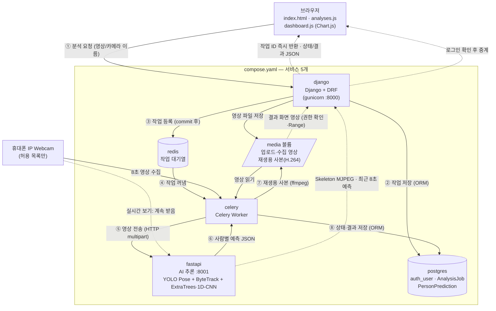
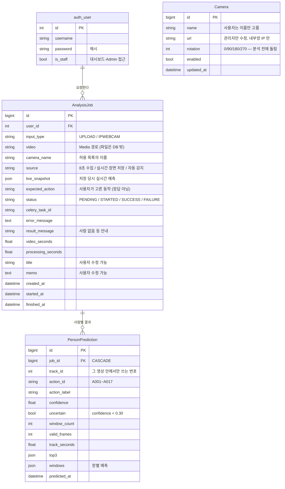
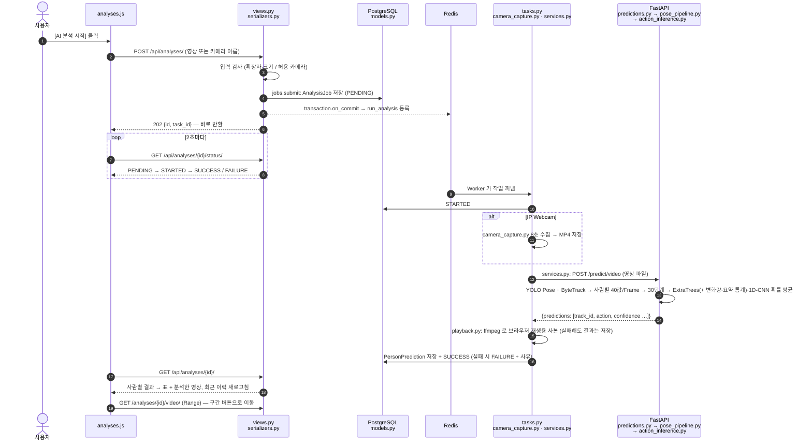
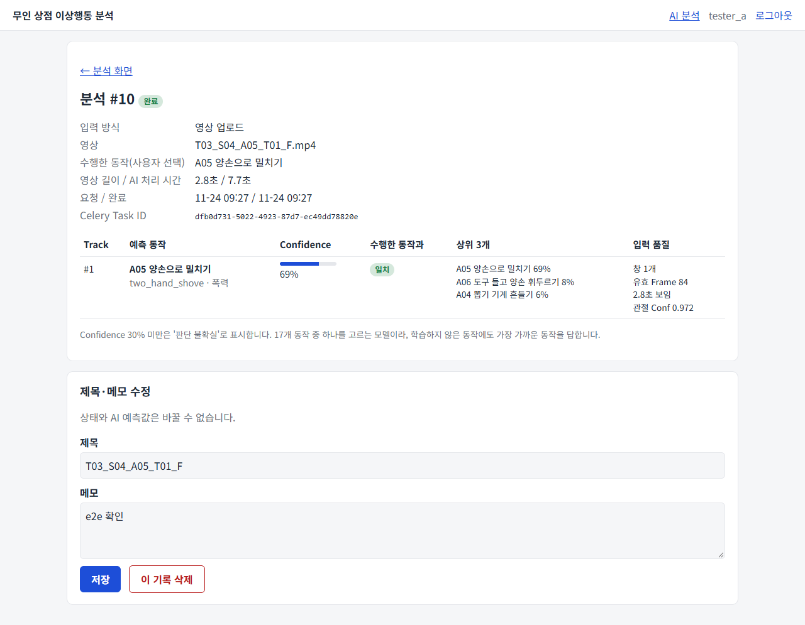
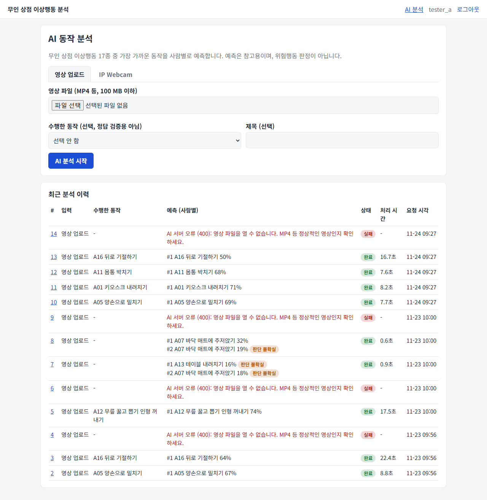
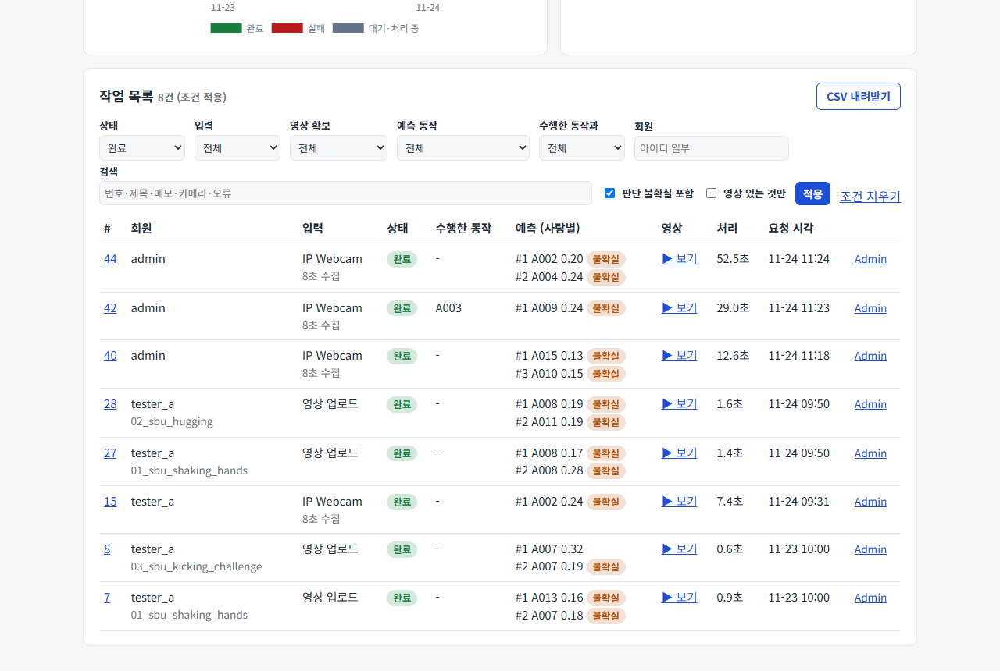

# store-anomaly-service

[](https://github.com/wlgptjd333/store-anomaly-service/actions/workflows/ci.yml)

무인 상점 CCTV 같은 영상에서 **사람마다 어떤 이상행동에 가까운지** 예측해 기록·조회하는 웹 서비스입니다.
교과10(자세추정·동작인식) 최종 프로젝트이며, 모델은 3팀이 직접 촬영한 데이터로 만든 것을 씁니다.

> 데이터·모델 쪽 작업(촬영 정리, Pose 추출, QA, 학습·평가)은 [unmanned-store-anomaly](https://github.com/wlgptjd333/unmanned-store-anomaly) 저장소에 있고,
> 이 저장소는 그 모델을 **웹 서비스로 연결하는 부분**만 담습니다. (촬영 데이터만 3팀이 함께 찍었고, 두 저장소 모두 개인 작업입니다)
>
> 'AI 분석 시작'부터 결과 저장까지 **어느 파일의 어느 함수가 무엇을 하는지**는 [docs/PIPELINE.md](docs/PIPELINE.md) 에 단계별로 정리했습니다.

## 1. 프로젝트 소개

- 로그인한 사용자가 **영상 업로드** 또는 **IP Webcam(휴대폰 카메라에서 8초 수집)** 으로 분석을 요청하면,
  YOLO Pose + ByteTrack 으로 사람을 추적하고 사람별로 **17개 이상행동 중 가장 가까운 동작과 Confidence** 를 보여 줍니다.
- 분석은 Celery 가 백그라운드에서 처리하므로, 요청하자마자 작업 ID를 받고 화면이 상태(대기 → 처리 중 → 완료/실패)를 따라갑니다.
- 결과는 PostgreSQL 에 남고, 관리자는 Django Admin 과 `/dashboard/`(Chart.js)에서 전체 기록·통계를 봅니다.
- **영상 확인**: 올리기 전에 미리보기(길이·해상도·예상 분석 시간)를 보고, 결과 화면에서는 분석한 영상(IP Webcam 녹화본 포함)을 바로 재생합니다.
  **구간별 예측** 버튼을 누르면 그 시점으로 이동하고, 재생 중인 구간이 진하게 표시돼 "어느 장면에서 무엇으로 봤는지"를 확인할 수 있습니다.
- **대시보드 편의 기능**: 기간(오늘·7일·30일), 상태·입력·예측 동작·일치 여부·회원·검색 조건, 20건씩 쪽 나누기, 조건 그대로 **CSV 내려받기**,
  날짜별 작업 수, 자주 헷갈린 동작, 차트 막대를 누르면 목록 거르기, 30초 자동 새로고침. 목록에서 다른 회원 기록도 **읽기 전용**으로 열어 영상까지 봅니다.
- **실시간 보기**: IP Webcam 탭에서 카메라 화면에 사람별 **Skeleton** 과 최근 8초 기준 예측을 겹쳐 계속 보여 줍니다 (1초마다 갱신).
  **이 장면 저장**을 누르면 화면에 보이던 최근 8초를 그대로 기록하고, **자동 감지 기록**을 켜면 같은 동작이 3초 넘게 기준 이상으로 이어질 때 자동으로 저장합니다.
- 휴대폰 IP 가 바뀌면 관리자가 같은 탭의 **카메라 주소 관리**에서 바로 고치고 연결을 확인합니다 (재시작 불필요, 내부망 주소만 허용).
- 예측은 **참고용**입니다. 17개 중 하나를 고르는 모델이라 학습하지 않은 동작에도 답을 내므로, Confidence 30% 미만은 `판단 불확실`로 표시합니다.

| 분류 | 동작 (ID) |
|---|---|
| 기물 파손 | A001 키오스크 두드리기 · A002 한손 물건 던지기 · A003 앞차기 · A004 잡고 흔들기 · A013 샷건 |
| 폭력 | A005 밀치기 · A006 휘두르기 · A011 몸통 박치기 |
| 장시간 머묾 | A007 바닥에 앉기 · A008 위에 앉기 · A009 앞으로 눕기 · A010 뒤로 눕기 |
| 도난 의심 | A012 쪼그려 물건 빼내기 |
| 응급 | A014 구토 · A015 옆으로 쓰러지기 · A016 뒤로 넘어지기 · A017 앞으로 넘어지기 |

번호·이름은 3팀이 함께 쓰는 **통일 표기**입니다 (11/24 부터, 데이터 저장소 [`configs/unified_label_map.csv`](https://github.com/wlgptjd333/unmanned-store-anomaly/blob/main/configs/unified_label_map.csv)).
데이터 저장소 안의 영상 이름·실험 표는 예전 번호(A01~A17)를 그대로 쓰고, 순서가 같아 A01 = A001 … A17 = A017 입니다.
11/24 전에 저장된 분석 기록은 migration `0004_unify_action_ids` 가 새 번호·이름으로 바꿨습니다 (모델 예측 확률은 바꾸기 전과 같음).

## 2. 실행 방법

필요한 것: Docker Desktop(Compose v2). GPU 는 필요 없습니다(AI 서버는 CPU 로 추론).

```bash
git clone https://github.com/wlgptjd333/store-anomaly-service.git
cd store-anomaly-service

# 1) 환경변수: 예시를 복사한 뒤 비밀값과 카메라 주소를 직접 채운다 (.env 는 Git 에 올라가지 않음)
cp .env.example .env
#    DJANGO_SECRET_KEY, POSTGRES_PASSWORD  → 긴 무작위 문자열
#    IPWEBCAM_CAMERAS                      → phone=http://<휴대폰 IP>:8080/video  (처음 migrate 때 카메라 표에 한 번 옮김.
#                                            이후 IP 가 바뀌면 웹 화면 IP Webcam 탭 → '카메라 주소 관리'(관리자)에서 수정)

# 2) 빌드·실행 (서비스 5개). 처음엔 PyTorch(CPU) 등을 받느라 몇 분 걸린다
docker compose up -d --build

# 3) 마이그레이션 — django 컨테이너가 시작할 때 자동으로 migrate 한다. 직접 하려면:
docker compose exec django python manage.py migrate

# 4) 관리자 계정
docker compose exec django python manage.py createsuperuser
```

| 화면 | 주소 |
|---|---|
| 사용자 (회원가입·로그인 → AI 분석) | http://localhost:8000/ |
| 관리자 대시보드 (is_staff 만) | http://localhost:8000/dashboard/ |
| Django Admin | http://localhost:8000/admin/ |
| FastAPI 문서 (개발용, 이 컴퓨터에서만) | http://localhost:8001/docs |

**모델 파일 위치** — `ai_service/models/`

| 파일 | 내용 | Git |
|---|---|---|
| `action_model.joblib` | ExtraTrees 1000그루 (17 Class, 8.7 MB) | 포함 |
| `action_cnn.pt` | 시간 순서 1D-CNN 3개 (난수 42·0·1, 0.9 MB) — ExtraTrees 확률과 평균 (`src/temporal_cnn.py`) | 포함 |
| `feature_columns.json` | 입력 2,560개 Feature 이름·순서 | 포함 |
| `training_info.json` | Class 이름, 30단계, Frame Feature 40개, 덧붙인 Feature 종류, Pose 설정, 평가 수치 | 포함 |
| `yolo11n-pose.pt` | YOLO Pose 가중치 (Ultralytics) | 제외 — Docker 빌드 때 자동으로 받음 |

모델을 다시 만들려면 데이터 저장소에서 `scripts/15_export_service_model.py` 를 실행한 뒤 `bash scripts/update_model.sh [데이터 저장소 경로] [확인용 영상]` —
모델 파일 복사(1D-CNN 포함), Feature·모델 코드가 두 저장소에서 같은지 확인, Pose 모델 일치 확인, fastapi 다시 빌드(모델이 이미지 안에 들어감), `/health`·E2E 확인까지 합니다.
영상 추가부터 전체 순서는 데이터 저장소 [Runbook](https://github.com/wlgptjd333/unmanned-store-anomaly/blob/main/docs/RETRAIN_RUNBOOK.md).

로컬(도커 없이) 확인: `bash scripts/check.sh` — 린트(`ruff.toml`) · JS 문법 · Django check · migration 누락 · 단위 테스트 44개(SQLite·가짜 AI 서버).
GitHub 에서도 push 마다 같은 확인이 돕니다 (`.github/workflows/ci.yml`, 위 check 배지). Docker 안에서는 `docker compose exec django python manage.py test`.

**녹화 영상 꺼내기 (재학습용)**: 분석에 쓴 영상 원본은 Docker 볼륨(`media`) 안에 있어 탐색기로 바로 안 보입니다.
`docker compose exec django python manage.py export_clips` 를 실행하면 IP Webcam 녹화(장면 저장·자동 감지 포함, 완료된 것)를
이 저장소 `exports/<시각>/` 로 복사합니다 (Windows 탐색기에서는 `\\wsl.localhost\Ubuntu\...\store-anomaly-service\exports`).
파일 이름은 `job0042_A003_CAPTURE_20261124_112324.mp4` (작업 번호 · 수행한 동작(NA = 안 고름) · 입력 방식 · 시각), `manifest.csv` 에 AI 예측·Confidence·일치 여부가 들어갑니다.
`--source all`(업로드 포함) · `--labeled-only` · `--since 2026-11-24` · `--dry-run`. '수행한 동작'은 검수 전 값이라 학습 전에 영상을 보고 `label_checked` 칸을 채웁니다. `exports/` 는 Git 제외 (얼굴이 나올 수 있음).

HTTPS 로 열 때(앞단 프록시가 TLS 처리)는 `.env` 에 `DJANGO_HTTPS=1` — 쿠키 secure · http→https 이동 · HSTS 가 켜지고 `manage.py check --deploy` 경고가 없어집니다.
내부망 http 시연에서는 0 (켜면 http 에서 로그인 쿠키가 안 보내짐).

## 3. 전체 아키텍처



점선 아래 세 줄은 **실시간 보기**(저장 안 함)입니다. 카메라 주소는 Django 가 DB 카메라 표에서 꺼내 FastAPI 에 넘기고,
브라우저는 FastAPI 에 직접 닿지 않고(127.0.0.1 전용) 로그인 확인을 거치는 Django 를 통해 화면을 받습니다.

- **PostgreSQL 은 Django ORM 으로만** 씁니다. FastAPI 는 DB 를 모르고, 영상을 받아 JSON 만 돌려줍니다.
- 컨테이너끼리는 `localhost` 가 아니라 서비스 이름(`postgres`, `redis`, `fastapi`)으로 부릅니다.
- 공개 포트는 django `8000` 하나. fastapi `8001` 은 개발 확인용으로 `127.0.0.1` 에만 엽니다.
- Django 와 Celery 는 같은 이미지(`backend/Dockerfile`)를 쓰고 실행 명령만 다릅니다. 업로드 영상은 `media` 볼륨을 함께 씁니다.
- 영상은 `/media/` 로 그대로 열지 않고 `/analyses/{id}/video/` 가 매번 권한(본인·관리자)을 확인한 뒤 보냅니다. 영상 중간으로 건너뛸 수 있게 HTTP Range(206)를 직접 처리합니다 (`playback.py`).

## 4. DB 설계 (ERD)



| 테이블 | 저장하는 것 | 작성 위치 |
|---|---|---|
| `auth_user` | 회원 (Django 기본) | Django 제공 |
| `AnalysisJob` | 분석 요청 1건: 누가, 어떤 입력으로, 지금 상태, 실패 사유, 처리 시간 | `backend/analyses/models.py` |
| `PersonPrediction` | 그 요청 영상 속 사람 1명의 예측. 두 사람이면 작업 1건에 2행 (`(job, track_id)` 유일) | `backend/analyses/models.py` |
| `Camera` | 허용한 IP Webcam (이름·주소). `AnalysisJob.camera_name` 은 FK 가 아니라 이름 문자열 — 카메라를 지워도 지난 기록의 이름은 남게 | `backend/analyses/models.py`, `cameras.py` |

- 영상 파일은 DB 에 넣지 않고 Media 폴더에 두며 경로만 저장합니다. 기록을 지우면 사람별 예측(CASCADE)과 영상 파일도 함께 지웁니다.
- 일반 사용자는 **제목·메모만** 고칠 수 있습니다. 상태·예측값을 사용자가 바꾸면 기록과 통계를 믿을 수 없게 되기 때문입니다.

## 5. AI 추론 버튼 구현 흐름



| 단계 | 파일 |
|---|---|
| 입력 화면·미리보기·상태 조회·결과 표·영상 | `backend/templates/analyses/index.html`, `detail.html`, `backend/static/js/analyses.js` |
| 요청 접수·권한 | `backend/analyses/views.py`, `serializers.py`, `permissions.py` |
| 작업 등록 (업로드·장면 저장 공통) | `backend/analyses/jobs.py` |
| 백그라운드 처리 | `backend/analyses/tasks.py`, `camera_capture.py`, `services.py` |
| 재생용 사본·영상 보내기 | `backend/analyses/playback.py`, `page_views.video`, `management/commands/make_playback.py` |
| 추론 API | `ai_service/main.py`, `routers/predictions.py` |
| 영상 → 사람별 Feature | `ai_service/services/pose_pipeline.py` `track_people` (실시간 보기와 같은 함수, + `src/` 의 Feature 코드) |
| 모델 로드·예측 | `ai_service/services/model_loader.py`, `action_inference.py`, `src/sequence_extras.py`, `src/temporal_cnn.py` |
| 대시보드 집계·조건·CSV·차트 | `backend/analyses/dashboard.py`, `page_views.dashboard`, `backend/static/js/dashboard.js` |

단계별 입력·출력, DB 상태 문구, 실패 처리, 파일이 생기고 지워지는 곳은 [docs/PIPELINE.md](docs/PIPELINE.md).

## 6. 사용한 모델과 입력 형식

**왜 Joblib 하나로는 영상을 분류할 수 없나** — 분류 모델(ExtraTrees·1D-CNN)은 숫자(2,560개 / 30단계 × 80)를 받는 분류기일 뿐입니다.
영상에서 사람을 찾고(YOLO Pose), 사람을 이어 붙이고(ByteTrack), 학습 때와 **같은 계산·같은 순서**로 숫자를 만드는 과정이 앞에 있어야 합니다.

| 단계 | 내용 |
|---|---|
| Pose | `yolo11n-pose.pt`, imgsz 640, 사람 conf 0.25, 관절 conf 0.5 (학습과 같음) |
| 추적 | ByteTrack — 사람마다 `track_id` |
| Frame Feature 40개 (`body40`) | 몸 크기 정규화 17관절 x,y (34) + 팔꿈치·무릎 각도 4 + 골반 화면 위치 2 |
| 유효 Frame | Pose 성공 · 정규화 성공 · 40개 값이 모두 숫자 (학습 때 규칙 그대로) |
| Sequence | 유효 Frame 을 시간 0~1 로 펴서 30단계로 보간 → 30 × 40 = 1,200 |
| 덧붙인 Feature | 단계 사이 변화량 29 × 40 = 1,160 + Feature 마다 30단계의 평균·표준편차·최솟값·최댓값·범위 5 × 40 = 200 → 합계 **2,560** (`src/sequence_extras.py`, 학습 쪽과 같은 파일) |
| 창(Window) | 사람이 보인 시간이 8초 이하면 전체가 창 1개, 더 길면 8초 창을 4초씩 밀며 확률 평균 |
| 모델 ① | ExtraTrees(Extremely Randomized Trees) 1000그루, class_weight balanced, 17 Class — Random Forest 와 같은 나무 모음 방식에서 나누는 기준을 무작위로 뽑는 변형. 입력 2,560 |
| 모델 ② | 1D-CNN (Conv1d 3층, 채널 폭 128, 시간 방향 평균·최댓값) 난수 3개 평균. 입력 = 30단계 × (관절 40 + 변화량 40) |
| 합치기 | ① 확률과 ② 확률의 평균 → 가장 높은 동작·Confidence (`ModelBundle.predict_proba`, 학습 15번과 같은 계산) |

- **학습 데이터 (2026-11-24 갱신)**: 3팀 5명 × 17동작 × **정면·측면·뒷모습** = 255개 영상 (RGB) + 학습 때만 **좌우 반전** 복사본을 더함.
  평가는 사람 단위로 나눠 Train S01~S03 → Validation S04 / Test S05(다른 날 따로 촬영). 서비스용은 5명 전부 + **팀원이 다른 카메라 구도(높은 곳 대각선)로 찍은 5개**로 다시 학습했습니다.

  | 서비스 모델 | Validation S04 | Test S05 | Test 정면 / 측면 / 뒤 |
  |---|---|---|---|
  | 11/22 정면·측면 170개 | 73.5% | 61.8% | — (뒷모습 평가 없음) |
  | 11/24 오전: 정면·측면·뒤 255개 + 좌우 반전 (RF) | 68.6% | 74.5% | 76.5% / 76.5% / 70.6% |
  | 11/24 오후: + 변화량·요약 통계, ExtraTrees | 88.2% | 78.4% | 88.2% / 76.5% / 70.6% |
  | 11/24 밤: ExtraTrees + 1D-CNN 확률 평균 | 98.0% | 82.4% | 88.2% / 82.4% / 76.5% |
  | 11/24 밤 2: 1D-CNN 폭 128 | 96.1% | 88.2% | 94.1% / 82.4% / 88.2% |
  | **11/24 밤 3: + 새 카메라 구도 영상 5개 학습 (현재)** | **96.1%** | **88.2%** | 94.1% / 82.4% / 88.2% (기록용 평가엔 5개를 안 넣어 같음) |

- **뒷모습을 넣은 이유**: 매장 카메라는 사람을 뒤에서도 봅니다. 11/23 5명이 뒷모습을 다시 찍어 확인해 보니,
  정면·측면으로만 배운 모델은 뒷모습을 **37%** 만 맞혔습니다 (LOSO: 한 명씩 빼고 학습해 그 사람으로 평가, whole 창).
  뒷모습을 학습에 넣고 좌우 반전을 더하니 뒷모습 **68%**, 정면·측면도 76.7% → **78.4%** 로 함께 올랐습니다.
  Validation S04 는 73.5 → 68.6% 로 내려갔지만 한 사람 51개 영상이라 변동이 크고(측면 58.8%), 5명을 돌아가며 본 LOSO 와
  다른 날 찍은 Test 가 모두 올라서 새 모델을 씁니다. 실험 전체는 데이터 저장소 `docs/BASELINE_EVALUATION.md` 5-2절.
- **Feature·모델을 바꾼 이유 (19번 실험)**: 영상 전체를 30단계로 펴면 같은 동작도 사람마다 시작 시점이 달라, 같은 단계 번호에 다른 자세가 옵니다.
  단계 번호와 상관없는 요약값(평균·최댓값 등)과 움직임(변화량)을 더하고, RF·ExtraTrees·SVM 을 비교했습니다.
  고르는 기준은 **S01~S04 사람 단위 4-fold** 만 쓰고(Test S05 는 고른 뒤 확인만), 난수 3개 평균으로
  지금 RF 71.9% → ExtraTrees + 변화량·요약 통계 **82.4%** (가장 낮은 사람도 74.5%). 5명 LOSO 75.7 → 83.5%, 뒷모습 71.8 → 76.5%.
  LogisticRegression(63%)·SVM(73~77%)·골반 위치 빼기(-pos)는 더 낮았습니다. 결과 표: 데이터 저장소 `reports/tables/model_improvement_*.csv`.
- **1D-CNN 을 더한 이유 (21번 실험)**: ExtraTrees 는 30단계를 펼쳐 '몇 번째 단계에 어느 관절이 어디' 를 따로 봐서, 시작이 조금 어긋나면 약합니다.
  1D-CNN 은 필터가 시간 방향으로 미끄러져 '어떤 움직임 모양이 있나' 를 봅니다. 같은 4-fold 규칙(난수 3개)으로
  ExtraTrees 82.4 → 1D-CNN 85.0 · GRU 79.7 → **ExtraTrees + 1D-CNN 평균 87.9 ± 0.2** (뒷모습 70.6 → 78.4, 가장 낮은 사람 75.2 → 82.4).
  두 모델이 틀리는 동작이 달라 평균이 둘보다 낫습니다 (A013 샷건 50 → 89%, A002 75 → 94%, 대신 A003 앞차기 92 → 75%).
  분석 시간은 2.8초 영상 7.3 → 8.1초로 거의 같습니다 (Pose 가 대부분). 결과 표: 데이터 저장소 `reports/tables/temporal_models_*.csv`.
- **GPU 로 더 찾아본 것 (22번 실험, 20가지)**: 서비스처럼 1D-CNN 3개를 평균한 모양으로 재면 4-fold **90.2** (위 87.9 는 1개 기준).
  여기서 **폭 64 → 128** 만 미리 정한 기준(+1%p 넘게, 가장 낮은 사람·뒷모습도 오름)을 넘어 바꿈: 4-fold 91.7 ± 0.4, 고른 뒤 Test S05 86.3 → 88.2.
  Pose 11m 은 4-fold 94.0 으로 가장 높았지만 다른 날 찍은 Test S05 에서 85.0 으로 낮았고 CPU 4배라 보류 (AI 서버를 GPU 로 돌릴 때 다시 볼 후보).
  mixup·TTA·200 epoch·TCN·Transformer 는 변동 안이거나 낮았습니다. 자세히: 데이터 저장소 `docs/BASELINE_EVALUATION.md` 5-6절.
- **Confidence 기준 30% 를 그대로 둔 이유**: 학습에 없던 사람(S01~S04 4-fold)에서 ExtraTrees + 1D-CNN 의 정답 평균 확률 0.51, 오답 0.32.
  30% 위쪽 정확도는 ExtraTrees 만일 때와 같고(95.3 → 95.4%), `판단 불확실` 로 표시되는 비율만 37% → 15% 로 줄어 기준을 바꾸지 않았습니다. 폭 128 에서도 위쪽 정확도 95.9%, 불확실 16%. 학습에 들어간 영상은 90% 가까이 나오므로 시연 숫자를 정확도로 읽으면 안 됩니다.
- **창을 `whole`(영상 전체)로 고른 이유**: 서비스로 들어오는 영상에는 사람이 표시한 '동작 구간'이 없습니다.
  구간(segment) 모델이 Validation 76.5% 로 조금 높지만 차이가 난수 변동(±4%p) 안이라, 입력 모양이 서비스와 같은 whole 모델을 씁니다.
- **입력 영상**: mp4·mov·avi·mkv·webm, 100 MB 이하, 처음 60초까지. 60fps 는 30fps 로 줄여 처리.
- **IP Webcam**: 관리자가 등록한 카메라만 이름으로 고릅니다. 영상을 확보하는 방법은 세 가지이고, 모두 같은 Celery → `/predict/video` 를 탑니다 (`AnalysisJob.source`).

  | 방법 | 영상 | 언제 쓰나 |
  |---|---|---|
  | 8초 수집 ('AI 분석 시작') | Worker 가 작업을 꺼낸 순간부터 8초 녹화 | 과제 기본 흐름. 화면이 **'지금 녹화 중'** 으로 바뀐 뒤 동작 |
  | 실시간 장면 저장 ('이 장면 저장') | 실시간 보기가 들고 있던 **최근 8초** 그대로 | 실시간 화면으로 자세를 확인하면서 기록할 때 (추천) |
  | 자동 감지 | 위와 같은 8초, 조건이 맞으면 자동 저장 | 무인 매장처럼 사람이 버튼을 누르지 않는 상황 흉내 |

**카메라 주소를 웹에서 바꾸게 한 이유와 막은 것** — 휴대폰은 와이파이를 다시 잡을 때마다 IP 가 바뀝니다.
처음에는 `.env` 에만 두었는데, 바뀔 때마다 파일을 고치고 컨테이너를 다시 띄워야 했고 실제로 예시 주소가 남아 연결이 실패했습니다(아래 오류 기록).
그렇다고 사용자가 아무 URL 이나 넣게 하면 서버가 그 주소로 접속하므로(SSRF) 서버 안쪽 서비스나 외부 아무 곳이나 찔러 볼 수 있습니다.
그래서 ① 주소 수정은 **관리자(is_staff)만**, 일반 사용자는 이름만 고름 ② 주소는 **숫자 IP + 내부망**(`CAMERA_ALLOWED_NETWORKS`, 기본 192.168.0.0/16·10.0.0.0/8)만 —
Docker 내부망 172.16.0.0/12 와 localhost 는 기본값에서 빠져 postgres·redis·fastapi 를 가리킬 수 없음 ③ `192.168.0.10:8080` 처럼 앱 화면 주소만 적어도 `http://…/video` 로 맞춤
④ 저장하면 바로 Frame 하나를 받아 보는 **연결 확인**. 사용자에게 주소를 안 보이는 것도 같은 이유입니다(API 가 이름만 돌려줌).

**실시간 보기 (Skeleton Overlay)** — 8초 분석은 "찍고 → 기다리고 → 결과"라 카메라 각도·사람 위치가 맞는지 미리 알 수 없습니다.
실시간 보기는 카메라 앞에 서서 관절이 잘 잡히는지, 모델이 지금 무엇으로 보는지를 바로 확인하는 용도입니다.

| 항목 | 내용 | 이유 |
|---|---|---|
| 처리 위치 | FastAPI 안의 세션(스레드 2개) — `services/live_session.py`, `routers/live.py` | Pose·ExtraTrees 가 이미 올라와 있는 곳. Celery 는 "한 번 처리하고 끝나는 작업"용이라 계속 도는 스트림에 맞지 않음 |
| 받기 / 처리 분리 | 받기 스레드는 쉬지 않고 읽어 **최신 Frame 하나만** 보관, 처리 스레드는 그 Frame 만 Pose | 읽기를 멈추면 OpenCV 버퍼에 Frame 이 쌓여 화면이 몇 초씩 늦어짐. CPU 가 느리면 Frame 을 건너뛰지 밀리지 않음 |
| Skeleton | 서버가 Frame 위에 관절·뼈대·박스·`#Track 동작ID 확률`을 그려 MJPEG 로 보냄 | 브라우저가 따로 그리면 영상과 관절 시점이 어긋남. 한글은 OpenCV 로 못 써서 이름은 옆 표에 |
| 예측 | 사람마다 **최근 8초**만 들고, 1초마다 그 구간을 창 1개로 `predict_track` (업로드 분석과 같은 함수) | 학습이 영상 전체(whole)를 30단계로 편 모양이라, 8초 창 1개가 같은 모양. 잠깐 가려지면 직전 예측 유지 |
| Pose 모델 | 세션마다 YOLO 를 따로 불러옴 | 업로드 분석과 같은 YOLO 객체를 쓰면 ByteTrack 의 Track ID 상태가 섞임 |
| 동시 실행 | 한 번에 1개 (같은 카메라는 같은 세션에 붙음, 다른 카메라는 409) | CPU 하나로 두 개를 돌리면 둘 다 느려짐 |
| 자동 종료 | 화면·상태 조회가 20초 없으면, 또는 10분이 지나면 멈춤 | 브라우저를 그냥 닫아도 서버가 계속 카메라를 붙잡지 않게 |
| 중계 | 브라우저 ← Django(`live_views.py`, 로그인 확인) ← FastAPI. gunicorn 을 `gthread` 8스레드로 | 스트림 하나가 worker 하나를 계속 잡으므로 스레드가 있어야 다른 요청이 막히지 않음 |
| 기록 | 1초마다의 예측은 남기지 않고, **장면을 저장할 때만** 그 8초 영상을 다시 분석해 기록 + 저장 당시 실시간 예측은 `live_snapshot` 에 | 1초마다 바뀌는 값 자체는 기록·통계 대상이 아님. 저장 영상은 업로드와 같은 경로로 분석해야 결과를 같은 기준으로 비교할 수 있음 |
| 화면 회전 | 카메라마다 0/90/180/270°, 받기 스레드·8초 수집에서 분석 전에 돌림 | 휴대폰을 세로로 들어도 IP Webcam 은 가로로 보냄 → 사람이 누워 보이면 모델이 눕기 동작(A009·A010)으로 답함 (아래 오류 기록) |
| 자동 감지 조건 | 같은 동작이 **3초 이상** 이어지고 그동안 **최저** Confidence 가 기준(기본 50%, 30% 아래로는 못 내림) 이상, 저장 사이 15초 | 한 순간 튄 값으로 저장하지 않게 '이어짐'과 '최저값'을 봄. 브라우저는 요청만 하고 판단은 서버(`live_views._auto_hit`)가 실시간 상태를 다시 읽어서 함 |

**자동 감지 기록을 정확도로 읽으면 안 되는 이유** — Confidence 가 높을 때만 골라 저장하므로, 그 기록만 모으면 실제보다 잘 맞는 것처럼 보입니다 (선택 편향).
그래서 `source=자동 감지`로 따로 표시하고(이력·Admin 필터), 모델 성능은 6번의 사람 단위 평가 수치로만 말합니다.

FastAPI `POST /predict/video` 응답 형식 (발췌, 11/23 첫 모델 때 받은 값 — 숫자는 지금 모델과 다름):

```json
{
  "ok": true, "message": "",
  "video": {"frames": 558, "fps": 60.0, "seconds": 9.3, "width": 1080, "height": 1920},
  "processing_seconds": 17.5,
  "predictions": [
    {"track_id": 1, "action_id": "A012", "action_label": "crouch_take_item", "action_name_ko": "쪼그려 물건 빼내기",
     "confidence": 0.74, "uncertain": false, "window_count": 2, "valid_frames": 279, "track_seconds": 9.3,
     "top3": [{"action_id": "A012", "probability": 0.74}, {"action_id": "A009", "probability": 0.13}, {"action_id": "A017", "probability": 0.07}]}
  ],
  "skipped_tracks": []
}
```

| 상황 | 응답 | Worker 처리 |
|---|---|---|
| 정상 | 200 + predictions | SUCCESS + 사람별 저장 |
| 사람 없음·관절이 거의 안 보임 | 200 + 빈 predictions + message | SUCCESS + 안내 문구 |
| 영상을 열 수 없음·형식 오류 | 400 + detail | FAILURE + 사유 |
| 모델 준비 안 됨 | 503 | FAILURE + 사유 |
| AI 서버 연결 실패·시간 초과 | — | FAILURE + 사유 |

## 7. 실행 결과와 검증

**정상 분석 + 영상 확인** — 입력: 사용자 본인(S04)이 촬영한 `A010 뒤로 눕기` 정면 영상 14.6초 → 예측 A010, Confidence 40%, 일치 (11/24 밤 모델).
영상이 8초보다 길어 창이 3개(0~8·4~12·6.5~14.5초)이고, 5초 지점으로 옮긴 화면이라 그 시점을 포함한 두 창이 진하게 표시됩니다.
마지막 창(일어나는 장면)은 25%로 낮아 점선입니다. 사람별 최종값은 세 창 확률의 평균이라 40%입니다.
(이 영상은 서비스용 모델 학습에도 들어간 영상이라 정확도 근거가 아니라 **흐름 확인용**입니다. 정확도는 6번의 사람 단위 평가 수치를 봅니다.)



**두 사람 (T04)** — 입력: 8일차 SBU 악수 영상(2명) → 한 작업에 Track 1·2 결과가 따로 저장. 학습하지 않은 동작이라 둘 다 Confidence 30% 아래(17%·28%)로 `판단 불확실`.
(공개 데이터셋 사람 영상이라 캡처에서는 영상 칸을 숨겼습니다.)


**오류·실패** — 입력: 이름만 `.mp4` 인 손상 파일 → AI 서버가 400, 작업은 `실패` 와 사유로 저장.


**사용자 화면** — 업로드 / IP Webcam 탭, 최근 이력 (영상 있는 기록은 `▶ 보기`)



**업로드 미리보기** — 파일을 고르면 올리기 전에 영상을 재생해 보고 길이·해상도·예상 분석 시간을 확인합니다.
100 MB 초과, 60초 초과(여러 동작이 섞임), 3초 미만, 세로 영상이면 주의 문구가 나옵니다. 올리는 동안 버튼에 업로드 % 가 표시됩니다.


**관리자 대시보드** — 기간 버튼, KPI 8개(실패율·판단 불확실 비율·평균 처리 시간·수행한 동작과 일치율·지금 대기 중),
동작별 예측 건수(분류별 색, 옅은 색 = 판단 불확실, 막대를 누르면 목록 거르기), 작업 상태별, 입력 방식별, 날짜별 작업 수, 자주 헷갈린 동작, 작업 목록.
'수행한 동작과 일치'는 사용자가 고른 값과 비교한 **참고 숫자**입니다. 검증된 정답이 아니고, Confidence 높은 장면만 골라 저장하는 자동 감지 기록은 뺍니다.


**작업 목록 조건·CSV** — 상태·입력·영상 확보 방법·예측 동작·일치 여부·회원·검색(번호·제목·메모·카메라·오류)·판단 불확실·영상 있음.
고르면 바로 적용되고, 20건씩 쪽을 나눕니다. **CSV 내려받기**는 지금 조건 그대로입니다.
Excel 에서 한글이 깨지지 않게 BOM 을 붙이고, `=`·`+`·`-`·`@` 로 시작하는 회원 입력은 수식으로 실행되지 않게 `'` 를 붙입니다.
번호를 누르면 다른 회원 기록도 **읽기 전용**으로 열립니다 (영상 포함, 수정·삭제 칸 없음, API 도 관리자는 상세 조회만).



**Django Admin** — 상태·입력 방식·예상 동작 필터, 사용자 검색, 사람별 예측 Inline


### 과제 테스트 (T01~T10)

| 테스트 | 확인 방법 | 결과 |
|---|---|---|
| T01 모델 불러오기 | `GET /health` — 파일 교차 확인(입력 수·Feature 순서·Class, 1D-CNN 의 Class·단계 수) | ExtraTreesClassifier + 1D-CNN · 17 Class · 2,560 Feature · ready |
| T02 영상 업로드 | `scripts/e2e_check.py` (Docker, 세션 로그인 → API) | PENDING → STARTED → SUCCESS. 11/24 오후 모델로 정면 A005·뒷모습 A001·A011·A016·A012 5개 모두 예측 일치 (학습에 들어간 영상이라 흐름 확인용). 통일 번호로 바꾼 뒤 다시: A005 밀치기 90%·A013 샷건(뒤) 85% 일치. 1D-CNN 더한 뒤(`update_model.sh`): A005 88% 일치, AI 8.1초 |
| T03 IP Webcam | ① 가짜 카메라: Worker 컨테이너 안에서 MJPEG `/video` 로 S04 영상을 반복 송출, `IPWEBCAM_CAMERAS` 에 임시 등록 ② 휴대폰 IP Webcam 앱 | ① 202(0.1초) → 8.0초 MP4 저장 → SUCCESS, 허용 목록 밖 이름은 400. 예측은 짧은 영상을 되풀이한 입력이라 `판단 불확실`(A002 24%) ② 실제 휴대폰(11/24): 카메라 주소 관리에서 연결 확인 640×480(0.1초), Celery 컨테이너에서 Frame 수신 확인. 사람이 동작하는 8초 분석 시연은 남음 |
| 추가: 장면 저장·자동 감지 (11/24) | 실시간 보기 중 '이 장면 저장' · 자동 감지 조건 미달·간격 안 재요청 · S04 A002 영상을 옆으로 눕혀 흘려 넣고 회전 0°/90° 비교 | 202 → 저장 영상 Celery 분석 SUCCESS(`실시간 장면 저장`, 재녹화 없음) · 409 / 429 · 0°: A009 앞으로 눕기 26% → 90°: A002 37.7%, 같은 8초를 저장해 다시 분석해도 A002 35.4% |
| 추가: 실시간 보기 (11/24) | 휴대폰 IP Webcam → 브라우저 '실시간 보기' · S04 Validation 영상(A002 정면)을 30fps 로 흘려 넣기 | Docker CPU 로 20~22 fps(사람 없음), 영상은 사람 1명 Skeleton + `A002` 36~40% 로 표시, 멈춤 → 204 |
| 추가: 카메라 주소 | 일반 회원이 주소 수정·연결 확인 요청, 관리자가 `172.18.0.5:6379`·`8.8.8.8` 등록 | 403 / 400 "같은 와이파이(내부망) 주소만…", 목록 API 는 일반 회원에게 이름만 |
| T04 사람별 결과 | SBU 2인 영상 2개 | 작업 1건에 Track 1·2 각각 저장 |
| T05 비동기 | 업로드 POST 응답 시간 | 0.02~0.5초에 202 + 작업 ID (분석은 9~22초 뒤 완료) |
| T06 영구 저장 | 새로고침·상세 재조회 | 같은 결과 |
| T07 CRUD 권한 | 회원 B 가 A 의 작업 조회/수정/삭제 | 404 / 404 / 404, B 목록 0건. A 의 PATCH 는 제목·메모만, PUT 405, 분석 중(대기·처리 중) 삭제는 409 |
| T08 관리자 | admin 으로 `/dashboard/`, 일반 회원 | 200 / 관리자 로그인으로 이동 |
| 추가: 영상 확인 (11/24 밤) | Docker 에서 업로드 → 결과 화면, `Range: bytes=0-99`, 다른 회원·관리자로 영상 주소, 옛 기록 `make_playback` | 완료와 함께 재생용 사본(14.1 MB → 0.08 MB, 1.1초), 206 `bytes 0-99/80667`, 404 / 200(관리자 읽기 전용), 옛 기록 33개 사본 생성(손상 파일 10개는 건너뜀) |
| 추가: 대시보드 조건 (11/24 밤) | 기간·상태·판단 불확실·일치·회원·검색·쪽·CSV | 단위 테스트 `DashboardToolsTests` + Docker 에서 `/dashboard/?period=today&status=SUCCESS`·`?export=csv` 200 |
| T09 예외 처리 | 손상 파일, `.txt`, 허용 안 된 카메라 URL, Redis·AI 서버 끊김 | FAILURE + 사유 / 400 (DB 저장 전 거절) · E2E 는 손상 파일 작업을 확인 뒤 본인 DELETE 로 지움(대시보드 실패 건수가 시험 기록으로 늘지 않게), 실패 + 재생용 사본 없음이면 플레이어 대신 원본 내려받기 링크만 |
| T09 추가 (11/24) | 휴대폰 앱이 꺼진 상태로 IP Webcam 요청 · 사람 없는 4초 영상 · 사람이 0.25초만 나온 영상 · Worker 를 멈춘 채 요청 | FAILURE "카메라 'phone'에 연결하지 못했습니다…"(5초) · SUCCESS + "영상에서 사람을 찾지 못했습니다" · SUCCESS + "판단하지 못했습니다: 화면에 0.2초만 보여…" · 10초 동안 PENDING 유지 → Worker 재시작 뒤 SUCCESS |
| T10 Docker 재시작 | `docker compose down` → `up` (11/24 ExtraTrees 모델로 다시) | 작업 32건·사람별 예측 24건·상태별 건수 그대로, 재시작 뒤 새 분석(A009 앞으로 눕기) SUCCESS·일치 |

Django 단위 테스트 44개(`backend/accounts/tests.py`, `backend/analyses/tests.py`)는 AI 서버·카메라·ffmpeg 를 가짜로 바꿔 위 흐름을 확인합니다
(카메라 주소 검사·관리자 권한·실시간 중계·장면 저장·자동 감지 조건 13개, 영상 재생·Range·사본·삭제 7개(분석 중 삭제 409 포함), 녹화 꺼내기 2개, 대시보드 조건·쪽·CSV 4개 포함).
리팩터링(공통 함수로 모으기) 전·후로 S04 영상 2개의 AI 예측이 동작·Confidence·창·유효 Frame 까지 같은지도 확인했습니다 ([docs/PIPELINE.md 6](docs/PIPELINE.md#6-한-곳에-모아-둔-공통-코드-리팩터링)).

### 만난 오류와 해결

| 증상 | 확인한 곳 | 바꾼 것 | 확인 |
|---|---|---|---|
| 업로드하면 화면에 응답 대신 오류, 작업이 `대기`에서 멈춤 | `docker compose logs celery` → `ModuleNotFoundError: packaging` (kombu Redis 전송) | `backend/requirements.txt` 에 `packaging` 추가. 등록 실패 시 500 대신 작업을 `FAILURE`(사유: Redis 등록 실패)로 남기게 `views.py` 수정 | 재빌드 후 E2E 통과, 단위 테스트 `test_queue_down_saved_as_failure` |
| 로컬 테스트에서 화면 테스트 6개가 `Missing staticfiles manifest entry` | 테스트는 `collectstatic` 없이 돌아가는데 해시 파일명 저장소를 씀 | 해시 저장소는 Docker 이미지(`STATIC_MANIFEST=1`)에서만 쓰게 설정 | 로컬 18개 통과, 컨테이너는 `app.<hash>.css` 로 서빙 |
| Docker Desktop 시작 직후 종료 (`docker-secrets-engine\engine.sock` 접근 불가) | 이전 실행이 남긴 소켓 파일이 지워지지 않음 | 그 폴더를 옆으로 옮기고 재시작 | 엔진·WSL `docker` 정상 |
| 휴대폰 IP Webcam 서버를 켰는데 `카메라 'phone'에 연결하지 못했습니다` | 브라우저로는 휴대폰 주소가 열림 → `.env` 의 `IPWEBCAM_CAMERAS` 가 예시 주소 `192.168.0.10` 그대로 | 주소를 고치는 김에, 주소를 DB 카메라 표로 옮기고 관리자가 웹에서 수정·연결 확인하게 바꿈 (내부망 IP 만) | Celery 컨테이너에서 Frame 수신, 화면 '연결 확인' 640×480 |
| 결과 화면에서 IP Webcam 녹화본·실시간 장면 저장 영상이 재생되지 않음 (검은 칸) | 파일은 정상, OpenCV 가 `mp4v`(MPEG-4 Part 2)로 저장 → Chrome·Edge `<video>` 미지원. 건너뛰기도 안 됨(Range 미지원) | 원본은 그대로 두고 Celery 가 ffmpeg 로 H.264 사본을 만들고, 권한 확인 + Range 응답 뷰로 보냄 | Edge 에서 재생·구간 이동 확인, 단위 테스트 206/416 |
| 실시간 보기에서는 잘 맞는데 'AI 분석 시작' 결과는 A009·A010 (눕기) 로 나옴 | 저장된 8초 영상을 Frame 별로 열어 봄 → ① 휴대폰을 세로로 들어 영상이 90° 누워 있음 ② 버튼 뒤 7~8초 대기열에서 기다리다 녹화 시작(앞 작업 2개 + 실시간 보기와 CPU 공유) → 동작이 녹화 전에 끝남 | 카메라 '화면 회전' 설정, 화면에 '지금 녹화 중' 표시, 실시간 화면의 최근 8초를 그대로 저장하는 '이 장면 저장'·자동 감지 추가 | 같은 영상을 똑바로 돌려 다시 분석하니 눕기 예측이 사라지고 고른 동작 A003 이 1위(#43)·3위(#42)로 올라옴, 장면 저장 E2E 통과 |
| Docker 안에서 단위 테스트 25개가 `camera name` 중복으로 실패 (밖에서는 통과) | 오류 내용 → migration `0002` 가 `.env` 의 `IPWEBCAM_CAMERAS` 를 테스트 DB 에도 옮겨 넣음 | 테스트 공통 부모 `CleanTestCase` 가 빈 카메라 표에서 시작, `scripts/check.sh` 는 환경변수를 비우고 실행 | 도커 안·밖·CI 모두 통과 (지금 44개) |

## 폴더 구조

```text
store-anomaly-service/
├── compose.yaml            서비스 5개 (django · fastapi · celery · redis · postgres)
├── .env.example            변수 이름과 자리표시자 (실제 .env 는 Git 제외)
├── backend/                Django + DRF + Celery (같은 이미지)
│   ├── config/             settings · urls · celery
│   ├── accounts/           회원가입 (로그인·로그아웃은 Django 기본 뷰)
│   ├── analyses/           models · serializers · views · jobs (작업 등록) · tasks · services · camera_capture · admin
│   │                       · page_views · dashboard (집계·조건·CSV) · playback (재생용 사본·Range)
│   │                       · cameras (주소 검사·연결 확인) · live_views (카메라 API·실시간 중계)
│   │                       · management/commands/make_playback.py (옛 기록 재생용 사본) · export_clips.py (재학습용 영상 꺼내기)
│   ├── templates/ static/  화면 · analyses.js · dashboard.js · app.css
│   └── Dockerfile          python:3.12-slim + ffmpeg
├── ai_service/             FastAPI
│   ├── main.py routers/ services/   predictions(영상 1건) · live(실시간 보기 세션)
│   ├── src/                데이터 저장소(unmanned-store-anomaly)에서 복사: pose_utils · feature_utils · team_feature_utils · sequence_extras · temporal_cnn
│   ├── models/             Joblib · Feature 순서 · 학습 정보
│   └── Dockerfile
├── scripts/                check.sh (린트·테스트 한 번에) · e2e_check.py (Docker 통합 확인) · capture_screens.py (README 캡처) · update_model.sh (모델 교체)
├── ruff.toml · .github/    린트 기준 · push 마다 check.sh 와 같은 확인 (CI)
├── docs/PIPELINE.md        'AI 분석 시작'부터 저장까지 파일·함수 단위 흐름, 공통 코드 정리 기록
└── docs/images/            README 캡처 (영상은 본인 S04 만, 비밀번호·카메라 주소 없음)
```

## 한계

- 학습 데이터가 5명·한 장소라, 다른 사람·다른 카메라 높이·다른 조명에서는 틀릴 수 있습니다 (Test S05 88.2%, 측면이 82.4% 로 가장 낮음).
  S01~S04 4-fold(지금 모델, 난수 3개)에서 약한 동작: A005 밀치기 72%, A003 앞차기·A004 잡고 흔들기 83% — 서서 팔·다리를 한 번 내미는 동작끼리 헷갈립니다.
  틀리면 **입력 품질(관절 Conf·유효 Frame) → Pose → Feature → 창 → 모델** 순서로 원인을 봅니다. 결과 표에 입력 품질을 함께 보여 주는 이유입니다.
- 있는 데이터로 더 올리는 방법은 거의 다 해 봤습니다 (데이터 저장소 BASELINE 5-6·5-7): 모델 크기·학습 방법 20가지, 교과12 VICON 3D 모션캡처(1명)를 16방향으로 2D 투영한 합성 데이터(91.7 → 91.0), Keypoint 회전·시간 늘이기·앞뒤 자르기(최고 +0.8) — 좌우 반전 말고는 기준을 넘지 못함.
  다음은 새 사람·대각선 각도·다른 장소의 **실제 영상**이고, 시연 중 녹화는 `export_clips` 로 꺼내 검수 후 학습에 더합니다.
- **카메라 구도가 바뀌면 크게 떨어집니다.** 11/24 팀원이 다른 구도(가로 1920×1080, 높은 곳에서 대각선)로 찍은 새 사람 영상 5개: 1위로 맞힘 2/5, 30% 넘은 것 1개, 상위 3개 안 3/5. 사람 중심으로 세로로 잘라도 확신도만 조금 오름 의자를 사람으로 잡던 가짜 Track 은 관절 Confidence 평균 0.4 미만이면 거르도록 고침.
  구도에 강해지는 방법 8가지(골반 위치 빼기, 시점 증강, 앞뒤 자르기, VICON 합성과 조합)를 같은 5개로 재 보니 모두 **2/5 그대로**(정답 확률 17 → 최고 22%) — 2D 관절을 늘이는 흉내로는 내려다본 모습이 안 만들어짐.
  그래서 **그 5개 자체를 학습에 더함** (S01~S04 4-fold 91.7 → 92.3, 뒤 83.3 → 84.8, 가장 낮은 사람 85.0 → 86.9 — 기존 평가도 오름).
  그 구도 정확도는 학습에 썼으므로 더 잴 수 없고, 다른 장소·높이에서는 여전히 떨어질 수 있음 → 새 구도 영상은 **평가 먼저, 그다음 학습** (데이터 저장소 BASELINE 5-8).
- 골반 화면 위치(`hip_x_img`, `hip_y_img`)를 Feature 로 쓰므로, 학습 때와 다른 화면 구도(가로/세로, 카메라 위치)에 약합니다. 빼면 같은 구도 4-fold 가 3%p 떨어져(91.7 → 88.7) 유지합니다.
- 실시간 보기는 CPU 처리라 사람이 많을수록 fps 가 떨어지고, 한 번에 세션 하나만 돌립니다. 실시간 보기를 켠 채 분석하면 CPU 를 나눠 써 처리 시간이 2~5배 길어집니다. 8초 창이 다 차기 전(처음 몇 초)의 예측은 짧은 구간 기준이라 흔들립니다.
- 재생용 사본은 소리를 빼고 최대 720p 로 줄입니다 (동작 확인용). 원본은 '원본 내려받기'로 받습니다. 사본을 만드는 동안(8초 녹화본 1초 안팎) 완료 표시가 그만큼 늦습니다.
- 17개 중 하나를 반드시 고르는 구조라 "정상 행동"을 따로 판정하지 못합니다. Confidence 기준(30%)은 처음 Validation 평균 최고 확률(약 39%)을 보고 정했고, 모델을 바꿀 때마다 30% 위쪽 정확도로 다시 확인합니다.
