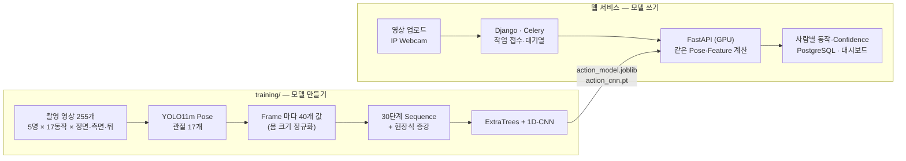
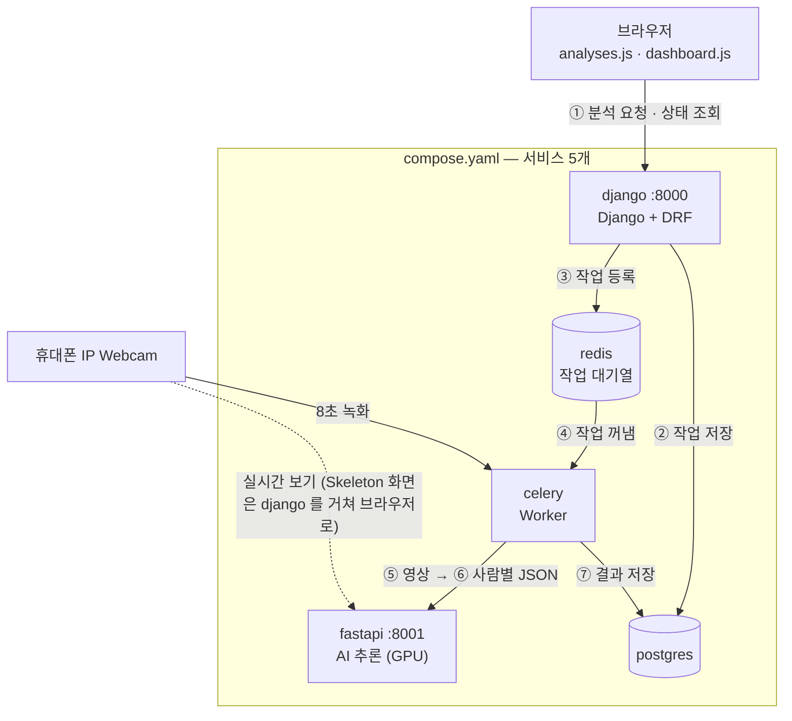
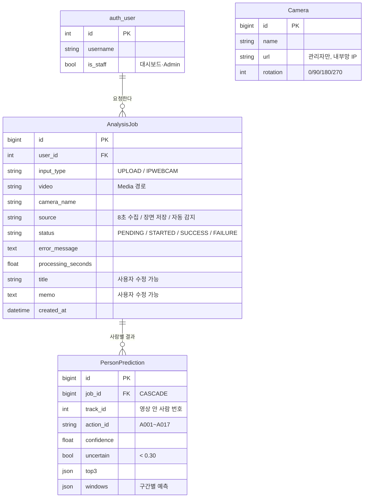
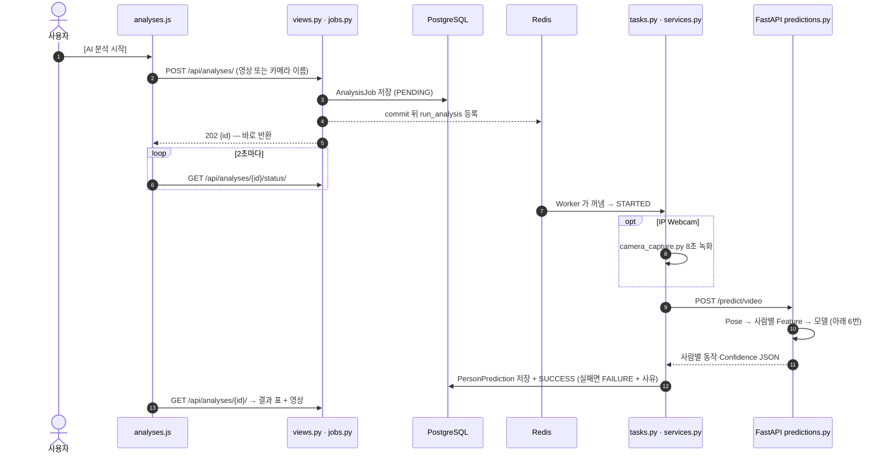
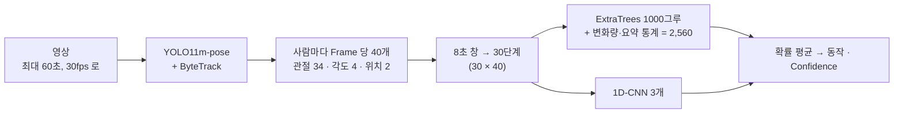
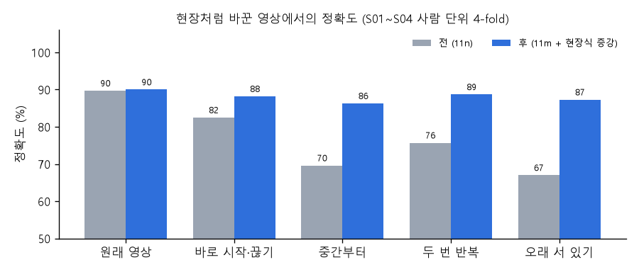
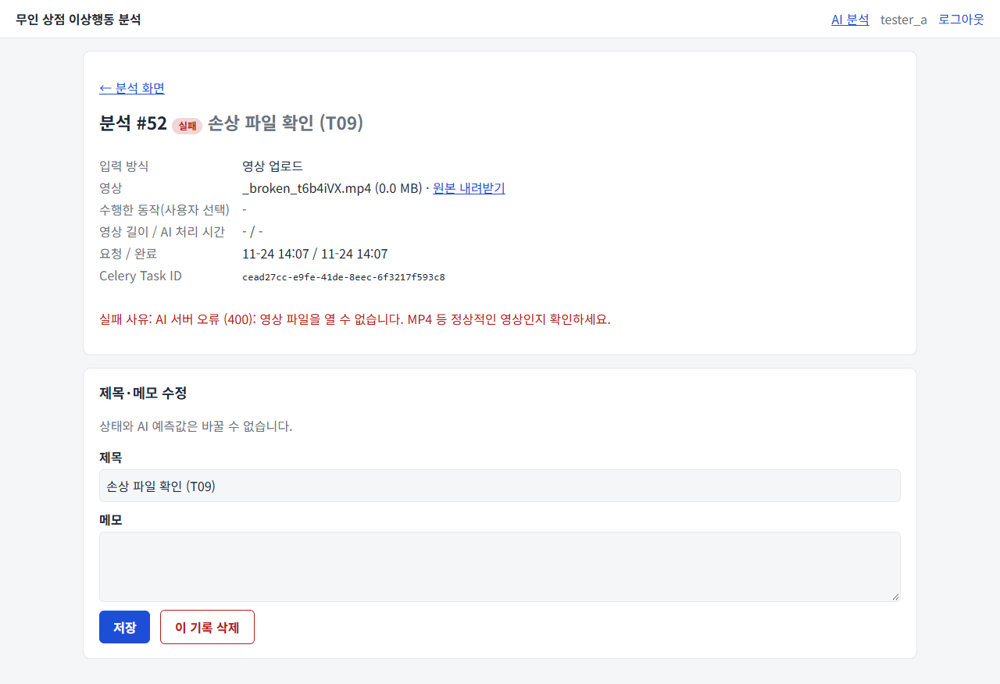
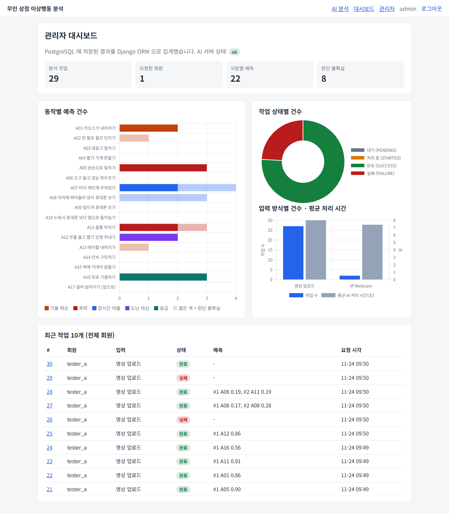

# 무인 상점 이상행동 감지 — store-anomaly-service

[](https://github.com/wlgptjd333/store-anomaly-service/actions/workflows/ci.yml)

무인 상점 카메라 영상에서 **사람마다 17가지 이상행동 중 무엇에 가까운지** 예측하고, 기록·통계로 남기는 웹 서비스입니다.
교과10(자세추정·동작인식) 최종 프로젝트이며, 개인 작업입니다. 학습 영상만 3팀 5명이 함께 촬영했습니다.
이 저장소 하나에 **모델 학습([`training/`](training/))과 웹 서비스**가 모두 들어 있습니다.


## 한눈에 보기



| 문서 | 내용 |
|---|---|
| [docs/PIPELINE.md](docs/PIPELINE.md) | 'AI 분석 시작' 버튼부터 저장까지 파일·함수 단위 흐름 |
| [docs/FEATURES.md](docs/FEATURES.md) | 실시간 보기·카메라 주소 관리·대시보드·녹화 꺼내기 — 기능별 설명과 이유 |
| [docs/TESTING.md](docs/TESTING.md) | 과제 테스트 T01~T10 전체, 만난 오류와 해결, 한계 |
| [training/README.md](training/README.md) | 데이터·학습: 촬영 정리 → Pose → 검수 → 학습·평가 |
| [training/docs/DESIGN_DECISIONS.md](training/docs/DESIGN_DECISIONS.md) | 왜 이렇게 만들었나 — 결정 21개, 대안·근거 숫자·한계 |

## 1. 프로젝트 소개

- 로그인한 사용자가 **영상 업로드** 또는 **IP Webcam**(휴대폰 카메라, 8초 수집)으로 분석을 요청합니다.
- 서버가 사람마다 관절을 추적해 **17개 동작 중 가장 가까운 것과 Confidence** 를 저장합니다. 30% 미만은 `판단 불확실`로 표시합니다.
- 분석은 Celery 가 뒤에서 처리합니다. 요청하자마자 작업 번호를 받고, 화면이 대기 → 처리 중 → 완료/실패를 따라갑니다.
- 관리자는 Django Admin 과 `/dashboard/`(Chart.js)에서 전체 기록·통계를 봅니다.
- 추가 기능: 결과 영상 재생(구간별 예측으로 이동) · **실시간 보기**(카메라 화면에 Skeleton + 예측) · 장면 저장·자동 감지 기록 · 웹에서 카메라 주소 관리 → [docs/FEATURES.md](docs/FEATURES.md)


| 분류 | 동작 |
|---|---|
| 기물 파손 | A001 키오스크 두드리기 · A002 한손 물건 던지기 · A003 앞차기 · A004 잡고 흔들기 · A013 샷건 |
| 폭력 | A005 밀치기 · A006 휘두르기 · A011 몸통 박치기 |
| 장시간 머묾 | A007 바닥에 앉기 · A008 위에 앉기 · A009 앞으로 눕기 · A010 뒤로 눕기 |
| 도난 의심 | A012 쪼그려 물건 빼내기 |
| 응급 | A014 구토 · A015 옆으로 쓰러지기 · A016 뒤로 넘어지기 · A017 앞으로 넘어지기 |

## 2. 실행 방법

필요한 것: Docker Desktop (Compose v2). NVIDIA GPU 가 있으면 AI 서버가 GPU 로 돕니다 (없어도 동작, 느림).

```bash
git clone https://github.com/wlgptjd333/store-anomaly-service.git
cd store-anomaly-service

cp .env.example .env          # DJANGO_SECRET_KEY · POSTGRES_PASSWORD 를 긴 무작위 문자열로
                              # IPWEBCAM_CAMERAS=phone=http://<휴대폰 IP>:8080/video
                              # GPU 가 없으면 COMPOSE_FILE 줄을 지움
docker compose up -d --build  # 서비스 5개. migrate 는 django 가 시작할 때 자동
docker compose exec django python manage.py createsuperuser
```

| 화면 | 주소 |
|---|---|
| 사용자 (회원가입·로그인 → AI 분석) | http://localhost:8000/ |
| 관리자 대시보드 (is_staff) | http://localhost:8000/dashboard/ |
| Django Admin | http://localhost:8000/admin/ |
| FastAPI 문서 (이 컴퓨터에서만) | http://localhost:8001/docs |

모델 파일은 `ai_service/models/` 에 들어 있습니다 (Pose 가중치 `yolo11m-pose.pt` 만 Docker 빌드 때 자동으로 받음).
로컬 확인 `bash scripts/check.sh` (린트·Django check·migration·단위 테스트 44개) — push 마다 GitHub CI 도 같은 확인을 돌립니다.

## 3. 전체 아키텍처



- PostgreSQL 은 **Django ORM 으로만** 씁니다. FastAPI 는 DB 를 모르고 영상을 받아 JSON 만 돌려줍니다.
- 공개 포트는 django `8000` 하나. fastapi `8001` 은 `127.0.0.1` 에만 열고, 브라우저는 로그인 확인을 거치는 Django 를 통해 실시간 화면을 받습니다.
- Django 와 Celery 는 같은 이미지(`backend/Dockerfile`)이고 명령만 다릅니다. 영상 파일은 DB 가 아니라 `media` 볼륨에 두고 둘이 함께 씁니다.

## 4. DB 설계 (ERD)



| 테이블 | 저장하는 것 |
|---|---|
| `AnalysisJob` | 분석 요청 1건 — 누가, 어떤 입력으로, 지금 상태, 실패 사유, 처리 시간 |
| `PersonPrediction` | 그 영상 속 사람 1명의 예측. 두 사람이면 작업 1건에 2행 |
| `Camera` | 허용한 IP Webcam. 작업에는 이름만 남겨 카메라를 지워도 지난 기록이 남음 |

모델은 모두 `backend/analyses/models.py`. 영상 파일은 DB 밖(Media)에 두고 경로만 저장합니다. 일반 사용자는 제목·메모만 고칠 수 있습니다.

## 5. AI 분석 버튼 구현 흐름



| 단계 | 파일 |
|---|---|
| 화면·상태 조회·결과 표 | `backend/templates/analyses/index.html`, `backend/static/js/analyses.js` |
| 요청 접수·권한·작업 등록 | `backend/analyses/views.py`, `serializers.py`, `jobs.py` |
| 백그라운드 처리 | `backend/analyses/tasks.py`, `camera_capture.py`, `services.py` |
| 추론 API | `ai_service/routers/predictions.py` → `services/pose_pipeline.py` → `action_inference.py` |

함수 단위 입력·출력과 실패 처리는 [docs/PIPELINE.md](docs/PIPELINE.md).

## 6. 사용한 모델과 입력 형식

분류 모델은 영상을 그대로 받지 못합니다. 숫자 2,560개를 받는 분류기라서, 영상에서 사람과 관절을 찾고 **학습 때와 같은 계산**으로 숫자를 만드는 단계가 앞에 있습니다.



| 항목 | 내용 |
|---|---|
| 모델 파일 | `ai_service/models/action_model.joblib` (ExtraTrees), `action_cnn.pt` (1D-CNN), `feature_columns.json`, `training_info.json` |
| Pose | `yolo11m-pose.pt`, imgsz 640, 사람 conf 0.25, 관절 conf 0.5 |
| 학습 데이터 | 5명 × 17동작 × 정면·측면·뒤 = 255개 + 다른 구도 5개, 좌우 반전 · **현장식 증강**(바로 시작·중간부터·반복·오래 서 있기) |
| 입력 영상 | mp4·mov·avi·mkv·webm, 100 MB 이하, 처음 60초까지 |
| IP Webcam | 관리자가 등록한 카메라만, 8초 수집 (또는 실시간 화면의 최근 8초 저장) |
| 응답 | `POST /predict/video` → `predictions: [{track_id, action_id, confidence, uncertain, top3, windows}]` |
| 속도 (RTX 3060) | 8초 영상 분석 약 4.3초 (Pose 가 4.1초), 실시간 보기 약 25fps. CPU 만 있으면 같은 이미지가 CPU 로 돌고 몇 배 느림 |

**정확도** — 고르는 기준은 사람 단위 4-fold(S01~S04), 다른 날 찍은 Test S05 는 고른 뒤 확인만 합니다.

| 서비스 모델 | 4-fold 원래 영상 | 4-fold 현장처럼 바꾼 영상 | Test S05 |
|---|---|---|---|
| 11/24 ExtraTrees + 1D-CNN (Pose 11n) | 89.7% | 73.7% | 88.2% |
| **11/25 + Pose 11m · 현장식 증강 (지금)** | **90.0%** | **87.6%** | **90.2%** |



학습 영상은 "서 있기 → 동작 한 번 → 서 있기"인데, 현장 영상은 바로 시작하거나 반복하거나 오래 서 있습니다.
평가 영상을 그렇게 바꿔 보니 예전 모델은 67~82% 로 떨어졌고, 학습에도 같은 변형을 무작위로 넣어 해결했습니다 → [결정 21번](training/docs/DESIGN_DECISIONS.md#21-pose-11m--현장식-증강--잘리고-반복된-현장-영상에-맞게-2026-11-25).

## 7. 실행 결과와 검증

**정상 분석** — 위 1번 화면. 본인(S04) `A010 뒤로 눕기` 영상 14.6초 → A010, 구간 3개를 누르면 그 장면으로 이동합니다.

**오류·실패** — 이름만 `.mp4` 인 손상 파일 → AI 서버 400, 작업은 `실패`와 사유로 저장됩니다.



**관리자 대시보드** — 기간·조건 거르기, KPI 8개, 동작별·상태별·날짜별 차트, 자주 헷갈린 동작, CSV 내려받기.



**Django Admin** — 상태·입력 방식 필터, 사람별 예측 Inline


| 테스트 | 결과 |
|---|---|
| T01 모델 불러오기 | `/health` — ExtraTrees + 1D-CNN · 17 Class · 2,560 Feature · ready |
| T02 영상 업로드 | `scripts/e2e_check.py`: PENDING → STARTED → SUCCESS, A005 밀치기 일치 |
| T03 IP Webcam | 휴대폰 640×480 연결 확인 · 8초 녹화 → 분석 SUCCESS · 허용 목록 밖 카메라 400 |
| T04 사람별 결과 | 2인 영상 → 작업 1건에 Track 1·2 각각 저장 |
| T05 비동기 | 업로드 0.02~0.5초에 202 + 작업 번호 |
| T06 영구 저장 | 새로고침·재조회해도 같은 결과 |
| T07 CRUD 권한 | 남의 작업 조회·수정·삭제 404, 제목·메모만 수정, 분석 중 삭제 409 |
| T08 관리자 | 관리자 `/dashboard/` 200 · 일반 회원은 로그인 화면으로 |
| T09 예외 처리 | 손상 파일 FAILURE + 사유 · `.txt` 400 · 카메라 꺼짐 FAILURE · 사람 없음 안내 |
| T10 Docker 재시작 | `down` → `up` 뒤 기록 그대로, 새 분석 SUCCESS |

확인 방법·숫자 전체와 추가 기능 시험은 [docs/TESTING.md](docs/TESTING.md).

## 8. 만난 오류와 해결

| 증상 | 확인한 곳 | 바꾼 것 | 확인 |
|---|---|---|---|
| 현장에서 찍은 밀치기를 '두드리기 19%'로 답함 | 학습 영상은 동작 한 번을 앞뒤로 서서 찍었는데 현장은 걸어 들어와 두 번 밂. 평가 영상을 현장처럼 잘라 보니 정확도 67~82% | 학습에 같은 변형을 무작위로 넣고 Pose 를 11m 으로, AI 서버를 GPU 로 | 현장처럼 바꾼 영상 73.7 → 87.6%, 그 밀치기 영상 6.5 → 37.7% (1위) |
| 학습을 안 돌리는데 실시간 보기가 14fps | 같은 코드를 스크립트로 돌리면 29fps → 서버에서만 느림 → 모델을 만든 요청 스레드가 살아 있으면 추론이 2배 느려짐 | 모델을 처리 스레드 안에서 불러오게 (`live_session.py`) | 14 → 30fps (11n CPU), 지금 11m GPU 약 25fps |
| 실시간 화면은 맞는데 저장 분석은 '눕기'로 나옴 | 저장된 영상을 열어 보니 휴대폰 세로 촬영이 90° 누워 있음 | 카메라마다 화면 회전 설정, 실시간 화면의 최근 8초를 그대로 저장 | 같은 영상을 돌려 다시 분석하니 눕기 예측이 사라짐 |

나머지 오류 기록은 [docs/TESTING.md](docs/TESTING.md#만난-오류와-해결).

## 9. 폴더 구조

```text
store-anomaly-service/
├── compose.yaml · compose.gpu.yaml   서비스 5개 · AI 서버 GPU 설정
├── backend/      Django + DRF + Celery (accounts · analyses · templates · static)
├── ai_service/   FastAPI — routers · services (Pose·Feature·예측·실시간 보기) · models
├── training/     데이터·학습 — scripts 01~27 · src (Feature 코드, 서비스도 같이 씀) · configs · docs
├── scripts/      check.sh · e2e_check.py · update_model.sh · capture_screens.py
└── docs/         PIPELINE · FEATURES · TESTING · images
```

## 한계

- 학습 데이터가 5명·한 장소입니다. 다른 사람·장소·카메라 높이에서는 떨어질 수 있어, 현장 영상은 **평가 먼저 → 그다음 학습**에 더합니다.
- 17개 중 하나를 꼭 고르는 구조라 "정상 행동"은 따로 판정하지 못합니다 (`판단 불확실` 30% 로 보완).
- GPU 가 없으면 Pose 11m 이 CPU 로 돌아 분석이 몇 배 느리고 실시간 보기는 몇 fps 에 그칩니다.
