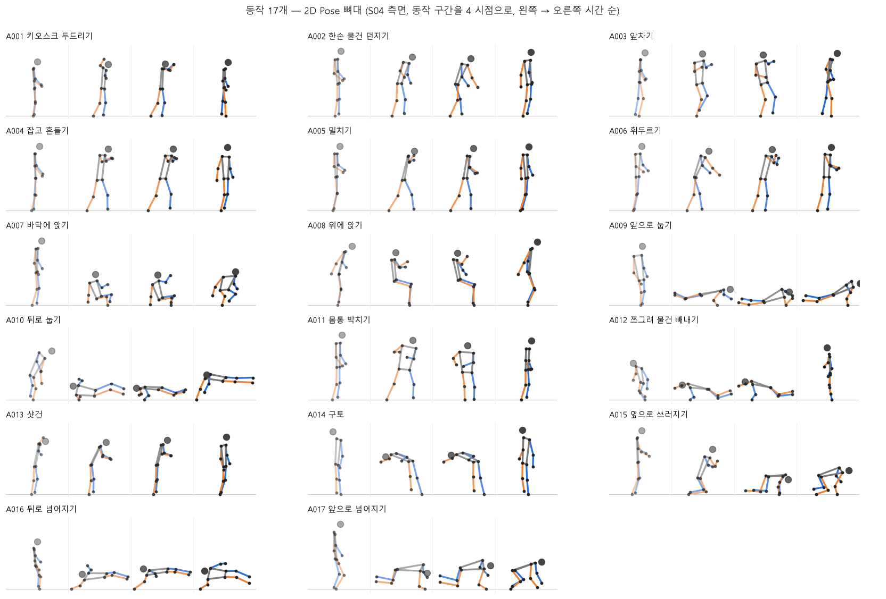

# Unmanned Store Anomaly — 무인 상점 이상행동 인식

무인 아이스크림 할인점 CCTV 를 가정하고, 사람의 **2D 자세(Pose)** 로 매장 안 이상행동을 찾는 팀 프로젝트입니다.
Vision AI 과정 3팀 프로젝트 (2D 자세추정 수업에서 시작).

- 입력: 핸드폰으로 찍은 RGB 영상 (정면·측면)
- 방법: YOLO Pose → COCO 17 Keypoint → 정규화 Feature → Frame 을 시간 순서로 묶은 Sequence
- 목표: 기물 파손·폭력·배회·절도 의심·응급(쓰러짐) 동작을 Sequence 로 구분

왜 이렇게 만들었는지(원본을 그대로 둔 이유, YOLO 를 고른 이유, 정규화·라벨·구간·개인정보 결정)는 [기술 결정 기록](docs/DESIGN_DECISIONS.md)에 숫자와 함께 적었습니다.

## 동작 17개

| ID | 동작 | 분류 |
|---|---|---|
| A01 | 키오스크 내려치기 | 기물 파손 |
| A02 | 한 팔로 물건 던지기 | 기물 파손 |
| A03 | 냉동고 앞차기 | 기물 파손 |
| A04 | 뽑기 기계 흔들기 | 기물 파손 |
| A05 | 양손으로 밀치기 | 폭력 |
| A06 | 도구 들고 양손 휘두르기 | 폭력 |
| A07 | 바닥 매트에 주저앉기 | 배회 |
| A08 | 의자에 뛰어올라 앉아 휴대폰 보기 | 배회 |
| A09 | 엎드려 휴대폰 보기 | 배회 |
| A10 | 누워서 휴대폰 보다 옆으로 돌아눕기 | 배회 |
| A11 | 몸통 박치기 | 폭력 |
| A12 | 무릎 꿇고 뽑기 인형 꺼내기 | 절도 의심 |
| A13 | 테이블 내려치기 | 기물 파손 |
| A14 | 연속 구토하기 | 응급 |
| A15 | 벽에 기대어 잠들기 | 응급 |
| A16 | 뒤로 기절하기 | 응급 |
| A17 | 걸려 넘어지기 (앞으로) | 응급 |



얼굴이 나오지 않게 원본 영상 없이 관절 뼈대만 그렸습니다 (`scripts/08_draw_skeleton_figure.py`).

정의 원본: [`configs/action_classes.csv`](configs/action_classes.csv)

라벨 검수에서 이름과 실제 촬영 모습이 다른 동작은 `filmed_as` 열에 적었습니다.

| ID | 실제 촬영 모습 |
|---|---|
| A08 | 의자 대신 책상 모서리에 올라가 걸터앉음 (뛰어오르지 않음) |
| A15 | 벽에 잠깐 기댔다가 바닥에 무릎 꿇고 손 짚어 엎드려 웅크림 |
| A16 | 쪼그려 앉았다가 천천히 뒤로 누움 (실제 기절보다 느림) |

## 데이터

- 영상 170개 = 동작 17개 × 참가자 5명 × 정면·측면, 약 60fps, 총 19.5분 (70,159 Frame)
  - S01~S04 는 2026-11-13 함께 촬영, S05 는 2026-11-16 따로 촬영 (A01 → A17 순서로 정면·측면)
- 이름 규칙: `T03_S{참가자}_A{동작}_T{테이크}_{F|S}` (예: `T03_S01_A07_T01_F` = 참가자 1, 바닥에 앉기, 정면)
- 목록: [`configs/clip_manifest.csv`](configs/clip_manifest.csv), 영상 상태: [`reports/tables/video_inventory.csv`](reports/tables/video_inventory.csv)
- **촬영 원본·실명 대응표는 올리지 않습니다** (얼굴·이름이 나옴). 참가자는 가명 S01~S05 로만 씁니다.

## Pipeline

```text
핸드폰 영상 (정면·측면)
   ↓ 01 Manifest: 촬영 시각으로 동작·참가자·방향 정하기 → clip_id
   ↓ 02 영상 검사: 열림·FPS·길이·끝까지 디코딩
   ↓ 03 Frame 마다 YOLO Pose
        → 38-D (어깨 폭 정규화 좌표 34 + 관절각도 4, 수업 형식)
        → 몸 크기 정규화 좌표 34 (측면·누운 자세에서도 안 튐)
        → 3팀 Feature: 상체 기울기·몸 상자 비율·골반 화면 위치·몸통 길이
        → 원본 Keypoint 17 × (x, y, conf)와 품질 정보
   ↓ 04 라벨 검수 그림: 동작마다 8개 영상 × 6개 시점, 사람 수 자동 경고
   ↓ 05 영상별 QA 요약 → PASS / REVIEW
Sequence CSV (clip 하나 = 파일 하나, 159열)
```

| 파일 | 하는 일 |
|---|---|
| `scripts/01_build_manifest.py` | 팀 드라이브 영상 → clip_id·Manifest (`--copy` 로 영상 복사) |
| `scripts/02_check_videos.py` | 모든 MP4 디코딩 검사 → `reports/tables/video_inventory.csv` |
| `scripts/03_build_sequences.py` | Frame별 Feature → `reports/sequences/<clip_id>_sequence.csv` (`--clip`, `--all`, `--save-video`) |
| `scripts/04_make_review_sheets.py` | 라벨 검수 그림 → `reports/review/`, 점검표 → `reports/tables/review_checklist.csv` |
| `scripts/05_summarize_sequences.py` | 영상별 QA → `reports/tables/sequence_qa.csv` |
| `scripts/06_estimate_segments.py` | 동작 시작·끝 자동 추정 → `reports/tables/segments_auto.csv` (누움·앉음 동작은 일어나기 직전까지, `--sheets` 로 확인 그림) |
| `scripts/08_draw_skeleton_figure.py` | 동작별 뼈대 그림 (영상·얼굴 없이) → `docs/images/actions_skeleton.png` |
| `scripts/video_hub.py` | 같은 와이파이에서 팀원 핸드폰 영상을 모으는 업로드 서버 (표준 라이브러리만) |
| `src/feature_utils.py` | 관절각도, 어깨 폭 정규화 (교과10 수업 코드) |
| `src/team_feature_utils.py` | 3팀 Feature, 몸 크기 정규화 |

## 지금까지 결과

- 170개 영상 모두 디코딩 정상, Pose 성공률 평균 99.9% (최저 88.7%)
- 자동 QA: **PASS 141 · REVIEW 29** (화면 끝 닿음 10, 손목 가림 10, 다른 사람 잡힘 6, 사람 놓침 2, 하체 가림 1 — 겹침 포함).
  다시 찍기·제외는 사람이 영상을 보고 정함
- 측면 영상은 어깨 폭이 0 에 가까워져 수업 방식(어깨 폭 정규화) 값이 튐
  → 어깨 폭과 몸통 길이 중 큰 쪽으로 나누는 **몸 크기 정규화**를 더함
  (값이 어깨 폭 5배 넘게 튀는 측면 Frame: 54.6% → 0.01% 미만)
- 라벨 검수 (2026-11-17, S05 는 11-18): 동작별 그림 17장으로 170개 모두 확인 → **라벨 오류 0, 170개 OK**
  - S05 의 A15 는 엎드리지 않고 벽 옆에 주저앉음 (같은 동작의 다른 모습으로 그대로 사용)
  - 자동 경고 3개는 모두 YOLO 검출 문제 (누운 자세 미검출 1, 1명을 2명으로 검출 2)
  - S01 은 A11·A12·A13·A17 에서 겉옷을 벗었을 뿐 같은 사람
  - S02 의 A13(테이블 내려치기)은 동작이 약하지만 "약한 예시"로 그대로 사용

## 실행

```bash
git clone https://github.com/wlgptjd333/unmanned-store-anomaly.git
cd unmanned-store-anomaly
uv sync
source .venv/bin/activate

# 영상은 data/rgb/videos/<clip_id>.mp4 에 둡니다 (팀 드라이브에서 받기)
python scripts/02_check_videos.py
python scripts/03_build_sequences.py --clip T03_S04_A01_T01_F --save-video
python scripts/03_build_sequences.py --all
python scripts/05_summarize_sequences.py
python scripts/04_make_review_sheets.py
```

`yolo11n-pose.pt` 는 첫 실행 때 Ultralytics 가 자동으로 받습니다.

## 다음 할 일

- [x] 라벨 사람 검수 (`review_checklist.csv` 의 `review_result`)
- [x] 동작 시작·끝 구간 자동 추정 (`segments_auto.csv`) — 사람 확인 남음
- [ ] Sequence 를 고정 길이로 맞추고 동작 분류 모델 학습

## 출처

교과10 수업 저장소 [`vision-ai-lab/subject10_pose_action`](https://github.com/wlgptjd333/vision-ai-lab/tree/main/subject10_pose_action) 에서 시작했고,
3팀 코드는 2026-11-17 이 저장소로 옮겼습니다. 이전 기록은 그쪽 커밋 `1f2afa1`, `3232372` 에 있습니다.
