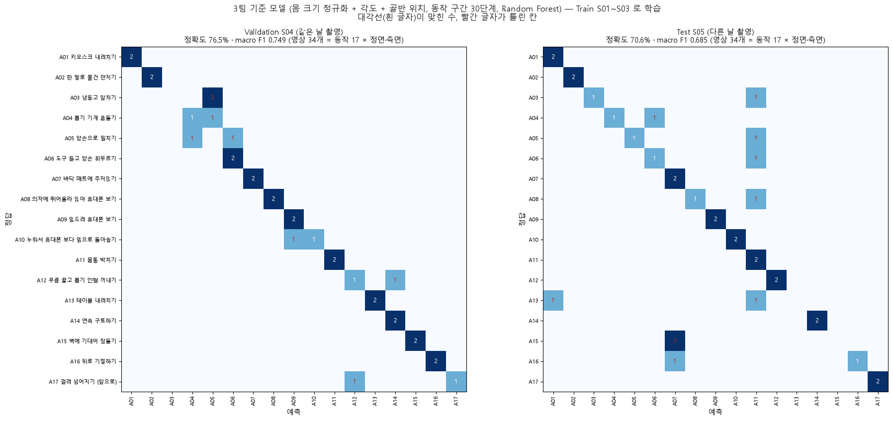
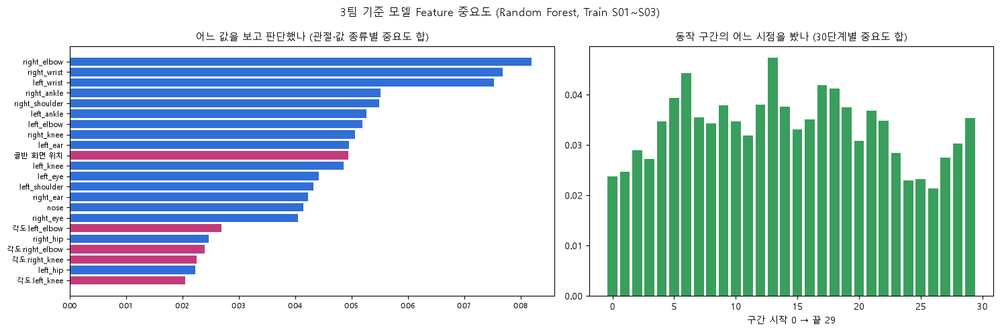

# 동작 분류 Baseline 성능평가 — 수업 6일차 방식 vs 3팀 방식

수업 6일차에서 만드는 것:

- 영상 길이를 30단계로 맞춘 **고정 길이 Sequence**
- **Random Forest** Baseline
- **사람 단위**로 Accuracy와 Macro F1 평가
- 오류 분석: 혼동 행렬, 틀린 영상 추적, Static vs Sequence, 각도 유무 비교

3팀 데이터에 같은 과정을 적용했습니다. 수업 방식 그대로와 3팀이 바꾼 부분을 같은 조건에서 **한 번에 하나씩만 바꿔** 비교했습니다.

**결론부터:**

| 모델 | Validation S04 (같은 날) | **Test S05 (다른 날)** |
|---|---:|---:|
| 수업 그대로 (어깨 폭 38-D, 영상 전체) | 67.6% | **55.9%** |
| **3팀 기준 모델** (몸 크기 정규화 + 각도 + 골반 화면 위치, 동작 구간) | 76.5% | **70.6%** |

동작은 17가지라 우연히 맞힐 확률은 5.9%입니다.

- 가장 큰 차이를 만든 것은 두 가지입니다.
  - **"한 장면이 아니라 시간 흐름을 본다"**: Sequence가 Static보다 +17%p 높습니다.
  - **"몸 크기로 정규화한다"**: 수업 방식보다 4-fold에서 +7%p, Test에서 +15%p 높습니다.
- 각도·골반 위치·동작 구간 자르기는 이 모델에서 **차이가 우연 변동보다 작았습니다.** 효과가 있다고 쓰지 않습니다.

> 재현:
> ```bash
> python scripts/13_build_sequence_dataset.py   # 고정 길이 Dataset (약 30초)
> python scripts/14_train_baseline.py           # 실험 9개 + 마지막 Test (약 2분)
> ```
> 기준값은 [`configs/baseline_config.json`](../configs/baseline_config.json) 한 파일에 있습니다.
> 결과 표는 `reports/tables/baseline_*.csv` 입니다.

## 1. 평가 규칙 — 무엇으로 고르고, 언제 Test 를 보나

| 세트 | 사람 | 영상 | 용도 |
|---|---|---:|---|
| Train | S01, S02, S03 | 102 | 학습 |
| Validation | S04 | 34 | 실험끼리 비교 |
| Test | S05 (11/16 다른 날 따로 촬영) | 34 | **마지막에 한 번만** |

- **고르는 데는 두 가지만 씁니다.** Validation(S04), 그리고 S01~S04 안에서 한 사람씩 빼는 4-fold입니다.
  - Validation이 한 사람뿐이라 운이 섞이므로 4-fold 평균·편차를 같이 봅니다.
  - S05는 이 단계에 넣지 않았습니다.
- **모델 설정은 고정했습니다.** Random Forest 300그루, depth 제한 없음, `class_weight="balanced"`, `random_state=42`로 수업 기준값과 같습니다.
  - 실험마다 바꾸는 것은 Feature·창·Static 여부 중 하나뿐입니다.
- **Random Forest 자체의 우연 변동도 쟀습니다.** 같은 실험을 난수 5개로 다시 학습했더니 Validation 정확도가 **±0~4%p** 흔들렸습니다.
  - 이보다 작은 차이는 "효과 없음"으로 봅니다.
- **정직하게 밝혀 둘 점:** [정규화 비교](NORMALIZATION_ANALYSIS.md)에서는 S05까지 포함한 5-fold를 봤습니다.
  - 그래서 "몸 크기 정규화를 쓴다"는 결정에는 S05 결과가 일부 반영되어 있습니다.
  - 모델 설정과 Feature 조합은 S05를 보지 않고 정했습니다.

## 2. 고정 길이 Sequence 만들기

영상마다 길이가 다릅니다. 동작 구간 기준으로 유효 Frame이 60~1,192개입니다 (1초 ~ 20초). 모델은 같은 길이의 입력을 받아야 합니다.

| 방법 | 문제 |
|---|---|
| 앞 30 Frame 만 자르기 | 60fps 에서 0.5초 — 동작 시작만 보고 끝은 못 봄 |
| 0 으로 채워 가장 긴 길이에 맞추기 | 짧은 영상은 대부분이 빈 값, Random Forest 는 위치마다 다른 Feature 로 봄 |
| **구간 전체를 시간 0~1 로 펴서 30단계로 보간 (수업 방식)** | 빠르게 한 사람·느리게 한 사람이 같은 "동작 진행률"끼리 비교됨 |

- **수업 방식(np.interp 선형 보간)을 그대로 썼습니다.** Frame 하나당 74개 값을 30단계로 저장한 뒤 14번에서 조합을 골라 씁니다.
  - 수업 38-D(어깨 폭 정규화 34 + 각도 4): 30 × 38 = **1,140개**
  - 3팀 body40(몸 크기 정규화 34 + 각도 4 + 골반 화면 위치 2): 30 × 40 = **1,200개**
- **입력 점검 결과:** 170개 모두 OK입니다 (`reports/tables/sequence_dataset_check.csv`).
  - 동작 구간 안 유효 Frame은 최소 60, 중앙값 219입니다.
  - 유효 비율은 최소 83.4%입니다.
  - 기준은 10 Frame 이상, 50% 이상입니다.
- 유효 Frame은 Pose·Feature·몸 크기 Feature가 모두 정상이고 값이 숫자인 Frame만 씁니다. 빠진 Frame은 앞뒤 시간으로 보간합니다.

## 3. 실험 결과 — 한 번에 하나씩 바꾸기

| 실험 | 기준과 다른 점 | Feature 수 | Validation S04 | 난수 5개 평균 | S01~S04 4-fold |
|---|---|---:|---:|---:|---:|
| 수업 그대로 | 어깨 폭 38-D, 영상 전체 | 1,140 | 67.6% | 67.6 ± 0.0 | 69.1 ± 4.9 |
| 수업 + 동작 구간 | 어깨 폭 38-D | 1,140 | 64.7% | 68.8 ± 1.4 | 66.9 ± 2.4 |
| 수업, 각도 제외 | 어깨 폭 34 | 1,020 | 73.5% | 70.6 ± 2.6 | 68.4 ± 3.8 |
| 수업, Static | 가운데 Frame 1개 | 38 | 52.9% | 59.4 ± 3.9 | **57.4 ± 4.9** |
| **3팀 기준** | — | 1,200 | **76.5%** | **79.4 ± 0.0** | **74.3 ± 3.8** |
| 3팀, 영상 전체 | 창만 바꿈 | 1,200 | 73.5% | 77.6 ± 2.4 | 77.2 ± 7.6 |
| 3팀, Static | 가운데 Frame 1개 | 40 | 58.8% | 55.3 ± 2.2 | **57.4 ± 4.4** |
| 3팀, 골반 위치 제외 | body38 | 1,140 | 79.4% | 74.7 ± 3.5 | 72.8 ± 6.7 |
| 3팀, 각도 제외 | body36 | 1,080 | 76.5% | 79.4 ± 2.6 | 75.0 ± 4.9 |

전체 값과 사람별 fold 결과는 `reports/tables/baseline_experiments.csv`에 있습니다.

### 읽는 법

1. **Sequence 대 Static: 효과가 분명합니다 (+17%p).**
   - 가운데 Frame 하나만 보면 4-fold가 57%이고, 30단계를 보면 74%입니다. 수업 38-D와 3팀 Feature 모두 같은 방향입니다.
   - 내려치기(A01)와 흔들기(A04)는 한 장면만 보면 "팔을 든 서 있는 사람"으로 같습니다. 팔이 **어떻게 움직였나**를 봐야 구분됩니다.
2. **몸 크기 정규화 대 수업 어깨 폭: 효과가 분명합니다.**
   - 같은 동작 구간·같은 모델에서 4-fold 66.9%와 74.3%, 난수 5개 평균 68.8%와 79.4%입니다.
   - 측면 영상에서 어깨 폭이 0에 가까워져 값이 튀는 문제([결정 4번](DESIGN_DECISIONS.md#4-수업-방식어깨-폭-정규화에-몸-크기-정규화를-더함))가 그대로 정확도 차이로 나타납니다.
3. **각도 4개: 이 모델에서는 효과가 없습니다.**
   - 3팀은 75.0%(각도 없음)와 74.3%(있음), 수업은 68.4%(없음)와 66.9%(있음)로 차이가 우연 변동 안입니다.
   - 각도는 관절 좌표로 계산되는 값이라, 좌표 1,000여 개를 이미 보는 Random Forest에는 새 정보가 거의 없습니다.
   - 수업의 질문 "Joint Angle 이 실제로 도움이 되나?"에 대한 3팀 데이터의 답은 **"이 조건에서는 아니다"** 입니다.
   - 그래도 기준 모델에는 남겨 둡니다. 계산이 싸고 사람이 읽을 수 있는 값이며, 시간 순서 모델(1D-CNN 또는 GRU)에서 다시 확인하려는 것입니다.
4. **골반 화면 위치 2개: 차이가 우연 변동 안입니다.**
   - 72.8%와 74.3%로, [정규화 비교](NORMALIZATION_ANALYSIS.md)에서 본 +1.8%p와 방향은 같지만 크기가 작아 단정하지 않습니다.
5. **동작 구간 대 영상 전체: 정확도로는 차이가 없습니다.**
   - 4-fold는 74.3±3.8과 77.2±7.6으로, 영상 전체가 평균은 높지만 편차가 두 배입니다. Validation은 동작 구간이 높습니다.
   - 촬영 영상은 "서 있기 → 동작 → 서 있기"로 모두 같은 모양이라 앞뒤 서 있는 부분이 방해가 되지 않았습니다.
   - **그래도 동작 구간을 기준으로 둡니다.** 실제 매장 카메라에는 "영상 한 개"라는 경계가 없습니다.
     - 모델은 Sliding Window로 잘린 몇 초를 보게 됩니다.
     - 그러니 "동작이 담긴 부분"으로 배운 모델이 실제 사용과 더 가깝습니다.
     - 정확도로 증명한 결정이 아니라 사용 환경에 맞춘 결정입니다.

## 4. 기준 모델 — 동작별 결과와 혼동 행렬



| | Validation S04 | Test S05 |
|---|---:|---:|
| 정확도 / macro F1 | 76.5% / 0.749 | 70.6% / 0.685 |
| 정면 / 측면 정확도 | 82.4% / 70.6% | 76.5% / 64.7% |
| 맞힌 영상의 평균 확신도 | 0.386 | 0.357 |
| 틀린 영상의 평균 확신도 | 0.257 | 0.212 |

동작별 Precision·Recall·F1은 `reports/tables/baseline_per_action.csv`, 영상별 예측과 2순위는 `baseline_predictions.csv`에 있습니다.

### 틀린 영상 추적 (Validation 8개, Test 10개 — `reports/tables/baseline_wrong_clips.csv`)

| 묶음 | 영상 | 원인 추정 |
|---|---|---|
| **서서 팔·다리를 앞으로 뻗는 동작끼리** | Validation 5개 (A03 앞차기 → A05 밀치기 ×2, A04 흔들기 ↔ A05 밀치기, A05 → A06 휘두르기), Test 1개 (A04 → A06) | 모두 "서서 기물 쪽으로 힘을 쓰는" 동작이라 자세 범위가 겹침. 차이는 힘을 주는 리듬(흔들기는 반복, 밀치기는 한 번)인데 30단계 좌표를 따로따로 보는 Random Forest 는 리듬을 직접 보지 못함 |
| **다른 날 촬영 S05 의 측면 → A11 몸통 박치기** | Test 5개 (A03·A05·A06·A08·A13) | 틀린 Test 10개 중 5개가 A11 로 쏠림, 그중 4개가 측면. S05 측면 영상의 카메라 거리·각도가 S01~S04 와 달라, 몸이 앞으로 쏠린 듯한 모양이 박치기와 비슷하게 잡힌 것으로 봄 → 카메라 차이에 대한 약점 |
| **촬영 방식이 다름 (라벨 검수 때 이미 기록)** | Test A15 ×2 → A07 주저앉기 | S05 는 A15(벽에 기대 잠들기)를 엎드리지 않고 벽 옆에 **주저앉아** 연기함 ([README 라벨 검수](../README.md#지금까지-결과)). 모델은 보이는 대로 "주저앉기"라고 답한 것 — 모델보다 데이터 쪽 문제 |
| **동작 앞부분이 같음** | Test A16 뒤로 기절 → A07 주저앉기 | A16 은 "쪼그려 앉았다가 뒤로 눕기"로 찍힘 (`filmed_as`). 앞 절반이 주저앉기와 같음 |
| **같은 팔 동작, 대상 높이만 다름** | Test A13 테이블 내려치기 → A01 키오스크 내려치기 | 팔 움직임은 같고 내려치는 높이만 다름. 몸 기준 좌표로는 높이 차이가 작음 |
| 기타 | Validation A10 → A09, A12 → A14, A17 → A12 | 바닥 자세끼리 (돌아눕기·엎드리기, 무릎 꿇기·구토 자세·넘어진 뒤) |

### 확신도로 "사람 확인" 범위를 줄일 수 있나

틀린 영상은 확신도가 낮습니다. Validation에서 맞힌 영상은 평균 0.39, 틀린 영상은 0.26입니다.
그래서 **Validation으로 기준을 정하고** Test에 그대로 적용해 봤습니다.

| 확신도 ≥ 0.30 일 때만 자동 판정 | 자동으로 판정한 비율 | 그 안의 정확도 |
|---|---:|---:|
| Validation S04 (기준을 정한 곳) | 65% | 90.9% |
| Test S05 | 44% | 100% (15개) |

- 이 프로젝트의 목표는 "이상행동 **후보**를 사람에게 보여주기"입니다.
- 그래서 확신이 높은 것만 바로 알리고 나머지는 사람이 확인하는 운영이 정확도 한 숫자보다 현실적입니다.
- 다만 Test 15개는 표본이 작습니다. 100%는 "이 정도면 쓸 만하다"는 신호일 뿐, 보장이 아닙니다.

### 모델이 무엇을 보고 판단했나



- **손목·팔꿈치가 가장 중요합니다.** 17개 중 7개가 팔이 핵심인 동작입니다(내려치기 2개, 던지기, 흔들기, 밀치기, 휘두르기, 인형 꺼내기). 서로 구분하려면 손이 어디로 움직였는지를 봐야 하니 자연스러운 결과입니다.
- 골반 좌표(left_hip, right_hip)가 거의 0인 것은 정상입니다. 골반 중심을 원점으로 정규화했기 때문에 골반 값은 거의 변하지 않습니다.
- 시간대별로는 구간 처음·끝(서 있는 자세)보다 **가운데 부분(5~22단계)** 이 중요합니다. 동작 구간 추정(06번)이 동작의 핵심을 잘 담았다는 간접 근거입니다.

## 5. 마지막 Test (S05) — 한 번만 본 결과

| 모델 | Train S01~S03 으로 학습 | Train + Validation S01~S04 로 다시 학습 |
|---|---:|---:|
| 수업 그대로 | 55.9% | 58.8% |
| **3팀 기준** | **70.6%** | 64.7% |

- **Validation과 Test의 차이: 3팀은 76.5%에서 70.6%, 수업 방식은 67.6%에서 55.9%입니다.**
  - S05는 다른 날, 다른 카메라 위치에서 혼자 찍었습니다. 매장마다 카메라가 다른 실제 상황에 가장 가깝습니다.
  - 3팀 방식은 6%p 떨어졌고, 수업 방식은 12%p 떨어졌습니다. 몸 기준 정규화가 카메라 변화에 덜 흔들립니다.
- **S01~S04로 다시 학습했더니 오히려 낮아졌습니다 (70.6%에서 64.7%).**
  - Test가 34개라 영상 1개가 2.9%p이고, 이 차이는 2개입니다.
  - 데이터를 늘렸는데 낮아진 것은 S04 추가가 해롭다기보다 **이 정도 크기에서는 숫자가 이만큼 흔들린다**는 뜻으로 읽습니다.
  - 그래서 결과를 한 숫자로 말하지 않고 4-fold 편차와 난수 변동을 함께 적습니다.
- **정확도 70%는 매장 성능이 아닙니다.** 5명이 같은 연기를 한 데이터입니다. 실제 매장의 평범한 행동(물건 고르기, 계산하기)을 섞으면 오탐이 생깁니다.
  - 지금 결과는 "17가지 이상행동끼리 구분"까지입니다.
  - "정상과 이상 구분"은 정상 행동 데이터를 모은 뒤 따로 평가해야 합니다.

## 6. 다음 단계와 기대

| 문제 | 다음에 해 볼 것 | 비교 방법 |
|---|---|---|
| 서서 하는 팔 동작끼리 혼동 (리듬 차이) | 시간 순서를 보는 1D-CNN 또는 GRU (Body Hero 에서 Conv1D 경험) | 같은 Split · 같은 Dataset 으로 이 문서의 3팀 기준 모델과 비교 |
| 다른 카메라(S05 측면)에서 약함 | VICON 3D 동작을 여러 각도로 2D 투영해 학습 데이터 늘리기 | "실제 영상만" vs "3D 합성 추가"를 S05 Test 로 |
| 작은 데이터에서 숫자가 흔들림 | 4-fold + 난수 변동을 계속 같이 보고, 차이가 변동보다 클 때만 "효과 있음" | — |
| 정상 행동 없음 | 정상 행동(물건 고르기·계산) 영상 추가 후 이상 / 정상 2단계 평가 | — |

## 한계

- 사람이 5명이고 Test는 34개라, 영상 1개가 정확도 2.9%p입니다. 비교 결과는 방향만 믿고 숫자는 넉넉하게 봐야 합니다.
- 동작 구간은 자동 추정입니다(06번). 사람 확인은 아직 남았습니다. 누워 있는 동작의 끝은 사람이 고치면 달라질 수 있습니다.
- Random Forest와 30단계 평탄화(Flatten)는 "몇 번째 단계에 어느 관절이 어디 있나"를 따로 봅니다. 동작이 조금 빠르거나 느리게 어긋나면 약합니다.
