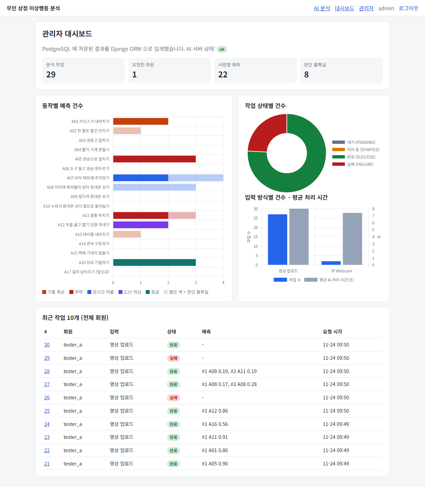
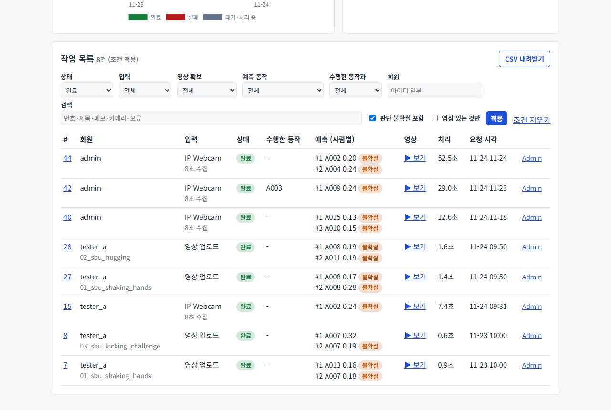
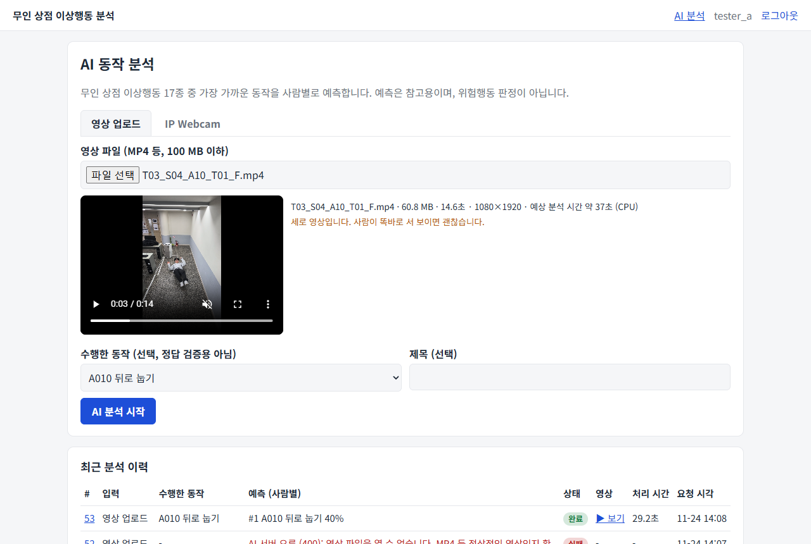
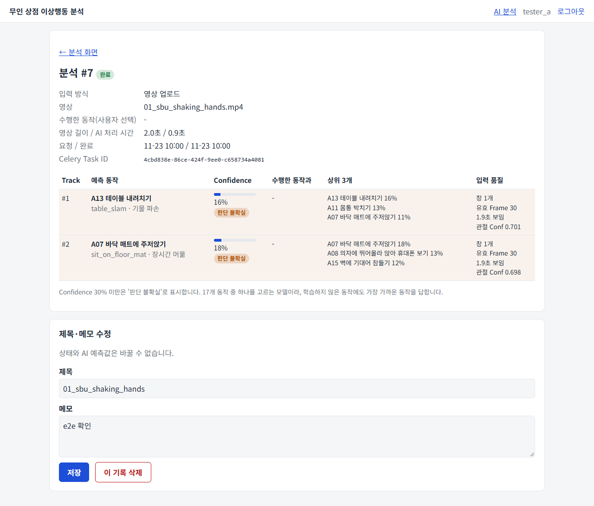

# 기능 설명 — 무엇을, 왜

README 에는 과제 순서(소개 → 실행 → 아키텍처 → ERD → 버튼 흐름 → 모델 → 결과)만 짧게 두고, 기능별 자세한 설명과 그렇게 만든 이유는 여기에 모았습니다.

## 1. 화면 기능 한눈에

- **영상 확인**: 올리기 전에 미리보기(길이·해상도·예상 분석 시간)를 보고, 결과 화면에서는 분석한 영상(IP Webcam 녹화본 포함)을 바로 재생합니다.
  **구간별 예측** 버튼을 누르면 그 시점으로 이동하고, 재생 중인 구간이 진하게 표시돼 "어느 장면에서 무엇으로 봤는지"를 확인할 수 있습니다.
- **대시보드 편의 기능**: 기간(오늘·7일·30일), 상태·입력·예측 동작·일치 여부·회원·검색 조건, 20건씩 쪽 나누기, 조건 그대로 **CSV 내려받기**,
  날짜별 작업 수, 자주 헷갈린 동작, 차트 막대를 누르면 목록 거르기, 30초 자동 새로고침. 목록에서 다른 회원 기록도 **읽기 전용**으로 열어 영상까지 봅니다.
- **실시간 보기**: IP Webcam 탭에서 카메라 화면에 사람별 **Skeleton** 과 최근 8초 기준 예측을 겹쳐 계속 보여 줍니다 (1초마다 갱신).
  **이 장면 저장**을 누르면 화면에 보이던 최근 8초를 그대로 기록하고, **자동 감지 기록**을 켜면 같은 동작이 3초 넘게 기준 이상으로 이어질 때 자동으로 저장합니다.
- 휴대폰 IP 가 바뀌면 관리자가 같은 탭의 **카메라 주소 관리**에서 바로 고치고 연결을 확인합니다 (재시작 불필요, 내부망 주소만 허용).

## 2. 아키텍처 보충

점선 아래 세 줄은 **실시간 보기**(저장 안 함)입니다. 카메라 주소는 Django 가 DB 카메라 표에서 꺼내 FastAPI 에 넘기고,
브라우저는 FastAPI 에 직접 닿지 않고(127.0.0.1 전용) 로그인 확인을 거치는 Django 를 통해 화면을 받습니다.

- **PostgreSQL 은 Django ORM 으로만** 씁니다. FastAPI 는 DB 를 모르고, 영상을 받아 JSON 만 돌려줍니다.
- 컨테이너끼리는 `localhost` 가 아니라 서비스 이름(`postgres`, `redis`, `fastapi`)으로 부릅니다.
- 공개 포트는 django `8000` 하나. fastapi `8001` 은 개발 확인용으로 `127.0.0.1` 에만 엽니다.
- Django 와 Celery 는 같은 이미지(`backend/Dockerfile`)를 쓰고 실행 명령만 다릅니다. 업로드 영상은 `media` 볼륨을 함께 씁니다.
- 영상은 `/media/` 로 그대로 열지 않고 `/analyses/{id}/video/` 가 매번 권한(본인·관리자)을 확인한 뒤 보냅니다. 영상 중간으로 건너뛸 수 있게 HTTP Range(206)를 직접 처리합니다 (`playback.py`).

- 영상 파일은 DB 에 넣지 않고 Media 폴더에 두며 경로만 저장합니다. 기록을 지우면 사람별 예측(CASCADE)과 영상 파일도 함께 지웁니다.
- 일반 사용자는 **제목·메모만** 고칠 수 있습니다. 상태·예측값을 사용자가 바꾸면 기록과 통계를 믿을 수 없게 되기 때문입니다.

## 3. IP Webcam — 영상을 확보하는 세 가지 방법

관리자가 등록한 카메라만 이름으로 고릅니다. 영상을 확보하는 방법은 세 가지이고, 모두 같은 Celery → `/predict/video` 를 탑니다 (`AnalysisJob.source`).

  | 방법 | 영상 | 언제 쓰나 |
  |---|---|---|
  | 8초 수집 ('AI 분석 시작') | Worker 가 작업을 꺼낸 순간부터 8초 녹화 | 과제 기본 흐름. 화면이 **'지금 녹화 중'** 으로 바뀐 뒤 동작 |
  | 실시간 장면 저장 ('이 장면 저장') | 실시간 보기가 들고 있던 **최근 8초** 그대로 | 실시간 화면으로 자세를 확인하면서 기록할 때 (추천) |
  | 자동 감지 | 위와 같은 8초, 조건이 맞으면 자동 저장 | 무인 매장처럼 사람이 버튼을 누르지 않는 상황 흉내 |

**카메라 주소를 웹에서 바꾸게 한 이유와 막은 것** — 휴대폰은 와이파이를 다시 잡을 때마다 IP 가 바뀝니다.
처음에는 `.env` 에만 두었는데, 바뀔 때마다 파일을 고치고 컨테이너를 다시 띄워야 했고 실제로 예시 주소가 남아 연결이 실패했습니다(아래 오류 기록).
그렇다고 사용자가 아무 URL 이나 넣게 하면 서버가 그 주소로 접속하므로(SSRF) 서버 안쪽 서비스나 외부 아무 곳이나 찔러 볼 수 있습니다.
그래서 ① 주소 수정은 **관리자(is_staff)만**, 일반 사용자는 이름만 고름 ② 주소는 **숫자 IP + 내부망**(`CAMERA_ALLOWED_NETWORKS`, 기본 192.168.0.0/16·10.0.0.0/8)만 —
Docker 내부망 172.16.0.0/12 와 localhost 는 기본값에서 빠져 postgres·redis·fastapi 를 가리킬 수 없음 ③ `192.168.0.10:8080` 처럼 앱 화면 주소만 적어도 `http://…/video` 로 맞춤
④ 저장하면 바로 Frame 하나를 받아 보는 **연결 확인**. 사용자에게 주소를 안 보이는 것도 같은 이유입니다(API 가 이름만 돌려줌).

## 4. 실시간 보기 (Skeleton Overlay)

**실시간 보기 (Skeleton Overlay)** — 8초 분석은 "찍고 → 기다리고 → 결과"라 카메라 각도·사람 위치가 맞는지 미리 알 수 없습니다.
실시간 보기는 카메라 앞에 서서 관절이 잘 잡히는지, 모델이 지금 무엇으로 보는지를 바로 확인하는 용도입니다.

| 항목 | 내용 | 이유 |
|---|---|---|
| 처리 위치 | FastAPI 안의 세션(스레드 2개) — `services/live_session.py`, `routers/live.py` | Pose·ExtraTrees 가 이미 올라와 있는 곳. Celery 는 "한 번 처리하고 끝나는 작업"용이라 계속 도는 스트림에 맞지 않음 |
| 받기 / 처리 분리 | 받기 스레드는 쉬지 않고 읽어 **최신 Frame 하나만** 보관, 처리 스레드는 그 Frame 만 Pose | 읽기를 멈추면 OpenCV 버퍼에 Frame 이 쌓여 화면이 몇 초씩 늦어짐. CPU 가 느리면 Frame 을 건너뛰지 밀리지 않음 |
| Skeleton | 서버가 Frame 위에 관절·뼈대·박스·`#Track 동작ID 확률`을 그려 MJPEG 로 보냄 | 브라우저가 따로 그리면 영상과 관절 시점이 어긋남. 한글은 OpenCV 로 못 써서 이름은 옆 표에 |
| 예측 | 사람마다 **최근 8초**만 들고, 1초마다 그 구간을 창 1개로 `predict_track` (업로드 분석과 같은 함수) | 학습이 영상 전체(whole)를 30단계로 편 모양이라, 8초 창 1개가 같은 모양. 잠깐 가려지면 직전 예측 유지 |
| Pose 모델 | 세션마다 YOLO 를 따로 불러옴 | 업로드 분석과 같은 YOLO 객체를 쓰면 ByteTrack 의 Track ID 상태가 섞임 |
| 동시 실행 | 한 번에 1개 (같은 카메라는 같은 세션에 붙음, 다른 카메라는 409) | CPU 하나로 두 개를 돌리면 둘 다 느려짐 |
| 자동 종료 | 화면·상태 조회가 20초 없으면, 또는 10분이 지나면 멈춤 | 브라우저를 그냥 닫아도 서버가 계속 카메라를 붙잡지 않게 |
| 중계 | 브라우저 ← Django(`live_views.py`, 로그인 확인) ← FastAPI. gunicorn 을 `gthread` 8스레드로 | 스트림 하나가 worker 하나를 계속 잡으므로 스레드가 있어야 다른 요청이 막히지 않음 |
| 기록 | 1초마다의 예측은 남기지 않고, **장면을 저장할 때만** 그 8초 영상을 다시 분석해 기록 + 저장 당시 실시간 예측은 `live_snapshot` 에 | 1초마다 바뀌는 값 자체는 기록·통계 대상이 아님. 저장 영상은 업로드와 같은 경로로 분석해야 결과를 같은 기준으로 비교할 수 있음 |
| 화면 회전 | 카메라마다 0/90/180/270°, 받기 스레드·8초 수집에서 분석 전에 돌림 | 휴대폰을 세로로 들어도 IP Webcam 은 가로로 보냄 → 사람이 누워 보이면 모델이 눕기 동작(A009·A010)으로 답함 (아래 오류 기록) |
| 자동 감지 조건 | 같은 동작이 **3초 이상** 이어지고 그동안 **최저** Confidence 가 기준(기본 50%, 30% 아래로는 못 내림) 이상, 저장 사이 15초 | 한 순간 튄 값으로 저장하지 않게 '이어짐'과 '최저값'을 봄. 브라우저는 요청만 하고 판단은 서버(`live_views._auto_hit`)가 실시간 상태를 다시 읽어서 함 |

**자동 감지 기록을 정확도로 읽으면 안 되는 이유** — Confidence 가 높을 때만 골라 저장하므로, 그 기록만 모으면 실제보다 잘 맞는 것처럼 보입니다 (선택 편향).
그래서 `source=자동 감지`로 따로 표시하고(이력·Admin 필터), 모델 성능은 6번의 사람 단위 평가 수치로만 말합니다.

## 5. AI 서버 응답 형식

FastAPI `POST /predict/video` 응답 형식 (발췌, 11/23 첫 모델 때 받은 값 — 숫자는 지금 모델과 다름):

```json
{
  "ok": true, "message": "",
  "video": {"frames": 558, "fps": 60.0, "seconds": 9.3, "width": 1080, "height": 1920},
  "processing_seconds": 17.5,
  "predictions": [
    {"track_id": 1, "action_id": "A012", "action_label": "crouch_take_item", "action_name_ko": "쪼그려 물건 빼내기",
     "confidence": 0.74, "uncertain": false, "window_count": 2, "valid_frames": 279, "track_seconds": 9.3,
     "top3": [{"action_id": "A012", "probability": 0.74}, {"action_id": "A009", "probability": 0.13}, {"action_id": "A017", "probability": 0.07}]}
  ],
  "skipped_tracks": []
}
```

| 상황 | 응답 | Worker 처리 |
|---|---|---|
| 정상 | 200 + predictions | SUCCESS + 사람별 저장 |
| 사람 없음·관절이 거의 안 보임 | 200 + 빈 predictions + message | SUCCESS + 안내 문구 |
| 영상을 열 수 없음·형식 오류 | 400 + detail | FAILURE + 사유 |
| 모델 준비 안 됨 | 503 | FAILURE + 사유 |
| AI 서버 연결 실패·시간 초과 | — | FAILURE + 사유 |

## 6. 관리자 대시보드

**관리자 대시보드** — 기간 버튼, KPI 8개(실패율·판단 불확실 비율·평균 처리 시간·수행한 동작과 일치율·지금 대기 중),
동작별 예측 건수(분류별 색, 옅은 색 = 판단 불확실, 막대를 누르면 목록 거르기), 작업 상태별, 입력 방식별, 날짜별 작업 수, 자주 헷갈린 동작, 작업 목록.
'수행한 동작과 일치'는 사용자가 고른 값과 비교한 **참고 숫자**입니다. 검증된 정답이 아니고, Confidence 높은 장면만 골라 저장하는 자동 감지 기록은 뺍니다.



**작업 목록 조건·CSV** — 상태·입력·영상 확보 방법·예측 동작·일치 여부·회원·검색(번호·제목·메모·카메라·오류)·판단 불확실·영상 있음.
고르면 바로 적용되고, 20건씩 쪽을 나눕니다. **CSV 내려받기**는 지금 조건 그대로입니다.
Excel 에서 한글이 깨지지 않게 BOM 을 붙이고, `=`·`+`·`-`·`@` 로 시작하는 회원 입력은 수식으로 실행되지 않게 `'` 를 붙입니다.
번호를 누르면 다른 회원 기록도 **읽기 전용**으로 열립니다 (영상 포함, 수정·삭제 칸 없음, API 도 관리자는 상세 조회만).



## 7. 그 밖의 화면

**업로드 미리보기**

100 MB 초과, 60초 초과(여러 동작이 섞임), 3초 미만, 세로 영상이면 주의 문구가 나옵니다. 올리는 동안 버튼에 업로드 % 가 표시됩니다.



**두 사람 (T04)**

**두 사람 (T04)** — 입력: 8일차 SBU 악수 영상(2명) → 한 작업에 Track 1·2 결과가 따로 저장. 학습하지 않은 동작이라 둘 다 Confidence 30% 아래(17%·28%)로 `판단 불확실`.
(공개 데이터셋 사람 영상이라 캡처에서는 영상 칸을 숨겼습니다.)



## 8. 녹화 영상 꺼내기 · HTTPS

**녹화 영상 꺼내기 (재학습용)**: 분석에 쓴 영상 원본은 Docker 볼륨(`media`) 안에 있어 탐색기로 바로 안 보입니다.
`docker compose exec django python manage.py export_clips` 를 실행하면 IP Webcam 녹화(장면 저장·자동 감지 포함, 완료된 것)를
이 저장소 `exports/<시각>/` 로 복사합니다 (Windows 탐색기에서는 `\\wsl.localhost\Ubuntu\...\store-anomaly-service\exports`).
파일 이름은 `job0042_A003_CAPTURE_20261124_112324.mp4` (작업 번호 · 수행한 동작(NA = 안 고름) · 입력 방식 · 시각), `manifest.csv` 에 AI 예측·Confidence·일치 여부가 들어갑니다.
`--source all`(업로드 포함) · `--labeled-only` · `--since 2026-11-24` · `--dry-run`. '수행한 동작'은 검수 전 값이라 학습 전에 영상을 보고 `label_checked` 칸을 채웁니다. `exports/` 는 Git 제외 (얼굴이 나올 수 있음).

HTTPS 로 열 때(앞단 프록시가 TLS 처리)는 `.env` 에 `DJANGO_HTTPS=1` — 쿠키 secure · http→https 이동 · HSTS 가 켜지고 `manage.py check --deploy` 경고가 없어집니다.
내부망 http 시연에서는 0 (켜면 http 에서 로그인 쿠키가 안 보내짐).
