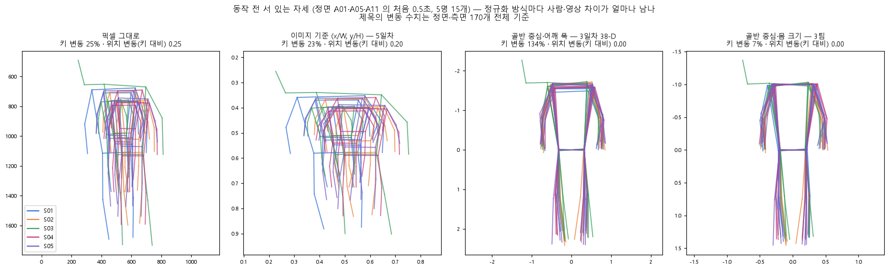

# 정규화 방식 비교 — 이미지 기준 vs 몸 기준

수업에서는 정규화를 두 가지 배웠습니다.

- **3일차 Body Normalization:** 골반 중심을 원점으로, 어깨 폭을 1 로 맞춤 → 자세 비교용 Feature
- **5일차 Image Normalization:** `x / 영상 가로`, `y / 영상 세로` → 해상도가 달라도 같은 비율로 저장

3팀 데이터에서 실제로 어떤 차이가 나는지, 여기에 3팀이 더한 **몸 크기 정규화**까지 다섯 가지를 같은 데이터로 비교했습니다.
결론부터 말하면 **이미지 기준 좌표는 "원본 보관용"으로 맞고, 학습용 Feature 는 몸 크기 정규화(+ 화면 위치)가 가장 좋았습니다.**

> 재현: `python scripts/12_compare_normalizations.py` (YOLO 를 다시 돌리지 않고 저장된 원본 Keypoint 만 사용, 약 1분)
> 결과 표: `reports/tables/normalization_compare.csv`, `reports/tables/normalization_loso.csv`

## 비교한 다섯 가지

| 이름 | 계산 | 출처 |
|---|---|---|
| 픽셀 | YOLO 가 준 좌표 그대로 | — |
| 이미지 기준 | `x / W`, `y / H` (세로 영상 1080×1920, 가로 영상 1920×1080) | 수업 5일차 |
| 어깨 폭 | (좌표 − 골반 중심) / 어깨 폭 | 수업 3일차 (38-D) |
| 몸 크기 | (좌표 − 골반 중심) / max(몸통 길이, 어깨 폭 / 0.70) | 3팀 추가 ([결정 기록 4번](DESIGN_DECISIONS.md#4-수업-방식어깨-폭-정규화에-몸-크기-정규화를-더함)) |
| 몸 크기 + 화면 위치 | 몸 크기 좌표 + 골반의 이미지 기준 위치 2개 | 3팀 추가 |

데이터: 승인된 영상 170개 (5명 × 17동작 × 정면·측면), 관절 12개(어깨·팔꿈치·손목·골반·무릎·발목).

## 1. 사람·영상마다 다른 "크기와 위치"를 얼마나 지우나

동작을 시작하기 전 서 있는 자세(처음 0.5초)는 모든 영상에서 거의 같은 자세입니다.
그러니 좋은 정규화라면 이 자세의 숫자가 영상마다 비슷해야 합니다.

| 방법 | 키 변동 (변동계수) | 골반 위치 변동 (키 대비) | 측면에서 값이 튀는 Frame |
|---|---:|---:|---:|
| 픽셀 | 25% | 0.25 | — |
| 이미지 기준 | **23%** | 0.20 | — |
| 어깨 폭 | **134%** | 0 | **56%** |
| 몸 크기 | **7%** | 0 | **0%** |

- **이미지 기준은 픽셀과 거의 같습니다 (25% → 23%).** 해상도는 맞춰 주지만, 사람이 카메라에서 가깝고 먼 차이,
  화면 왼쪽·오른쪽 위치 차이는 그대로 남습니다. 그림 두 번째 칸에서 뼈대들이 흩어져 있는 이유입니다.
- **어깨 폭은 정면에서는 잘 맞지만(그림 세 번째 칸) 측면에서 무너집니다.** 옆으로 서면 두 어깨가 겹쳐 어깨 폭이
  0 에 가까워지고, 그걸로 나눈 값이 기준 길이의 5배 넘게 튀는 Frame 이 측면의 56% 입니다. 키 변동 134% 도 이 때문입니다.
- **몸 크기 정규화는 정면·측면 모두 7% 로 가장 고르게 맞춥니다.**

## 2. 동작을 얼마나 잘 구분하나

같은 조건에서 좌표만 바꿔 동작 17개 분류를 해 봤습니다.

- Feature: 동작 구간(06번 추정) 안 관절 좌표의 평균·표준편차·최소·최대
- 모델: Random Forest 300그루 (분류 모델을 고르려는 게 아니라 **좌표 방식끼리 비교**하려는 고정된 잣대)
- 평가: **사람 단위 Leave-One-Subject-Out 5-fold** — 매번 한 사람을 통째로 빼서 시험 (같은 사람이 학습·시험에 섞이지 않음)

| 방법 | 5-fold 평균 정확도 | 편차 | macro F1 | **S05 시험** (다른 날 따로 촬영) |
|---|---:|---:|---:|---:|
| 픽셀 | 64.7% | ±13.9 | 0.616 | 38.2% |
| 이미지 기준 | 64.7% | ±14.2 | 0.620 | **38.2%** |
| 어깨 폭 | 64.1% | ±5.1 | 0.619 | 55.9% |
| 몸 크기 | 72.9% | ±8.0 | 0.704 | 61.8% |
| **몸 크기 + 화면 위치** | **74.7%** | **±4.8** | **0.722** | **67.6%** |

(우연히 맞힐 확률은 1/17 ≈ 5.9%)

### 읽는 법

- **같은 날 찍은 사람(S01~S04)을 시험할 때는 방법끼리 차이가 작습니다 (62~79%).** 같은 방·같은 카메라 위치라
  "화면 어디쯤에서 어떤 크기로 움직였나"만으로도 어느 정도 맞힐 수 있기 때문입니다.
- **다른 날 따로 찍은 S05 를 시험하면 픽셀·이미지 기준은 38% 로 무너집니다.** 카메라 위치·거리가 조금만 달라져도
  좌표 값이 통째로 바뀌기 때문입니다. 실제 매장에 설치하면 매장마다 카메라 위치가 다르니, 이게 실제 상황에 더 가깝습니다.
- **몸 기준 정규화는 S05 에서도 62~68% 를 유지합니다.** 카메라가 바뀌어도 "몸 모양"은 같기 때문입니다.
- **화면 위치를 조금 다시 넣으면(+골반 위치 2개) 더 좋아집니다.** 넘어지기·눕기는 몸이 화면에서 아래로 내려가는
  움직임 자체가 단서인데, 골반 중심 정규화는 이 정보를 지웁니다. 위치를 전부 쓰면 카메라에 끌려가고,
  전혀 안 쓰면 이동 정보를 잃으니 **"몸 모양은 몸 기준으로, 위치는 2개 값만"** 으로 절충했습니다.

## 결론과 적용

| 용도 | 쓰는 좌표 | 이유 |
|---|---|---|
| 원본 Keypoint 보관 (5일차 방식) | 픽셀 + 영상 크기(`img_w`, `img_h`) | 이미지 기준 값은 `x / img_w` 로 언제든 계산 가능 → 따로 저장하지 않음 |
| 학습 Feature (6일차) | **몸 크기 정규화 좌표 + 골반 화면 위치** | 사람 단위 평가와 다른 날 촬영(S05)에서 가장 높고 가장 안정적 |
| 수업 비교용 | 어깨 폭 38-D 도 함께 저장 | 수업 결과와 나란히 비교하기 위해 |

## 한계 — 이 숫자를 어디까지 믿을 수 있나

- 영상이 170개, 시험 세트가 한 번에 34개라 1~2개만 달라도 정확도가 3~6%p 움직입니다. 그래서 한 번의 Split 이 아니라
  5-fold 평균과 편차를 같이 봤습니다. 방법 사이 차이(64% vs 73~75%)는 편차보다 크지만, 데이터를 늘리면 다시 확인해야 합니다.
- Random Forest + 단순 통계 Feature 는 시간 순서를 보지 않습니다. 6일차 이후 시간 순서를 보는 모델에서도 같은 순위가
  나오는지 확인할 예정입니다.
- S05 의 정확도가 낮은 데는 카메라 차이 말고도 "같은 동작을 다르게 한 것"(예: A15 를 엎드리지 않고 주저앉음)이 섞여 있습니다.
