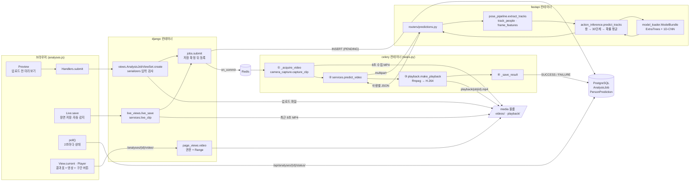
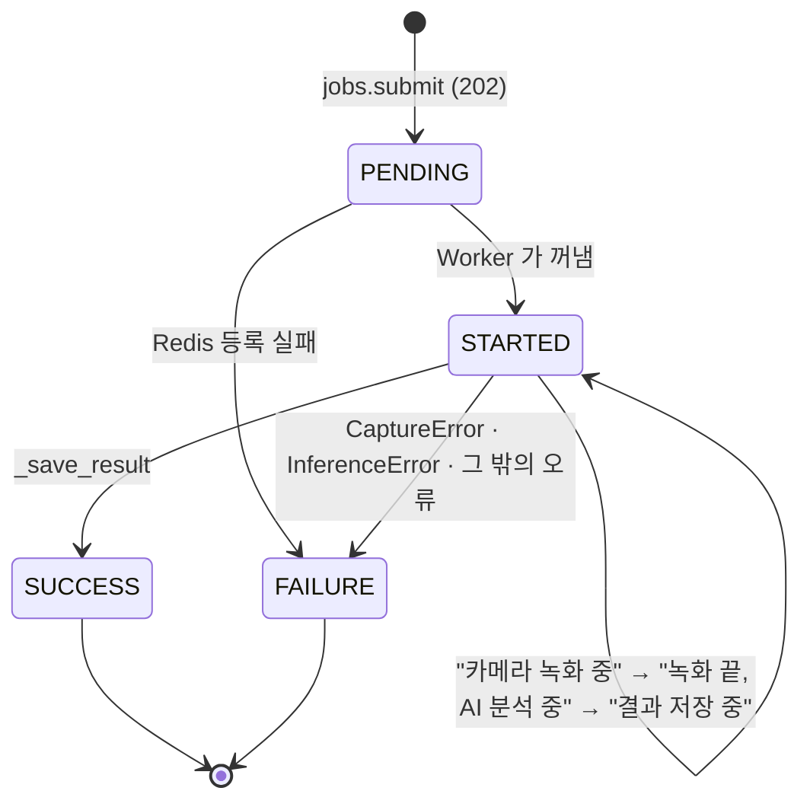

# 분석 파이프라인 — 'AI 분석 시작'을 누르면 무슨 일이, 어느 파일에서 일어나나

README 5번의 요약을 파일·함수 단위로 풀어 쓴 문서입니다. 코드를 고치거나 오류 원인을 찾을 때
**"이 단계는 어느 컨테이너의 어느 함수인가"** 를 바로 찾을 수 있게 정리했습니다.

- 입력 경로는 세 가지(영상 업로드, IP Webcam 8초 수집, 실시간 장면 저장·자동 감지)이지만, 작업을 등록한 뒤에는 **모두 같은 길**을 탑니다.
- 그 길은 `jobs.submit` → Redis → `tasks.run_analysis` → FastAPI `/predict/video` → DB 저장입니다.
- 함께 쓰는 함수가 한 곳에만 있어야 규칙이 갈라지지 않습니다. 그래서 리팩터링 때 공통 부분을 모았습니다 (맨 아래 [6](#6-한-곳에-모아-둔-공통-코드-리팩터링)).

## 1. 한눈에 보기



## 2. 단계별 표

| # | 어디서 | 파일 · 함수 | 들어가는 것 → 나오는 것 | 화면·DB 상태 | 실패하면 |
|---|---|---|---|---|---|
| 0 | 브라우저 | `static/js/analyses.js` `Preview.show` | 고른 파일 → `<video>` 미리보기, 길이·해상도·예상 분석 시간·주의 문구 | (서버 요청 없음) | 브라우저가 못 트는 형식이면 "미리보기 불가(분석은 가능)" |
| 1 | 브라우저 | `Handlers.submit` → `Data.create` | FormData(input_type, video 또는 camera_name, expected_action, title) → `POST /api/analyses/` | 버튼에 업로드 % 표시 | 400 사유를 폼 아래에 표시 |
| 2 | django | `views.AnalysisJobViewSet.create` · `serializers.AnalysisJobCreateSerializer.validate` | 확장자·100 MB·허용 카메라 검사 | — | **DB 저장 전에** 400 (잘못된 파일은 기록도 안 남김) |
| 3 | django | `jobs.submit` | Task ID 를 먼저 만들고 → `AnalysisJob` INSERT → `transaction.on_commit` 으로 `run_analysis.apply_async` | `PENDING` · 202 `{id, task_id, status_url}` 즉시 반환 | Redis 가 꺼져 있으면 `jobs.enqueue` 가 `FAILURE`("대기열에 등록하지 못했습니다") |
| 3′ | django | `live_views.live_save` (장면 저장·자동 감지) | FastAPI 가 들고 있던 최근 8초 MP4(`services.live_clip`) + 저장 당시 예측(`live_snapshot`) → 같은 `jobs.submit` | `source=LIVE` / `LIVE_AUTO` | 조건 미달 409, 간격 안 429 (자동 감지는 조용히 넘어감) |
| 4 | celery | `tasks.run_analysis` | 작업 번호 | `STARTED` | 그 사이 삭제됐으면 `missing` 으로 끝 |
| 4-① | celery | `tasks._acquire_video` → `camera_capture.capture_clip` | (IP Webcam 8초 수집만) DB 카메라 표의 주소·회전 → `media/videos/ipwebcam/job{id}_….mp4` | result_message `카메라 녹화 중` → 화면에 '● 지금 녹화 중' → `녹화 끝, AI 분석 중` | `CaptureError` → `FAILURE` + "연결하지 못했습니다 / 중간에 끊겼습니다" |
| 4-② | celery → fastapi | `services.predict_video` → `POST /predict/video` | 영상 파일(multipart) → 사람별 예측 JSON ([3](#3-ai-서버-안-predictvideo-한-번)) | — | 타임아웃·연결 실패·4xx/5xx → `InferenceError` → `FAILURE` + 사유 |
| 4-③ | celery | `tasks._playback` → `playback.make_playback` | 원본 → ffmpeg H.264·최대 720p·소리 없음 → `media/playback/job{id}.mp4` | result_message `결과 저장 중 (재생용 영상 만드는 중)` | 실패해도 **분석 결과는 그대로 저장**, 화면은 원본으로 재생 시도 |
| 4-④ | celery | `tasks._save_result` | 예측 JSON → `PersonPrediction` 여러 행 (한 transaction) | `SUCCESS`, video_seconds · processing_seconds(AI 시간만) | — |
| 5 | 브라우저 | `poll()` → `Handlers.finished` → `View.current` | `/status/` 2초마다 → 끝나면 `/api/analyses/{id}/` | 결과표 + 분석한 영상 + '상세 보기' | 15분 넘으면 조회를 멈춤 (Celery 시간 제한과 같음) |
| 6 | 브라우저 · django | 상세 `Init.detail` · `Player.show` / `page_views.video` | `GET /analyses/{id}/video/` (Range) → 재생용 사본, 없으면 원본 | 구간 버튼을 누르면 그 시점으로 이동, 재생 중인 창은 진하게 | 본인·관리자 외 404 |

## 3. AI 서버 안: `/predict/video` 한 번

| 순서 | 파일 · 함수 | 하는 일 | 학습과 같은가 |
|---|---|---|---|
| 1 | `routers/predictions.py` `predict_video` | 확장자·크기 검사 → 임시 파일로 저장 → 끝나면 지움 | — |
| 2 | `services/pose_pipeline.py` `extract_tracks` | 영상을 Frame 단위로 읽음. 60fps 는 30fps 로 줄임, 최대 60초 | 학습 03번과 같은 Pose 값(`project.json`) |
| 3 | `pose_pipeline.track_people` | YOLO11n-pose + ByteTrack → Frame 안 사람마다 `Person(track_id, 관절, 신뢰도, 상자, 40값, 유효 여부)` | 실시간 보기도 **같은 함수** |
| 4 | `pose_pipeline.frame_features` (+ `src/feature_utils`, `src/team_feature_utils`) | 몸 크기 정규화 관절 34 + 팔꿈치·무릎 각도 4 + 골반 화면 위치 2 = **body40** | 데이터 저장소 `src/` 를 그대로 복사 (`update_model.sh` 가 같은지 확인) |
| 5 | `TrackData.add` | 사람(Track ID)별로 시간·40값·유효 여부를 쌓음 | — |
| 6 | `services/action_inference.py` `predict_tracks` → `predict_track` | 1초 미만으로 보인 Track, **관절 Confidence 평균 0.4 미만 Track(의자·가방 같은 물체)** 은 판단하지 않음 (11/24, 진짜 사람은 학습 영상 최저 0.77 · 서비스 기록 최저 0.64, 물체는 0.08~0.34). 나머지는 보인 시간이 8초 이하면 창 1개, 길면 8초 창을 4초씩 밀며 여러 개 (`make_windows`) | 학습은 영상 전체(whole) 1개 |
| 7 | `action_inference.resample` | 창 안의 유효 Frame 만 → **30단계**로 보간 (유효 Frame 10개·50% 미만인 창은 버림) | 학습 13번 resample 과 같음 |
| 8 | `services/model_loader.py` `ModelBundle.predict_proba` | ① `src/sequence_extras.add_extras` 로 변화량·요약 통계를 붙여 2,560값 → ExtraTrees ② `src/temporal_cnn` 1D-CNN 3개 → 두 확률의 평균 | 학습 15번 `predict()` 와 같은 계산 |
| 9 | `predict_track` | 창별 확률을 평균 → 1위 동작·Confidence·상위 3개, 30% 미만은 `uncertain`, 창별 결과는 `windows` | — |
| 10 | `predict_video` | 사람 없음 / 너무 짧음은 200 + `message` 로 이유 (실패가 아님) | — |

응답 예 (작업 #53: S04 `A010 뒤로 눕기` 정면 14.6초 영상)

```json
{
  "ok": true, "message": "",
  "video": {"frames": 875, "fps": 60.017, "seconds": 14.58, "width": 1080, "height": 1920},
  "processing_seconds": 29.2, "uncertain_below": 0.3,
  "predictions": [{
    "track_id": 1, "action_id": "A010", "action_name_ko": "뒤로 눕기", "confidence": 0.40, "uncertain": false,
    "window_count": 3,
    "windows": [{"start_sec": 0.0, "end_sec": 8.0, "action_id": "A010", "confidence": 0.58},
                {"start_sec": 4.0, "end_sec": 12.0, "action_id": "A010", "confidence": 0.39},
                {"start_sec": 6.53, "end_sec": 14.53, "action_id": "A010", "confidence": 0.25}],
    "top3": ["A010 0.40", "A008 0.07", "A015 0.07"], "valid_frames": 437, "track_seconds": 14.5
  }],
  "skipped_tracks": []
}
```
(`top3` 는 읽기 쉽게 줄여 적었습니다. 실제로는 `{action_id, action_label, action_name_ko, probability}` 목록입니다.
60fps 영상이라 2 Frame 마다 1개(438개)만 Pose 를 돌렸고, 그중 437개가 유효 Frame 입니다.)

결과 화면의 **구간별 예측** 버튼이 이 `windows` 입니다.
위 예에서는 마지막 창(6.5~14.5초, 일어나는 장면)이 25%로 낮아 점선으로 표시됩니다.
사람별 최종 Confidence 40%는 세 창 확률의 평균입니다.

## 4. 파일이 생기고 지워지는 곳

| 무엇 | 경로 (media 볼륨 `/app/media`) | 만드는 곳 | 지우는 곳 |
|---|---|---|---|
| 업로드 원본 | `videos/YYYY/MM/DD/<파일 이름>` | `views.create` (Django FileField) | 기록 삭제 → `models.delete_video_files` (post_delete) |
| IP Webcam 8초 수집 | `videos/ipwebcam/job{id}_{시각}.mp4` (OpenCV `mp4v`) | `camera_capture.capture_clip` | 위와 같음 |
| 실시간 장면 저장 | `videos/YYYY/MM/DD/live_{시각}.mp4` (FastAPI 가 보낸 `mp4v`) | `live_views.live_save` | 위와 같음 |
| 재생용 사본 | `playback/job{id}.mp4` (H.264, ≤720p, 소리 없음) | `playback.make_playback` (Celery), 옛 기록은 `manage.py make_playback` | 위와 같음 |
| FastAPI 임시 파일 | 컨테이너 `/tmp` | `predictions.predict_video` | 같은 요청 끝에서 바로 |

원본을 그대로 두고 사본을 따로 만드는 이유가 있습니다.
- 원본은 분석 근거라 다시 분석할 때도 같은 파일을 써야 합니다.
- `mp4v`(MPEG-4 Part 2)는 OpenCV 가 쓰기 쉽지만 Chrome·Edge `<video>` 가 못 틉니다.

사본은 원본의 1/30~1/100 크기입니다 (14.1 MB → 0.08 MB). 8초 녹화본 기준 만드는 데 0.3~1.3초 걸립니다.

## 5. 상태와 화면 문구



- `SUCCESS` 인데 예측이 0명일 수 있습니다 (사람 없음·너무 짧게 보임). 이유는 `result_message` 에 있습니다.
- `processing_seconds` 는 FastAPI 가 잰 AI 처리 시간만입니다. 녹화·사본 시간은 들어가지 않습니다.

## 6. 한 곳에 모아 둔 공통 코드 (리팩터링)

같은 일을 두 곳에서 따로 하면 한쪽만 고쳐져 규칙이 갈라집니다. 11/24 정리한 것:

| 공통 함수 | 전에는 | 지금 쓰는 곳 | 확인 |
|---|---|---|---|
| `backend/analyses/jobs.py` `submit` · `enqueue` · `accepted` | `views.create` 와 `live_views.live_save` 가 Task ID 만들기·on_commit 등록·202 본문을 각자 작성 (live 쪽은 ViewSet 의 private 메서드를 빌려 씀) | 업로드·8초 수집·장면 저장·자동 감지 | 단위 테스트 37개 |
| `tasks.py` `_acquire_video` · `_save_result` · `_step` · `_playback` | `run_analysis` 한 함수에 녹화·추론·저장이 다 들어 있음 | 단계마다 함수 하나, `run_analysis` 는 순서만 | 같은 테스트 + E2E |
| `services.py` `_url` · `_detail` | FastAPI 주소 조합 3번, 오류 본문 읽기 2번 | 추론·실시간·health 호출 | 같은 테스트 |
| `ai_service/services/pose_pipeline.py` `track_people` · `Person` · `TrackData.add` | 업로드 분석(`extract_tracks`)과 실시간 보기(`live_session._pose`)가 YOLO 결과 읽기·40값 계산·쌓기를 각자 작성, `_Track` 이 `TrackData` 칸을 복사 | 두 곳이 같은 함수, `_Track` 은 `TrackData` 를 상속 | S04 영상 2개로 바꾸기 전·후 예측(동작·Confidence·창·유효 Frame) **완전히 같음** |
| `analyses.js` `Util.json` · `Util.flash` · `View.actionText` · `View.confidenceCell` · `Handlers.finished` | json_script 읽기 3번, 안내 문구 함수 2개, "A001 이름 77%" 조합 4번, Confidence 막대 2번, 끝났을 때 콜백 2번 | 결과표·이력·실시간 표·카메라 관리 | 화면 캡처 확인 |
| `analyses.js` `Init.index` | 처음 열 때 작업 목록 API 를 두 번 부름 (이력 + 진행 중 작업 찾기) | 한 번 받아 둘 다 씀 | — |
| `dashboard.py` | 집계가 `page_views.dashboard` 안에 모두 있음 | 기간·조건·CSV 가 같은 쿼리 함수를 씀 | `DashboardToolsTests` |

11/25 정리 — 같은 **값**을 여러 곳에 다시 적어 둔 것:

| 한 곳 | 전에는 | 지금 쓰는 곳 | 확인 |
|---|---|---|---|
| `ai_service/src/schema.py` (데이터 저장소 `src/schema.py` 복사) | 관절 17개·각도 4개·body40 이름을 `pose_pipeline` 이 따로 정의 (데이터 저장소는 7개 스크립트가 각자) | `pose_pipeline`·`model_loader` 검사, 학습 스크립트 전부. `update_model.sh` 가 두 파일이 같은지 확인 | 예전 이름 목록과 같음, 모델 가중치까지 그대로 재현 |
| `models.AnalysisJob.FINISHED` · `CAPTURING_MESSAGE` · `is_recording` | 끝난 상태를 `is_finished`·대시보드 '진행 중'이 따로, 녹화 문구를 `tasks.py`·`analyses.js` 가 같은 글자로 | 서버가 `is_recording` 을 보내고 JS 는 그 값만 봄 | 테스트 44개 + 화면 |
| `AnalysisJobQuerySet.with_results` · `running`, `PredictionQuerySet.graded` | `select_related("user").prefetch_related("predictions")` 5곳, '채점 대상' 조건 2곳 | API·대시보드 표·CSV·Admin·`export_clips` | 같은 테스트 |
| `actions.action_name` · `category_ko` · `ACTION_NAMES` | `ACTION_BY_ID.get(…, {}).get("name_ko", "")` 4곳 | serializer·대시보드·CSV·화면 json | 같은 테스트 |
| json_script `page-config` 하나 | `uncertain-below`·`live-config`·`action-names` 3개 + JS 안의 상태 이름표·녹화 문구·조회 횟수(15분) | `analyses.js` `Config` (상태 이름은 API `status_display`, 조회 한도는 `CELERY_TASK_TIME_LIMIT`) | 화면 3곳 콘솔 오류 없음 |
| `dashboard.js` 분류 색 | 한글 이름("기물 파손")으로 색을 찾음 → 이름을 바꾸면 색이 빠짐 | 분류 코드로 찾고 이름은 서버(`CATEGORY_KO`)가 보냄 | 화면 |
| `routers/deps.ready_bundle`, `live._session` | '모델 준비 안 됨' 503 검사 2곳, `touch()` 3곳 | `/predict/video`·`/live/start`, 실시간 조회 3개 | E2E |
| `compose.yaml` `x-shared-limits` | 업로드 용량·불확실 기준·확장자를 Django settings 와 FastAPI `project.json`·`ALLOWED_EXT` 가 따로 | 같은 환경변수를 두 컨테이너에 (FastAPI `load_config` 가 덮어씀) | `docker compose config` + E2E |

따로 둔 것: 카메라 회전·열기 코드는 Django(8초 수집)와 FastAPI(실시간)에 각각 있음 — 다른 컨테이너·다른 라이브러리 묶음이라 공유하면 이미지가 서로 기대게 됨.

## 7. 문제가 생기면 볼 곳

| 증상 | 먼저 볼 것 |
|---|---|
| `대기`에서 안 넘어감 | `docker compose ps` (celery 가 떠 있나), `docker compose logs celery --tail 50` |
| `실패: AI 서버 오류 (400)` | 영상이 정상인지 (손상·지원 안 하는 코덱). `docker compose logs fastapi` |
| `실패: 카메라 …에 연결하지 못했습니다` | 휴대폰 IP Webcam 앱이 켜져 있나, 카메라 주소 관리의 주소·연결 확인 |
| 예측이 이상함 (눕기로 나옴 등) | 결과 화면 영상을 직접 재생해 봄 → 영상이 돌아가 있으면 카메라 '화면 회전', 동작이 녹화 전에 끝났으면 '이 장면 저장' 사용 |
| 영상 칸이 검거나 "재생할 수 없는 형식" | `docker compose logs celery \| grep 재생용`, 옛 기록이면 `docker compose exec celery python manage.py make_playback` |
| 결과가 학습 때와 다름 | `update_model.sh` 로 `src/` 와 모델 파일이 데이터 저장소와 같은지 (README 6) |
