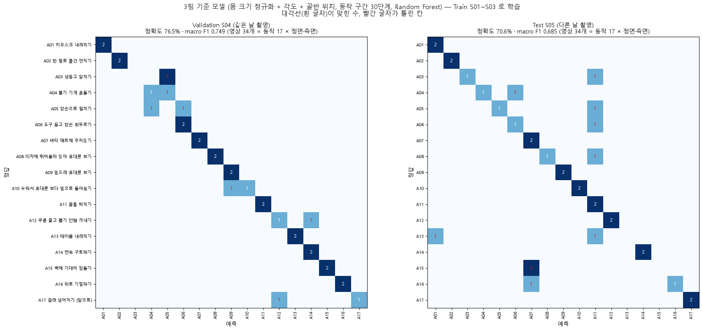
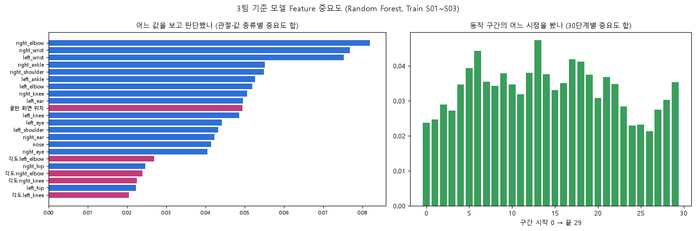
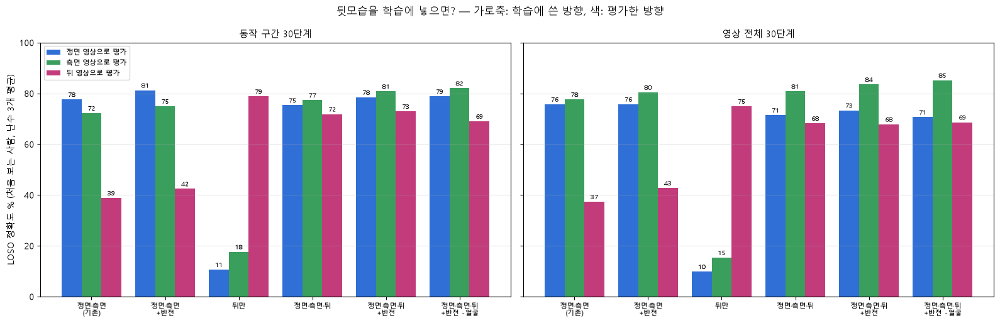
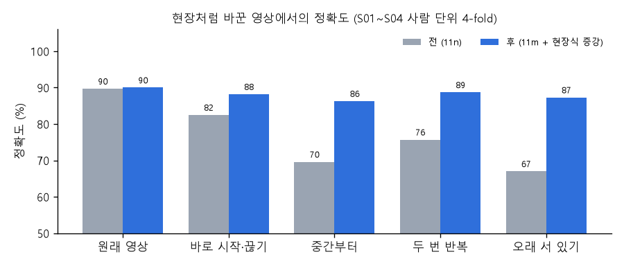

# 동작 분류 Baseline 성능평가 — 수업 6일차 방식 vs 3팀 방식

수업 6일차에서 만드는 것:

- 영상 길이를 30단계로 맞춘 **고정 길이 Sequence**
- **Random Forest** Baseline
- **사람 단위**로 Accuracy와 Macro F1 평가
- 오류 분석: 혼동 행렬, 틀린 영상 추적, Static vs Sequence, 각도 유무 비교

3팀 데이터에 같은 과정을 적용했습니다. 수업 방식 그대로와 3팀이 바꾼 부분을 같은 조건에서 **한 번에 하나씩만 바꿔** 비교했습니다.

**결론부터:**

| 모델 | Validation S04 (같은 날) | **Test S05 (다른 날)** |
|---|---:|---:|
| 수업 그대로 (어깨 폭 38-D, 영상 전체) | 67.6% | **55.9%** |
| **3팀 기준 모델** (몸 크기 정규화 + 각도 + 골반 화면 위치, 동작 구간) | 76.5% | **70.6%** |

동작은 17가지라 우연히 맞힐 확률은 5.9%입니다.

- 가장 큰 차이를 만든 것은 두 가지입니다.
  - **"한 장면이 아니라 시간 흐름을 본다"**: Sequence가 Static보다 +17%p 높습니다.
  - **"몸 크기로 정규화한다"**: 수업 방식보다 4-fold에서 +7%p, Test에서 +15%p 높습니다.
- 각도·골반 위치·동작 구간 자르기는 이 모델에서 **차이가 우연 변동보다 작았습니다.** 효과가 있다고 쓰지 않습니다.

> 재현:
> ```bash
> python scripts/13_build_sequence_dataset.py   # 고정 길이 Dataset (약 30초)
> python scripts/14_train_baseline.py           # 실험 9개 + 마지막 Test (약 2분)
> ```
> 기준값은 [`configs/baseline_config.json`](../configs/baseline_config.json) 한 파일에 있습니다.
> 결과 표는 `reports/tables/baseline_*.csv` 입니다.

## 1. 평가 규칙 — 무엇으로 고르고, 언제 Test 를 보나

| 세트 | 사람 | 영상 | 용도 |
|---|---|---:|---|
| Train | S01, S02, S03 | 102 | 학습 |
| Validation | S04 | 34 | 실험끼리 비교 |
| Test | S05 (11/16 다른 날 따로 촬영) | 34 | **마지막에 한 번만** |

- **고르는 데는 두 가지만 씁니다.** Validation(S04), 그리고 S01~S04 안에서 한 사람씩 빼는 4-fold입니다.
  - Validation이 한 사람뿐이라 운이 섞이므로 4-fold 평균·편차를 같이 봅니다.
  - S05는 이 단계에 넣지 않았습니다.
- **모델 설정은 고정했습니다.** Random Forest 300그루, depth 제한 없음, `class_weight="balanced"`, `random_state=42`로 수업 기준값과 같습니다.
  - 실험마다 바꾸는 것은 Feature·창·Static 여부 중 하나뿐입니다.
- **Random Forest 자체의 우연 변동도 쟀습니다.** 같은 실험을 난수 5개로 다시 학습했더니 Validation 정확도가 **±0~4%p** 흔들렸습니다.
  - 이보다 작은 차이는 "효과 없음"으로 봅니다.
- **정직하게 밝혀 둘 점:** [정규화 비교](NORMALIZATION_ANALYSIS.md)에서는 S05까지 포함한 5-fold를 봤습니다.
  - 그래서 "몸 크기 정규화를 쓴다"는 결정에는 S05 결과가 일부 반영되어 있습니다.
  - 모델 설정과 Feature 조합은 S05를 보지 않고 정했습니다.

## 2. 고정 길이 Sequence 만들기

영상마다 길이가 다릅니다. 동작 구간 기준으로 유효 Frame이 60~1,192개입니다 (1초 ~ 20초). 모델은 같은 길이의 입력을 받아야 합니다.

| 방법 | 문제 |
|---|---|
| 앞 30 Frame 만 자르기 | 60fps 에서 0.5초 — 동작 시작만 보고 끝은 못 봄 |
| 0 으로 채워 가장 긴 길이에 맞추기 | 짧은 영상은 대부분이 빈 값, Random Forest 는 위치마다 다른 Feature 로 봄 |
| **구간 전체를 시간 0~1 로 펴서 30단계로 보간 (수업 방식)** | 빠르게 한 사람·느리게 한 사람이 같은 "동작 진행률"끼리 비교됨 |

- **수업 방식(np.interp 선형 보간)을 그대로 썼습니다.** Frame 하나당 74개 값을 30단계로 저장한 뒤 14번에서 조합을 골라 씁니다.
  - 수업 38-D(어깨 폭 정규화 34 + 각도 4): 30 × 38 = **1,140개**
  - 3팀 body40(몸 크기 정규화 34 + 각도 4 + 골반 화면 위치 2): 30 × 40 = **1,200개**
- **입력 점검 결과:** 170개 모두 OK입니다 (`reports/tables/sequence_dataset_check.csv`).
  - 동작 구간 안 유효 Frame은 최소 60, 중앙값 219입니다.
  - 유효 비율은 최소 83.4%입니다.
  - 기준은 10 Frame 이상, 50% 이상입니다.
- 유효 Frame은 Pose·Feature·몸 크기 Feature가 모두 정상이고 값이 숫자인 Frame만 씁니다. 빠진 Frame은 앞뒤 시간으로 보간합니다.

## 3. 실험 결과 — 한 번에 하나씩 바꾸기

| 실험 | 기준과 다른 점 | Feature 수 | Validation S04 | 난수 5개 평균 | S01~S04 4-fold |
|---|---|---:|---:|---:|---:|
| 수업 그대로 | 어깨 폭 38-D, 영상 전체 | 1,140 | 67.6% | 67.6 ± 0.0 | 69.1 ± 4.9 |
| 수업 + 동작 구간 | 어깨 폭 38-D | 1,140 | 64.7% | 68.8 ± 1.4 | 66.9 ± 2.4 |
| 수업, 각도 제외 | 어깨 폭 34 | 1,020 | 73.5% | 70.6 ± 2.6 | 68.4 ± 3.8 |
| 수업, Static | 가운데 Frame 1개 | 38 | 52.9% | 59.4 ± 3.9 | **57.4 ± 4.9** |
| **3팀 기준** | — | 1,200 | **76.5%** | **79.4 ± 0.0** | **74.3 ± 3.8** |
| 3팀, 영상 전체 | 창만 바꿈 | 1,200 | 73.5% | 77.6 ± 2.4 | 77.2 ± 7.6 |
| 3팀, Static | 가운데 Frame 1개 | 40 | 58.8% | 55.3 ± 2.2 | **57.4 ± 4.4** |
| 3팀, 골반 위치 제외 | body38 | 1,140 | 79.4% | 74.7 ± 3.5 | 72.8 ± 6.7 |
| 3팀, 각도 제외 | body36 | 1,080 | 76.5% | 79.4 ± 2.6 | 75.0 ± 4.9 |

전체 값과 사람별 fold 결과는 `reports/tables/baseline_experiments.csv`에 있습니다.

### 읽는 법

1. **Sequence 대 Static: 효과가 분명합니다 (+17%p).**
   - 가운데 Frame 하나만 보면 4-fold가 57%이고, 30단계를 보면 74%입니다. 수업 38-D와 3팀 Feature 모두 같은 방향입니다.
   - 내려치기(A01)와 흔들기(A04)는 한 장면만 보면 "팔을 든 서 있는 사람"으로 같습니다. 팔이 **어떻게 움직였나**를 봐야 구분됩니다.
2. **몸 크기 정규화 대 수업 어깨 폭: 효과가 분명합니다.**
   - 같은 동작 구간·같은 모델에서 4-fold 66.9%와 74.3%, 난수 5개 평균 68.8%와 79.4%입니다.
   - 측면 영상에서 어깨 폭이 0에 가까워져 값이 튀는 문제([결정 4번](DESIGN_DECISIONS.md#4-수업-방식어깨-폭-정규화에-몸-크기-정규화를-더함))가 그대로 정확도 차이로 나타납니다.
3. **각도 4개: 이 모델에서는 효과가 없습니다.**
   - 3팀은 75.0%(각도 없음)와 74.3%(있음), 수업은 68.4%(없음)와 66.9%(있음)로 차이가 우연 변동 안입니다.
   - 각도는 관절 좌표로 계산되는 값이라, 좌표 1,000여 개를 이미 보는 Random Forest에는 새 정보가 거의 없습니다.
   - 수업의 질문 "Joint Angle 이 실제로 도움이 되나?"에 대한 3팀 데이터의 답은 **"이 조건에서는 아니다"** 입니다.
   - 그래도 기준 모델에는 남겨 둡니다. 계산이 싸고 사람이 읽을 수 있는 값이며, 시간 순서 모델(1D-CNN 또는 GRU)에서 다시 확인하려는 것입니다.
4. **골반 화면 위치 2개: 차이가 우연 변동 안입니다.**
   - 72.8%와 74.3%로, [정규화 비교](NORMALIZATION_ANALYSIS.md)에서 본 +1.8%p와 방향은 같지만 크기가 작아 단정하지 않습니다.
5. **동작 구간 대 영상 전체: 정확도로는 차이가 없습니다.**
   - 4-fold는 74.3±3.8과 77.2±7.6으로, 영상 전체가 평균은 높지만 편차가 두 배입니다. Validation은 동작 구간이 높습니다.
   - 촬영 영상은 "서 있기 → 동작 → 서 있기"로 모두 같은 모양이라 앞뒤 서 있는 부분이 방해가 되지 않았습니다.
   - **그래도 동작 구간을 기준으로 둡니다.** 실제 매장 카메라에는 "영상 한 개"라는 경계가 없습니다.
     - 모델은 Sliding Window로 잘린 몇 초를 보게 됩니다.
     - 그러니 "동작이 담긴 부분"으로 배운 모델이 실제 사용과 더 가깝습니다.
     - 정확도로 증명한 결정이 아니라 사용 환경에 맞춘 결정입니다.

## 4. 기준 모델 — 동작별 결과와 혼동 행렬



| | Validation S04 | Test S05 |
|---|---:|---:|
| 정확도 / macro F1 | 76.5% / 0.749 | 70.6% / 0.685 |
| 정면 / 측면 정확도 | 82.4% / 70.6% | 76.5% / 64.7% |
| 맞힌 영상의 평균 확신도 | 0.386 | 0.357 |
| 틀린 영상의 평균 확신도 | 0.257 | 0.212 |

동작별 Precision·Recall·F1은 `reports/tables/baseline_per_action.csv`, 영상별 예측과 2순위는 `baseline_predictions.csv`에 있습니다.

### 틀린 영상 추적 (Validation 8개, Test 10개 — `reports/tables/baseline_wrong_clips.csv`)

| 묶음 | 영상 | 원인 추정 |
|---|---|---|
| **서서 팔·다리를 앞으로 뻗는 동작끼리** | Validation 5개 (A03 앞차기 → A05 밀치기 ×2, A04 흔들기 ↔ A05 밀치기, A05 → A06 휘두르기), Test 1개 (A04 → A06) | 모두 "서서 기물 쪽으로 힘을 쓰는" 동작이라 자세 범위가 겹침. 차이는 힘을 주는 리듬(흔들기는 반복, 밀치기는 한 번)인데 30단계 좌표를 따로따로 보는 Random Forest 는 리듬을 직접 보지 못함 |
| **다른 날 촬영 S05 의 측면 → A11 몸통 박치기** | Test 5개 (A03·A05·A06·A08·A13) | 틀린 Test 10개 중 5개가 A11 로 쏠림, 그중 4개가 측면. S05 측면 영상의 카메라 거리·각도가 S01~S04 와 달라, 몸이 앞으로 쏠린 듯한 모양이 박치기와 비슷하게 잡힌 것으로 봄 → 카메라 차이에 대한 약점 |
| **촬영 방식이 다름 (라벨 검수 때 이미 기록)** | Test A15 ×2 → A07 주저앉기 | S05 는 A15(벽에 기대 잠들기)를 엎드리지 않고 벽 옆에 **주저앉아** 연기함 ([README 라벨 검수](../README.md#지금까지-결과)). 모델은 보이는 대로 "주저앉기"라고 답한 것 — 모델보다 데이터 쪽 문제 |
| **동작 앞부분이 같음** | Test A16 뒤로 기절 → A07 주저앉기 | A16 은 "쪼그려 앉았다가 뒤로 눕기"로 찍힘 (`filmed_as`). 앞 절반이 주저앉기와 같음 |
| **같은 팔 동작, 대상 높이만 다름** | Test A13 테이블 내려치기 → A01 키오스크 내려치기 | 팔 움직임은 같고 내려치는 높이만 다름. 몸 기준 좌표로는 높이 차이가 작음 |
| 기타 | Validation A10 → A09, A12 → A14, A17 → A12 | 바닥 자세끼리 (돌아눕기·엎드리기, 무릎 꿇기·구토 자세·넘어진 뒤) |

### 확신도로 "사람 확인" 범위를 줄일 수 있나

틀린 영상은 확신도가 낮습니다. Validation에서 맞힌 영상은 평균 0.39, 틀린 영상은 0.26입니다.
그래서 **Validation으로 기준을 정하고** Test에 그대로 적용해 봤습니다.

| 확신도 ≥ 0.30 일 때만 자동 판정 | 자동으로 판정한 비율 | 그 안의 정확도 |
|---|---:|---:|
| Validation S04 (기준을 정한 곳) | 65% | 90.9% |
| Test S05 | 44% | 100% (15개) |

- 이 프로젝트의 목표는 "이상행동 **후보**를 사람에게 보여주기"입니다.
- 그래서 확신이 높은 것만 바로 알리고 나머지는 사람이 확인하는 운영이 정확도 한 숫자보다 현실적입니다.
- 다만 Test 15개는 표본이 작습니다. 100%는 "이 정도면 쓸 만하다"는 신호일 뿐, 보장이 아닙니다.

### 모델이 무엇을 보고 판단했나



- **손목·팔꿈치가 가장 중요합니다.** 17개 중 7개가 팔이 핵심인 동작입니다(내려치기 2개, 던지기, 흔들기, 밀치기, 휘두르기, 인형 꺼내기). 서로 구분하려면 손이 어디로 움직였는지를 봐야 하니 자연스러운 결과입니다.
- 골반 좌표(left_hip, right_hip)가 거의 0인 것은 정상입니다. 골반 중심을 원점으로 정규화했기 때문에 골반 값은 거의 변하지 않습니다.
- 시간대별로는 구간 처음·끝(서 있는 자세)보다 **가운데 부분(5~22단계)** 이 중요합니다. 동작 구간 추정(06번)이 동작의 핵심을 잘 담았다는 간접 근거입니다.

## 5. 마지막 Test (S05) — 한 번만 본 결과

| 모델 | Train S01~S03 으로 학습 | Train + Validation S01~S04 로 다시 학습 |
|---|---:|---:|
| 수업 그대로 | 55.9% | 58.8% |
| **3팀 기준** | **70.6%** | 64.7% |

- **Validation과 Test의 차이: 3팀은 76.5%에서 70.6%, 수업 방식은 67.6%에서 55.9%입니다.**
  - S05는 다른 날, 다른 카메라 위치에서 혼자 찍었습니다. 매장마다 카메라가 다른 실제 상황에 가장 가깝습니다.
  - 3팀 방식은 6%p 떨어졌고, 수업 방식은 12%p 떨어졌습니다. 몸 기준 정규화가 카메라 변화에 덜 흔들립니다.
- **S01~S04로 다시 학습했더니 오히려 낮아졌습니다 (70.6%에서 64.7%).**
  - Test가 34개라 영상 1개가 2.9%p이고, 이 차이는 2개입니다.
  - 데이터를 늘렸는데 낮아진 것은 S04 추가가 해롭다기보다 **이 정도 크기에서는 숫자가 이만큼 흔들린다**는 뜻으로 읽습니다.
  - 그래서 결과를 한 숫자로 말하지 않고 4-fold 편차와 난수 변동을 함께 적습니다.
- **정확도 70%는 매장 성능이 아닙니다.** 5명이 같은 연기를 한 데이터입니다. 실제 매장의 평범한 행동(물건 고르기, 계산하기)을 섞으면 오탐이 생깁니다.
  - 지금 결과는 "17가지 이상행동끼리 구분"까지입니다.
  - "정상과 이상 구분"은 정상 행동 데이터를 모은 뒤 따로 평가해야 합니다.

## 5-1. 추가 확인 (11/23) — 좌우 반전 증강과 촬영 각도

`scripts/17_flip_and_view_check.py` → `reports/tables/flip_augmentation.csv`, `view_generalization.csv`

**좌우 반전 증강.** 촬영 때 사람마다 보는 방향·쓰는 손이 달랐습니다. 학습 데이터만 좌우로 뒤집은 복사본을 더했습니다(x 부호 반전 + 왼쪽↔오른쪽 관절·각도 교환, 평가는 원본).

| | 반전 없음 | 반전 추가 | 차이 |
|---|---|---|---|
| LOSO 평균 (구간 모델) | 73.5% | **77.1%** | +3.6%p |
| LOSO 평균 (영상 전체 모델) | 75.3% | **78.8%** | +3.5%p |
| LOSO S05 (다른 날 촬영) 구간 / 전체 | 64.7% / 61.8% | **73.5% / 70.6%** | +8.8%p |
| Test S05, 난수 6개 평균 (구간 / 전체) | 67.1% / 58.3% | **73.0% / 64.2%** | +5.9%p |
| Validation S04, 난수 6개 평균 (구간 / 전체) | 78.9% / 77.0% | 78.0% / 72.5% | −0.9 / −4.5%p |

- 처음 보는 사람, 특히 다른 날 찍은 S05에서 크게 오릅니다. S04는 변화가 난수 변동(±3~4%p) 안이거나 조금 내려갑니다.
- 다시 촬영하지 않고 데이터를 2배로 만드는 방법이라 비용이 거의 없습니다. 서비스 모델에 넣을지는 발표 뒤에 정합니다.

**촬영 각도.** 한 방향만 학습하고 처음 보는 사람을 맞힌 LOSO 평균입니다 (구간 모델, 반전 없음).

| 평가 방향 | 정면+측면 학습 | 같은 방향만 학습 | **다른 방향만 학습** |
|---|---|---|---|
| 정면 | 76.5% | 75.3% | **24.7%** |
| 측면 | 70.6% | 74.1% | **24.7%** |

- **학습에 없던 각도는 거의 못 맞힙니다 (75% → 25%).** 2D 관절 좌표는 같은 동작이라도 카메라 각도가 바뀌면 숫자가 완전히 달라집니다.
- 좌우 반전으로도 해결되지 않습니다 (다른 방향만 학습 + 반전: 22~33%). 반전은 "왼쪽을 보느냐 오른쪽을 보느냐"를 메울 뿐, 정면과 측면 사이의 각도를 만들지 못합니다.
- → 서비스 카메라가 정면·측면이 아닌 **대각선**이나 **뒤쪽**에서 사람을 본다면, 그 각도의 영상을 실제로 찍어 학습에 넣어야 합니다. 정면·측면 사이(45°)를 모델이 알아서 메워 줄지는 찍어서 확인해야 합니다.

## 5-2. 뒷모습 추가 (11/23 재촬영) — 학습에 넣으면 뒤를 맞히고, 정면·측면도 떨어지지 않음

`scripts/18_back_view_experiments.py` → `reports/tables/back_view_*.csv`, `docs/images/back_view_summary.png`

5-1 에서 "학습에 없던 각도는 25%" 가 나와서, 5명이 동작 17개를 **뒤에서** 다시 찍었습니다 (85개, 통일 번호 `T03`, 이 저장소 `..._T01_B`).
무인 매장 카메라는 키오스크·뽑기 기계·냉동고 앞에 선 사람의 등을 보는 경우가 많기 때문입니다.
이제 영상은 255개 (정면·측면·뒤 × 85) 이고, Split 은 그대로 Train S01~S03 · Validation S04 · Test S05 입니다.

**LOSO (처음 보는 사람 5번, 난수 3개 평균, 동작 구간 30단계 body40)**

| 학습에 쓴 방향 | 정면 | 측면 | **뒤** | 정면·측면 | 전체 |
|---|---:|---:|---:|---:|---:|
| 정면·측면 (기존) | 77.6 | 72.2 | **38.8** | 74.9 | 62.9 |
| 정면·측면 + 좌우 반전 | 81.2 | 74.9 | 42.4 | 78.0 | 66.1 |
| 뒤만 | 10.6 | 17.6 | 78.8 | 14.1 | 35.7 |
| 정면·측면·뒤 | 75.3 | 77.3 | 71.8 | 76.3 | 74.8 |
| **정면·측면·뒤 + 좌우 반전** | 78.4 | 80.8 | **72.9** | **79.6** | **77.4** |
| 정면·측면·뒤 + 반전, 얼굴 관절 뺌 | 78.8 | 82.0 | 69.0 | 80.4 | 76.6 |



**기본 Split (Train S01~S03, 난수 6개 평균, 동작 구간)**

| 학습 | Validation S04 전체 (뒤) | **Test S05 전체 (뒤)** |
|---|---:|---:|
| 정면·측면 (기존) | 62.1% (28.4%) | 55.6% (32.4%) |
| 정면·측면·뒤 + 좌우 반전 | **73.5% (61.8%)** | **74.2% (75.5%)** |

- **뒤를 넣으면 뒷모습 정확도가 39% → 73% 로 오릅니다.** 기존 모델은 뒷모습을 거의 못 맞힙니다
  (5-1 의 정면↔측면 25% 보다는 높은데, 2D 뼈대에서 뒷모습은 "좌우가 바뀐 정면"과 비슷하기 때문으로 봅니다).
- **정면·측면은 떨어지지 않습니다** (74.9 → 76.3, 반전까지 넣으면 79.6). 방향을 섞어 배워도 서로 방해하지 않았습니다.
- **뒤만 학습하면 뒷모습은 78.8% 로 더 높지만 정면·측면은 14%** — 카메라 위치가 정해진 매장이라면 "카메라별 모델"도 선택지입니다.
  다만 71.8 vs 78.8 차이는 난수 변동(±4~9%p) 과 겹쳐 확실하다고 하지 않습니다.
- **좌우 반전:** 정면·측면에는 계속 +3%p 안팎으로 도움이 되지만, 뒷모습에는 효과가 불확실합니다 (71.8 → 72.9, 뒤만 학습에선 78.8 → 71.4).
- **얼굴 관절(코·눈·귀) 빼기:** 뒤에서는 얼굴이 안 보여 YOLO 가 추정한 값이 흔들릴 거라 봤지만, 빼도 나아지지 않았습니다 (뒤 72.9 → 69.0) → 그대로 둡니다.
- **창:** 영상 전체(whole)보다 동작 구간(segment)이 뒷모습에서 낫습니다 (같은 설정 뒤 67.8% vs 72.9%).

**뒷모습에서 약한 동작** (가장 좋은 설정, `back_view_per_action.csv`): A12 무릎 꿇고 꺼내기 26.7% · A06 휘두르기 33.3% · A13 테이블 내려치기 40% · A03 앞차기 53.3%.
등 뒤에서는 팔·손 끝이 몸에 가려서, 서서 하는 팔 동작끼리(휘두르기 ↔ 던지기·밀치기)와 바닥 동작끼리(무릎 꿇기 ↔ 엎드리기·구토) 헷갈립니다 (`back_view_confusions.csv`).

**라벨 확인:** 뒷모습 85개는 촬영자가 통일 번호로 이름을 붙인 그대로 쓰고, 자동 QA(CHECK 6개: 구토는 뒤라 코가 안 보임 5, S05 바닥 앉기 하체 가림 1)와
모델 예측으로 확인했습니다. 난수 3개 모두 틀린 16개(전부 확신도 0.41 이하) 중 8개는 영상 프레임을 직접 봤고 모두 라벨대로 찍혀 있었습니다.
사람이 85개 전부를 영상으로 본 것은 아닙니다 (`human_qa.csv` 의 `human_note`).

**서비스 모델 (11/24 교체):** 웹 서비스(store-anomaly-service)를 정면·측면·뒤 + 좌우 반전 모델(whole 창, 255개 전부 학습)로 바꿨습니다.
Train S01~S03 기록용 평가는 Validation S04 73.5% → 68.6%, Test S05 61.8% → 74.5% (Test 뒤 70.6%). 예전 모델은 `15_export_service_model.py --views FS --no-flip`.
같은 날 오후 5-3의 ExtraTrees 모델로 한 번 더 바꿨습니다.

## 5-3. 서비스 모델 정확도 올리기 (11/24) — Feature 덧붙이기 + ExtraTrees

**왜:** 서비스는 영상 전체(whole)를 30단계로 펴서 넣습니다. 같은 동작도 사람마다 시작 시점·길이가 달라,
같은 단계 번호(예: t10)에 서로 다른 자세가 옵니다. 단계 번호에 묶인 1,200개 값만으로는 이 차이를 나무가 배우기 어렵습니다.

**방법 (`scripts/19_model_improvement.py`):** 학습 데이터는 5-2의 가장 좋은 설정(정면·측면·뒤 + 좌우 반전, whole).
- 고르는 기준은 **S01~S04 사람 단위 4-fold** 만 씁니다. Test S05 는 고른 뒤 확인용으로만 봅니다 (`selection_rule` 그대로).
- Feature: 지금 1,200 / + 변화량(29 × 40) / + 요약 통계(평균·표준편차·최솟값·최댓값·범위 × 40) / 골반 화면 위치 빼기
- 모델: RF 300(지금) · RF 1000 · ExtraTrees 1000 · SVM(RBF). LogisticRegression 은 63.2% 로 낮고 느려 뺐습니다.

| 4-fold (S01~S04) | 지금 Feature | + 변화량 | + 요약 통계 | + 변화량 + 요약 통계 |
|---|---|---|---|---|
| RF 300 (지금) | 71.6 | 73.5 | 77.9 | 76.0 |
| RF 1000 | 71.1 | 69.6 | 78.9 | 76.5 |
| ExtraTrees 1000 | 77.0 | 75.5 | 82.8 | **82.4** (난수 3개 82.4 ± 0.4) |
| SVM (RBF) | 73.5 | 64.7 | 77.0 | 67.6 |

- 요약 통계가 가장 큰 효과(+6%p 안팎), ExtraTrees 가 RF 보다 +4~5%p. 골반 위치를 빼면 2~3%p 내려가 그대로 둡니다.
- 난수 3개 평균으로 다시 보면 ExtraTrees + 변화량 + 요약 통계 82.4 > ExtraTrees + 요약 통계 81.9 > RF 1000 + 요약 통계 78.7 > 지금 71.9.

**확인 (고른 뒤 한 번, 난수 3개 평균):**

| | Validation S04 | Test S05 | Test 정면 / 측면 / 뒤 | 5명 LOSO (뒤) |
|---|---|---|---|---|
| 지금 RF 300 | 70.6 | 71.9 | 74.5 / 74.5 / 66.7 | 75.7 (71.8) |
| **ExtraTrees + 변화량 + 요약 통계** | **86.9** | **78.4** | 86.3 / 76.5 / 72.5 | **83.5 (76.5)** |

- 학습에 없던 사람에서 Confidence 는 정답 평균 0.37~0.40, 오답 0.28~0.29 로 RF 와 비슷 → 서비스의 `판단 불확실` 기준 30% 는 그대로.
- 계산은 `src/sequence_extras.py` 한 파일에 두고, 웹 서비스(`ai_service/src/`)에 같은 파일을 복사했습니다. 19번 실험의 계산과 같은지 확인했습니다.
- 한계: Test S05 측면·뒤는 거의 그대로(76.5·72.5)라, 다른 날·다른 카메라 차이는 Feature 만으로 다 메우지 못했습니다. 시간 순서 모델(1D-CNN/GRU)은 아직 비교하지 않았습니다.

## 5-4. 더 해 본 방법들 (11/24 저녁) — 바꾼 것 없음

**왜:** 5-3 모델(4-fold 82.4 ± 0.4)에서 더 올릴 수 있는지, 입력 쪽(Pose 모델 크기·단계 수·떨림)과 예측 쪽(반전 평균·나무 설정·모델 섞기·증강)을 하나씩 바꿔 봤습니다.
`scripts/20_more_improvements.py`, 고르는 규칙은 같음 (S01~S04 4-fold, 난수 3개 평균). 4-fold 에서 영상 1개 = 약 0.5%p.

| 바꾼 것 (S01~S04 4-fold) | 전체 | 정면·측면 | 뒤 | 판단 |
|---|---:|---:|---:|---|
| **지금 (11n, 모든 Frame, 30단계)** | **82.4 ± 0.4** | 88.2 | 70.6 | 기준 |
| Pose 11n · 30fps (서비스와 같은 처리) | 81.5 ± 0.2 | 87.7 | 69.1 | 아래 Pose 비교의 기준 |
| Pose 11s · 30fps | 82.7 ± 0.8 | 88.5 | 71.1 | 11n 30fps 보다 +1.2 |
| Pose 11m · 30fps | 83.5 ± 0.6 | 89.2 | 72.1 | 11n 30fps 보다 +2.0, CPU 4배 |
| 시간 자르기 증강 ×1 | 83.3 ± 1.1 | 89.5 | 71.1 | 변동 안 |
| 시간 자르기 증강 ×2 | 83.2 ± 1.0 | 89.2 | 71.1 | 변동 안 |
| 45단계 | 82.8 ± 0.7 | 88.0 | 72.5 | 변동 안 |
| 보간 전 5 Frame 이동 평균 | 82.5 ± 0.5 | 88.2 | 71.1 | 같음 |
| 좌우 반전 평균 (TTA) | 82.0 ± 0.5 | 87.5 | 71.1 | 같음 (학습에 반전이 이미 들어 있음) |
| min_samples_leaf 2 | 81.0 ± 1.0 | 87.0 | 69.1 | 낮음 |
| max_features 0.1 / 0.25 | 79.7 / 78.3 | 85.3 / 83.3 | 68.6 / 68.1 | 낮음 (기본 sqrt 가 가장 좋음) |
| 20단계 | 79.4 ± 0.4 | 84.8 | 68.6 | 낮음 (빠른 팔 동작이 뭉개짐) |
| ExtraTrees + SVM 확률 평균 | 76.5 ± 1.1 | 78.9 | 71.6 | 낮음 (SVM 이 정면·측면을 깎음) |

**Pose 모델 크기 (yolo11n / s / m):** 서비스가 60fps 영상을 30fps 로 줄여 처리하므로 세 모델 모두 30fps 로 다시 뽑아 같은 조건에서 비교했습니다.
- 정확도: 11n 81.5 → 11s 82.7 → 11m 83.5. 큰 모델일수록 조금씩 오르고, 특히 뒤(69.1 → 72.1)에서 손·팔 Keypoint 가 덜 흔들립니다.
- 비용: fastapi 컨테이너 CPU 에서 Frame 당 11n 65 ms · 11s 123 ms · 11m 266 ms → 8초 영상(240 Frame) Pose 가 약 16초 → 64초.
- **결정: 11n 유지.** +2%p(4-fold 영상 4개 정도)를 위해 분석 대기 시간이 4배가 되는 건 서비스(업로드 즉시 결과, 실시간 화면)에 맞지 않습니다.
  GPU 서버로 옮기면 11m 으로 바꾸는 게 첫 후보입니다 (방법: [Runbook](RETRAIN_RUNBOOK.md) 4장 "Pose 모델을 바꿀 때만").
- 참고: 11n 모든 Frame(82.4)과 30fps(81.5)의 차이는 변동 수준입니다. 서비스 모델은 모든 Frame 으로 학습했지만 30fps 입력에서도 크게 다르지 않습니다.

**정리:** 82~84% 사이에서 모두 난수 변동(±0.5~1.1) 안팎이라, 같은 데이터·같은 Feature 로 할 수 있는 조정은 거의 다 했습니다.
더 올리려면 **데이터**(사람 수, 대각선 각도, 약한 동작 A13·A15·A06·A04 추가 촬영)나 **시간 순서 모델**(1D-CNN/GRU)이 필요합니다.

## 5-5. 시간 순서 모델 (11/24 밤) — ExtraTrees + 1D-CNN 확률 평균을 서비스에

**왜:** 5-4 까지 ExtraTrees 쪽 조정은 모두 변동 안이었습니다. 남은 약점은 "몇 번째 단계에 어느 관절이 어디" 를 따로 보는 구조라
동작 시작이 사람마다 어긋나면 약하다는 것 (서서 팔만 움직이는 A13·A06·A04 끼리 혼동). 시간 방향으로 미끄러지는 1D-CNN 과 순서대로 읽는 GRU 를 비교했습니다.

**방법 (`scripts/21_temporal_models.py`, 모델 코드는 `src/temporal_cnn.py` — 서비스와 같은 파일):**
- 입력: 같은 30단계 × body40 + 단계 사이 변화량 40 → (80 채널, 30단계). 채널마다 학습 데이터 평균·표준편차로 맞춤.
- 1D-CNN: Conv1d(5) → Conv1d(5) → Conv1d(3), 시간 방향 평균·최댓값 → 17. GRU: 양방향 64.
- 학습: 정면·측면·뒤 + 좌우 반전, 매 묶음 시간 자르기(앞뒤 0~15%)·작은 잡음, 120 epoch, label smoothing 0.1. 설정은 한 번 정하고 4-fold 를 보며 바꾸지 않았습니다.
- 고르는 규칙 같음: S01~S04 4-fold, 난수 3개. GPU 계산 순서를 고정(cudnn deterministic)해 같은 난수면 같은 결과.

| S01~S04 4-fold | 전체 | 정면·측면 | 뒤 | 가장 낮은 사람 |
|---|---:|---:|---:|---:|
| ExtraTrees (5-3, 지금까지 서비스) | 82.4 ± 0.4 | 88.2 | 70.6 | 75.2 |
| 1D-CNN | 85.0 ± 0.2 | 88.0 | 78.9 | 79.1 |
| GRU | 79.7 ± 1.7 | 84.8 | 69.6 | 71.2 |
| **ExtraTrees + 1D-CNN 확률 평균** | **87.9 ± 0.2** | **92.6** | **78.4** | **82.4** |
| ExtraTrees + GRU | 83.8 ± 2.4 | 88.7 | 74.0 | 77.8 |
| ExtraTrees + 1D-CNN + GRU | 86.8 ± 1.1 | 91.4 | 77.5 | 81.7 |

- 처음 21번은 학습 반복문을 따로 갖고 있어 계산 순서 고정이 빠져 있었고, 88.6 · 88.7 · 89.4 로 흔들렸습니다.
  11/24 밤 21번이 서비스와 같은 `fit_cnn` 을 쓰게 합친 뒤(고정 포함) 두 번 돌려 같은 값 87.9 → +5.5%p 는 난수 변동(±0.2)보다 훨씬 큼.
- 두 모델이 틀리는 동작이 다릅니다 (동작별, 이 저장소 번호): A13 테이블 내려치기 50 → 89, A02 던지기 75 → 94, A06 휘두르기 72 → 89, A04 흔들기 50 → 67
  ↔ A03 앞차기 92 → 75, A05 밀치기 75 → 67 은 내려감. 평균하면 서로 메워 둘보다 낫습니다.

**확인 (고른 뒤 한 번, Train S01~S03, 난수 3개 평균):**

| | Validation S04 | Test S05 | Test 정면·측면 / 뒤 |
|---|---:|---:|---:|
| ExtraTrees | 86.9 | 78.4 | 81.4 / 72.5 |
| **ExtraTrees + 1D-CNN** | **94.8** | **84.3** | 85.3 / **82.4** |

- 서비스용으로 내보낸 모델(1D-CNN 난수 3개를 평균해 ExtraTrees 와 평균, `15_export_service_model.py`)의 기록용 평가: Validation 98.0, Test 82.4 (정면 88.2 · 측면 82.4 · 뒤 76.5).
  → 5-6 에서 1D-CNN 폭 128 로 바꿈 (Validation 96.1, Test 88.2). 이 표의 4-fold 는 1D-CNN 1개 기준이고, 서비스처럼 3개 평균이면 90.2 (5-6).
- Test S05 는 51개라 영상 1개 = 2%p. 계산 순서 고정 전 실행에서는 79.7~83.0 으로 흔들렸습니다 (고정 후 84.3) → "+4~6%p, 뒤에서 확실히 오름" 정도로 읽습니다.
- Confidence (4-fold, 학습에 없던 사람): 정답 평균 0.41 → 0.51, 오답 0.25 → 0.32. 30% 위쪽 정확도 95.3 → 95.4% 로 같고 `판단 불확실` 표시는 37% → 15% → 서비스 기준 30% 유지.
- 비용: 파일 0.9 MB, 서비스 분석 2.8초 영상 7.3 → 8.1초 (CPU, Pose 가 대부분).
- 한계: 신경망은 데이터 255개로 학습해 난수에 따라 ±2%p 흔들림 → 난수 3개 평균으로 줄임. GRU 는 이 크기 데이터에서 ExtraTrees 보다 낮았습니다.

## 5-6. GPU 로 더 찾아보기 (11/24 밤) — 1D-CNN 폭 128 을 서비스에, Pose 11m 은 보류

**왜:** 21번 이후 안 해 본 것(신경망 크기·학습 방법·다른 시간 모델·큰 Pose 모델·섞는 비율)을 같은 규칙으로 한꺼번에 확인 (`scripts/22_gpu_search.py`, RTX 3060).
규칙 같음: S01~S04 4-fold, 난수 3개 평균, Test S05 는 고른 뒤 한 번만. 설정이 많을수록 우연히 높은 걸 고를 위험이 커서,
**+1%p 넘게 오르고 가장 낮은 사람·뒷모습도 같이 오를 때만** 바꾸기로 미리 정했습니다.

**먼저 바로잡은 숫자:** 서비스는 1D-CNN 을 난수 3개로 학습해 평균하는데, 5-5 의 4-fold(87.9)는 난수 하나짜리였습니다.
서비스와 같은 모양(난수 3개 평균)으로 재면 **90.2** — 모델이 바뀐 게 아니라 그동안 낮게 적은 것.

| S01~S04 4-fold (난수 3개 반복 평균) | 전체 | 정면·측면 | 뒤 | 가장 낮은 사람 |
|---|---:|---:|---:|---:|
| 1D-CNN 1개 (5-5 표기) | 87.9 ± 0.2 | 92.6 | 78.4 | 82.4 |
| **1D-CNN 3개 평균 (11/24 밤 서비스 모양)** | **90.2 ± 0.4** | 93.9 | 82.8 | 83.7 |
| 1D-CNN 5개 평균 | 90.4 ± 1.2 | 94.4 | 82.4 | 83.7 |
| 1D-CNN 폭 128 (1개) | 90.0 ± 0.9 | 94.9 | 80.4 | 84.3 |
| **1D-CNN 폭 128 · 3개 평균 (지금 서비스)** | **91.7 ± 0.4** | **95.8** | **83.3** | **85.0** |
| Pose 11s · 3개 평균 | 92.2 ± 1.1 | 95.6 | 85.3 | 86.9 |
| Pose 11m · 3개 평균 | 94.0 ± 0.6 | 95.8 | 90.2 | 90.2 |
| Pose 11m · 폭 128 · 3개 평균 | 94.0 ± 1.2 | 95.8 | 90.2 | 89.5 |
| 200 epoch · mixup 0.2 · 좌우 반전 TTA · 45단계 · 섞는 비율 0.3/0.7 | 87.4~88.7 | | | |
| Dropout 0.5 · TCN · 작은 Transformer · ExtraTrees + 1D-CNN + TCN | 83.3~88.9 | | | |

- 1개짜리 비교에서 기준(87.9)보다 변동 이상 오른 건 **3개 평균·폭 128·큰 Pose** 뿐 → 2차로 3개 평균끼리 다시 비교.
- 학습 방법(epoch·mixup·TTA)과 다른 시간 모델(TCN·Transformer)은 변동 안이거나 낮음 — 데이터 255개에서는 모델을 키우기보다 평균이 효과.

**고른 뒤 확인 (Train S01~S03, 난수 3개, 한 번만):**

| | Validation S04 | Test S05 | Test 정면·측면 / 뒤 |
|---|---:|---:|---:|
| 1D-CNN 3개 평균 (11/24 밤 서비스) | 97.4 | 86.3 | 85.3 / 88.2 |
| **1D-CNN 폭 128 · 3개 평균** | 97.4 | **88.2** | 88.2 / 88.2 |
| Pose 11m · 3개 평균 | 99.3 | 85.0 | 83.3 / 88.2 |

- **폭 128 채택:** 4-fold +1.5 (편차 ±0.4), 가장 낮은 사람 +1.3, 뒤 +0.5, Test +1.9(영상 1개). 신경망만 커져 분석 시간은 거의 같음 (파일 2.9 MB).
  서비스용으로 내보낸 모델(5명 전부 학습 전, Train S01~S03 기록용): Validation 98.0 → 96.1, **Test 82.4 → 88.2** (정면 94.1 · 측면 82.4 · 뒤 88.2).
- **Pose 11m 보류:** 4-fold 는 가장 높았지만(+3.8, 뒤 +7.4) 다른 날 찍은 Test S05 에서는 오히려 낮았고(85.0),
  fastapi CPU 에서 Frame 당 65 → 266 ms (분석·실시간 보기 4배 느림). 서비스 AI 서버를 GPU 로 돌릴 때 다시 볼 후보.
- **Confidence 기준 30% 유지:** 폭 128 · 3개 평균 4-fold(난수 42)에서 `판단 불확실` 16.2%, 30% 위쪽 정확도 95.9% (전 모델 16.2% · 96.5%). 35% 로 올려도 위쪽 정확도는 96.8% 로 거의 같고 불확실만 23.5% 로 늘어남.
- 동작별(4-fold): A04 흔들기 72 → 83, A05 밀치기 61 → 72, A16 89 → 94, A17 97 → 92. 남은 약한 동작 **A05 밀치기 72%**, A03·A04·A09·A15 83%.
- 결과 표: `reports/tables/gpu_search_cv.csv`(round 1·2), `gpu_search_per_action.csv`, `gpu_search_test.csv`.

## 5-7. 데이터 늘리기 — VICON 3D 합성 · Keypoint 기하 증강 (11/24 밤) — 바꾼 것 없음

**왜:** 5-6 에서 모델 쪽 조정은 거의 끝났고, 남은 약점(새 사람·다른 각도)은 데이터 문제. 새로 찍지 않고 늘릴 수 있는 두 가지를 같은 규칙으로 확인했습니다.
기준은 지금 서비스 모양(ExtraTrees + 1D-CNN 폭 128 · 3개 평균) 4-fold **91.7**. 바꾸는 조건도 5-6 과 같음 (+1%p 넘게 + 가장 낮은 사람·뒤도 오름). 늘린 데이터는 **학습 쪽에만** 넣고 평가는 언제나 실제 영상.

**1) VICON 3D → 2D 합성 (`scripts/23_mocap_synthetic.py`)**

- 재료: 교과12(비솔 스튜디오) VICON 모션캡처 17동작 GLB → 교과12 프로젝트가 뽑은 3D 관절 JSON (30fps, 73 Bone, 1명). D001~D017 = 이 저장소 A01~A17.
- 만드는 법: 앞뒤 VICON 보정 자세(T-pose) 자르기 → Bone 을 COCO 17 관절로 (얼굴 5점은 Head 와 몸 방향으로 근사)
  → 가상 휴대폰 카메라(세로 1080×1920, 화각 60°)를 사람 둘레 8·16방향, 높이 1.0~1.6 m, 거리 3~4.5 m 에 두고 투영 → 몸 높이 0.5% 잡음 → 실제와 같은 함수로 Feature 40개 → 30단계.
- 확인: 정면 카메라에서 왼쪽 어깨가 화면 오른쪽에 오는지(실제 정면 영상과 같은 방향 100%), Feature 평균·편차가 실제 영상과 비슷한지 (손목 y −0.23 vs −0.26, 팔꿈치 각도 106° vs 116°).
- 누설 막기: 연기자는 이 저장소 **S03**(통일 S02)과 같은 사람 → S03 이 평가 쪽인 fold 에서는 합성 데이터를 뺌 (그래서 S03 숫자는 그대로 96.1).

| S01~S04 4-fold (난수 3개 평균) | 전체 | 정면·측면 | 뒤 | S01 | S02 | S03 | S04 |
|---|---:|---:|---:|---:|---:|---:|---:|
| **실제 영상만 (지금 서비스)** | **91.7 ± 0.4** | 95.8 | 83.3 | 85.0 | **88.2** | 96.1 | 97.4 |
| + 합성 8방향 (135개) | 90.7 ± 0.8 | 93.9 | 84.3 | 85.6 | 83.0 | 96.1 | 98.0 |
| + 합성 16방향 (272개) | 91.0 ± 0.5 | 94.4 | 84.3 | 86.9 | 82.4 | 96.1 | 98.7 |

- **안 씀:** 뒤(+1.0)와 S01·S04 는 조금 올랐지만 S02 가 6%p 떨어지고 정면·측면도 내려감 → 전체가 낮아짐.
- 이유로 보는 것: (1) 연기자가 1명이라 동작 하는 방식이 한 사람 것으로 쏠림 (합성 272개 = 실제 학습 데이터의 1.4배),
  (2) VICON 관절 위치(뼈 회전 중심)와 YOLO Keypoint(겉으로 보이는 관절) 위치가 조금 다름 — 골반 화면 높이 0.54 vs 0.59 등,
  (3) 실제 영상의 가림·놓침·옷 모양이 없음.
- 다음에 쓴다면: 여러 사람의 3D 가 생기면 다시, 또는 합성은 가중치를 낮춰(예: 0.3) 대각선 각도만. 합성 데이터 표는 Git 제외(`reports/dataset/mocap_synthetic_whole.csv`), 결과 표 `mocap_synthetic_cv.csv`, `mocap_synthetic_per_subject.csv`.

**2) Keypoint 기하 증강 (`scripts/24_geo_augment.py`, 학습 영상마다 사본 2개 더)**

| S01~S04 4-fold (난수 3개 평균) | 전체 | 정면·측면 | 뒤 | 가장 낮은 사람 |
|---|---:|---:|---:|---:|
| **증강 없음 (지금 서비스)** | **91.7 ± 0.4** | 95.8 | 83.3 | 85.0 |
| 회전 ±10° (카메라 기울기) | 92.2 ± 0.4 | 96.6 | 83.3 | 85.6 |
| 시간 늘이고 줄이기 (빠르기) | 91.3 ± 0.8 | 95.6 | 82.8 | 85.0 |
| 앞뒤 0~15% 자르기 (창 경계) | 92.5 ± 0.2 | 96.8 | 83.8 | 86.3 |
| 회전 + 자르기 | 91.5 ± 0.8 | 96.3 | 81.9 | 85.0 |
| 넷 다 (+ 화면 위치 이동) | 91.7 ± 0.4 | 96.1 | 82.8 | 86.9 |

- **안 씀:** 가장 좋은 '앞뒤 자르기'가 +0.8 (가장 낮은 사람 +1.3, 뒤 +0.5) 로 미리 정한 +1%p 에 못 미침. 회전과 합치면 오히려 91.5 → 둘의 효과가 더해지지 않음 = 변동 안의 차이로 읽음.
  Test S05 는 고른 게 없어서 보지 않음 (규칙대로).
- 좌우 반전(5-1, 이미 사용)과 달리 이 증강들은 "실제로 있을 법한 다른 영상"을 정확히 만들지 못함 — 회전은 실제 카메라 기울기와 다르고(몸 크기 정규화가 이미 대부분 흡수), 시간 늘이기는 동작 리듬 자체를 바꿈.
- 앞뒤 자르기는 서비스의 8초 창과 가장 닮은 증강이라, 영상이 늘어나 숫자가 더 안정되면 다시 볼 후보.
- 결과 표: `reports/tables/geo_augment_cv.csv`.

**결론:** 255개 데이터에서 "있는 데이터를 변형"하는 방법은 거의 다 해 봤고(반전만 효과), 남은 건 **새로 찍은 실제 영상** — 새 사람, 대각선(45°), 다른 장소·카메라 높이.
서비스 `export_clips` 로 시연 중 찍힌 IP Webcam 녹화를 꺼내 검수 후 더하는 방법을 [Runbook 1-1b](RETRAIN_RUNBOOK.md) 에 적었습니다.

## 5-8. 카메라 구도가 바뀌면 — 팀원 새 구도 영상 5개로 고르기 (11/24 밤) — 새 구도 영상을 학습에 더함

**왜:** 11/24 S05 가 학습 때와 다른 구도(가로 1920×1080, 높은 곳에서 대각선으로 내려다봄)로 5개 동작(A12·A05·A09·A01·A04)을 찍어
서비스에 올렸더니 **2/5** 만 맞힘 (30% 넘은 것 1개). S05 는 학습에 들어 있는 사람이라 원인은 사람이 아니라 **카메라 구도**.
실제 웹캠·IP Webcam 은 설치할 때마다 높이·각도가 달라서, 4-fold(같은 촬영 구도) 숫자만 보고 고르면 이 약점이 안 보임.

**어떻게 재나:** `scripts/25_extra_videos.py` 가 새 영상을 학습과 똑같이(03 Pose·Feature → 13 whole 30단계) Sequence 로 만듦
→ `reports/extra/s05_newcam/` (Git 제외, view = D). `scripts/26_camera_robust.py` 가 후보마다
(1) S01~S04 4-fold (난수 3개), (2) Train S01~S04 → 원래 구도 Test S05(51개) + 새 구도 5개 (난수 3개 확률 평균) 를 잼.
5개는 너무 적어 맞힌 수가 잘 안 움직이므로 **정답 확률 평균**(연속값)도 같이 봄.
미리 정한 규칙: 4-fold 0.5%p 넘게 안 떨어지고 가장 낮은 사람·뒤도 1%p 넘게 안 떨어짐 + 새 구도 맞힌 수·정답 확률이 오름 → 그중 정답 확률 최고, Test S05 는 2%p(영상 1개) 넘게 떨어지면 안 씀.

| 후보 (모두 ET + 1D-CNN 폭 128, 좌우 반전 포함) | 4-fold | 정면·측면 | 뒤 | 가장 낮은 사람 | Test S05 (원래 구도) | 새 구도 맞힘 | 새 구도 정답 확률 | 상위 3 |
|---|---:|---:|---:|---:|---:|---:|---:|---:|
| **지금 서비스** | **91.7** | 95.8 | 83.3 | 85.0 | **92.2** | 2/5 | 17.3 | 2 |
| nopos: 골반 화면 위치 2개 빼기 | 88.7 | 93.4 | 79.4 | 83.7 | 86.3 | 2/5 | 19.4 | 3 |
| view: 시점 증강 (가로 0.6~1.1·세로 0.8~1.05배 늘이고 정규화·각도 다시 계산, 사본 2) | 92.0 | 96.1 | 83.8 | 86.9 | 90.2 | 2/5 | 19.2 | 2 |
| crop: 앞뒤 0~15% 자르기 (24번) | 92.5 | 96.8 | 83.8 | 86.3 | 89.5 | 2/5 | 17.0 | 2 |
| view + crop | 91.7 | 96.1 | 82.8 | 87.6 | 90.8 | 2/5 | 18.8 | 2 |
| nopos + view | 89.2 | 93.9 | 79.9 | 83.7 | 87.6 | 2/5 | 21.6 | 3 |
| nopos + view + crop | 90.0 | 94.6 | 80.9 | 85.0 | 88.2 | 2/5 | 21.0 | 3 |
| nopos + VICON 합성 16방향 (23번) | 88.6 | 93.4 | 78.9 | 81.7 | 88.9 | 2/5 | 22.5 | 3 |
| **+ 새 구도 5개를 학습에** | **92.3** | 96.1 | **84.8** | **86.9** | — | (학습에 씀) | — | — |
| view + 새 구도 5개를 학습에 | 91.7 | 95.8 | 83.3 | 87.6 | — | — | — | — |

- **증강·Feature 빼기는 다 안 씀:** 어느 것도 새 구도 맞힌 수를 2/5 에서 못 올림. 정답 확률은 17 → 최고 22.5 로 조금 오르지만,
  그런 후보(nopos 계열)는 4-fold 가 3%p 가까이 떨어짐 = 골반 화면 위치가 같은 구도에서는 실제로 도움이 되는 정보.
  view 는 4-fold 를 지키지만(92.0) 새 구도 이득이 작고(+1.9) 원래 구도 Test 가 영상 1개 줄어 규칙의 '맞힌 수가 오름'을 못 채움.
  → 2D Keypoint 를 늘이고 자르는 흉내로는 '높은 곳에서 내려다본 모습'이 만들어지지 않음 (원근·가림·누운 자세 모양이 다름).
- **고른 것 = 새 구도 영상 5개를 서비스 최종 학습에 더함** (`15_export_service_model.py --extra-csv reports/extra/s05_newcam/sequence_dataset_whole.csv`).
  이 5개를 4-fold 학습 쪽에 넣어도 S01~S04 평가는 떨어지지 않고 오히려 92.3 / 뒤 84.8 / 가장 낮은 사람 86.9 로 모두 오름 (S05 영상이라 평가와 겹치지 않음).
  실제 그 구도의 영상이 증강보다 확실한 정보라는 판단. 기록용 평가(Train S01~S03 → Val S04 96.1 / Test S05 88.2)는 이 5개를 넣지 않으므로 그대로.
- **새 구도 정확도는 이제 잴 수 없음** — 그 5개로 배웠기 때문 (서비스로 다시 돌리면 5/5 지만 정확도 근거 아님, 12초 '앞으로 눕기'는 8초 창으로 나뉘어 33%).
  다음 새 구도 영상(다른 장소·높이)이 생기면 **먼저 25번으로 평가만** 하고, 그 뒤 학습에 더하는 순서를 지킴.
- 결과 표: `reports/tables/camera_robust_cv.csv`, `camera_robust_test.csv`, `camera_robust_newcam.csv` (영상별 예측·정답 순위).

## 5-9. 현장처럼 잘리고 반복된 영상 (11/25) — Pose 11m + 현장식 증강을 서비스에

현장 밀치기 영상(걸어 들어와 두 번 밂, 8초)이 '키오스크 두드리기'로 나와서 시작. 학습 영상은 모두 '서 있기 → 동작 한 번 → 서 있기'라
4-fold 가 이 차이를 재지 못했다 → 평가 사람의 영상을 네 가지로 바꾼 **현장 흉내**를 만들어 같이 잰다 (`scripts/27_field_robust.py`).

| 바꾼 모양 | 뜻 |
|---|---|
| `cut` | 사람이 검수한 동작 구간만 (앞뒤 서 있기 없음) |
| `late` | 구간 25% 지점부터 (동작 중간부터 찍힘) |
| `double` | 구간을 두 번 이어 붙임 (반복) |
| `pad` | 앞뒤 2초 가만히 (오래 서 있음) |

S01~S04 4-fold, 난수 3개 (ExtraTrees + 1D-CNN 폭 128). 규칙은 미리 정함 — 원래 영상이 1%p 넘게 떨어지면 안 되고, 그 안에서 넷 평균이 가장 높은 것.

| 후보 | 원래 | cut·late·double·pad 평균 |
|---|---:|---:|
| 지금 (11n, 영상 전체) | 89.7 | 73.7 |
| 현장식 증강 2개 (11n) | 87.4 | 84.2 |
| 현장식 증강 1개 (11n) | 89.1 | 80.8 |
| 움직인 구간만 (`src/motion_window.py`) | 83.2 | 77.9 |
| 관계 Feature 10개 (손 높이·무릎 높이·보폭 등) | 89.4 | 76.7 |
| Pose 11m | 93.1 | 77.7 |
| **Pose 11m + 현장식 증강 2개** | **90.0** | **87.6** |
| Pose 11m + 움직인 구간 + 증강 | 90.7 | 87.7 |



- 고른 뒤 확인 — Test S05: 원래 86.3 → 86.9, 현장 흉내 68.8 → 83.2. 현장 밀치기 영상 6.5% → 40% (1위, 서비스에서 37.7%).
- 서비스 모델(5명 + 새 구도 5개 학습): 기록용 Validation S04 94.1 · Test S05 90.2. AI 서버는 GPU(RTX 3060)로 8초 영상 약 4.3초.
- 같이 받은 카톡 영상 중 5개는 이미 학습한 새 구도 영상의 사본이라 평가에서 뺌. 나머지 IP Webcam 녹화는 정답 확인 후 **마지막 Test 로만** 쓴다.
- 이유·대안·한계: [결정 21번](DESIGN_DECISIONS.md). 결과 표: `reports/tables/field_robust_*.csv`.

## 6. 다음 단계와 기대

| 문제 | 다음에 해 볼 것 | 비교 방법 |
|---|---|---|
| 서서 하는 팔 동작끼리 혼동 (리듬 차이) | 시간 순서를 보는 1D-CNN 또는 GRU **(완료, 5-5·5-6: ExtraTrees + 1D-CNN 폭 128 · 3개 평균 4-fold 91.7)** — 남은 약점 A03·A05·A04 | 같은 Split · 같은 Dataset 으로 이 문서의 3팀 기준 모델과 비교 |
| 다른 카메라(S05 측면)에서 약함 | 좌우 반전 증강(5-1, LOSO +3.5%p) + VICON 3D 동작을 여러 각도로 2D 투영 **(해 봄, 5-7: 1명 3D 로는 오히려 91.7 → 91.0, 안 씀)** → 새 사람·각도 실제 영상 | "실제 영상만" vs "3D 합성 추가"를 S05 Test 로 |
| 학습에 없던 각도는 25% | 뒤쪽 촬영 추가 **(완료, 5-2: 뒤 39% → 73%)**, 높은 곳 대각선은 팀원 5개를 학습에 더함 (5-8), 더 많은 구도는 아직 | 새 각도 영상만 따로 평가 (학습 전 / 후) |
| 뒷모습 팔 동작·무릎 꿇기 약함 (27~53%) | 시간 순서 모델(GRU/1D-CNN), 카메라별 모델 | 같은 LOSO·Split 로 뒷모습 동작별 정확도 |
| 작은 데이터에서 숫자가 흔들림 | 4-fold + 난수 변동을 계속 같이 보고, 차이가 변동보다 클 때만 "효과 있음" | — |
| 정상 행동 없음 | 정상 행동(물건 고르기·계산) 영상 추가 후 이상 / 정상 2단계 평가 | — |

## 한계

- 사람이 5명이고 Test는 34개라, 영상 1개가 정확도 2.9%p입니다. 비교 결과는 방향만 믿고 숫자는 넉넉하게 봐야 합니다.
- 동작 구간은 자동 추정입니다(06번). 사람 확인은 아직 남았습니다. 누워 있는 동작의 끝은 사람이 고치면 달라질 수 있습니다.
- Random Forest와 30단계 평탄화(Flatten)는 "몇 번째 단계에 어느 관절이 어디 있나"를 따로 봅니다. 동작이 조금 빠르거나 느리게 어긋나면 약합니다.
